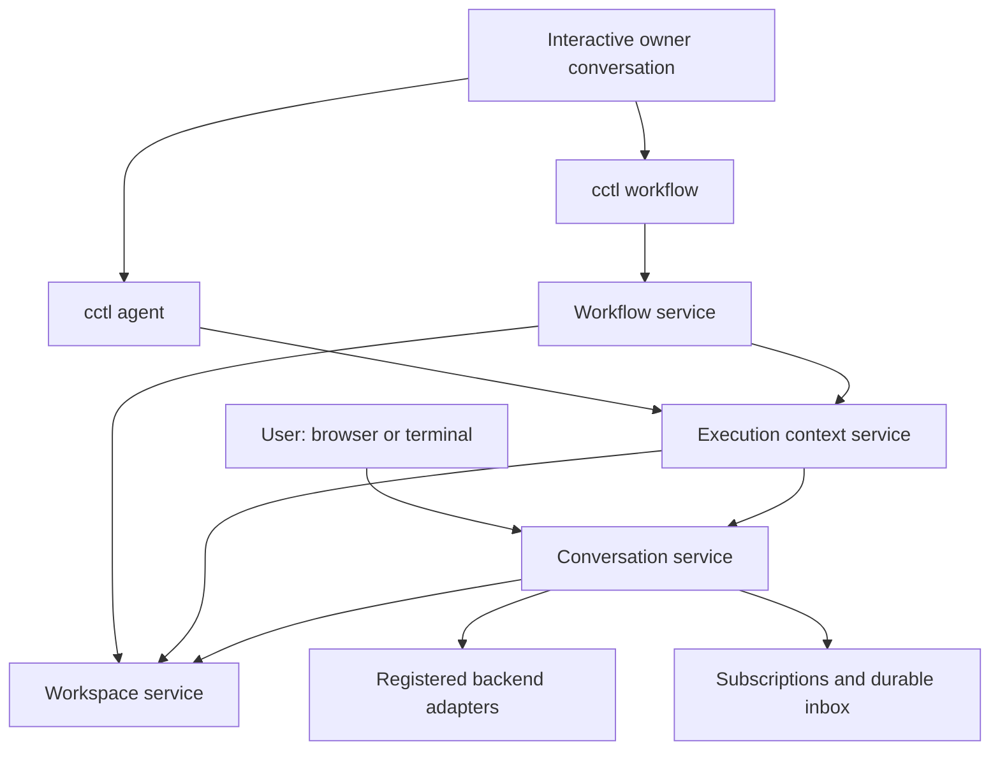

# A shared Conversation core for agents and workflows

Independent design for Alex · Authored 2026-10-01 · Decisions incorporated 2026-10-02

Source of intent: notepad `6bea7281-f742-4560-8937-fa52068d7e9b`, revision 338, the session Alignment charter, and Alex's confirmed design answers of 2026-10-02. This is a design deliverable, not authorization to begin the rewrite. No other agent's design proposal was read. Parallel research supplied facts about current production code, not design recommendations.

The charter's decided requirements and Alex's answers of 2026-10-02 govern this document. Those answers confirm bounded routes, loops and safe edits with no runtime expansion (§8), closed isolated lanes (§6), and owner-mediated second opinions (§5). Other recommendations remain design proposals; the three answers do not constitute approval of the entire design or authorization to implement it.

## 1. Recommendation

Build three deep modules with three different promises:

| Module | Promise to its caller | Knowledge it hides |
|---|---|---|
| **Conversation** | Send work and messages to a persistent conversation; observe what happened. | Admission, inbox delivery, backend continuity, prompt context, capabilities, structured output, waits, cancellation, accounting and recovery. |
| **Execution context** | Pursue a bounded task contract and return an accepted result or an actionable halt. | Task progression, implementer/reviewer turns, retry budgets, candidate validation, optional advice and human approval. |
| **Workflow** | Run several contexts in dependency order and make their contributions available where needed. | Readiness, inputs, lane topology, joins, control flow and definition revisions. |

Use the existing backend descriptors, profile library, capability resolution, subscriptions, registered validation, persistence repositories and Git primitives underneath these modules. Rewrite the affected orchestration and its records. Do not turn the current graph execution record into the new universal Conversation record.

The important simplification is the direction of dependence. Conversation has no tasks or graph vocabulary. A context has no siblings, edges or workflow repository. Workflow sees context results and workspace contributions; it never invokes a model or reconstructs a validation loop.



Workspace is a shared infrastructure module, not a fourth orchestration layer. It knows directories, write grants, candidate identities and Git effects. It knows nothing about why a context is ready or whether a validator passed.

## 2. Operating envelope and evidence

Each installation has one operator, one coordinating server and one SQLite database on one machine. Alex's Mac and Linux installations do not synchronize. Many conversations and child processes run concurrently; builds can open the same database, and a development server has separate state. Restarts can interrupt model calls and Git operations. Agents are trusted but mistaken output, overlapping writes and ambiguous completion are real failure modes.

This calls for durable local records, serialized mutations, explicit ownership, bounded recovery and checked Git effects. It does not call for a distributed actor system, leader election, a message broker, a generic event-sourcing framework or a compatibility protocol for third-party clients.

Current code establishes several useful starting points:

| Evidence | Design consequence |
|---|---|
| Graph implementers, validators, advisory responses and output capture already enter `executeConversationTurn` (`workflow-graph/implementer-runner.ts:278`, `validator-runner.ts:830`, `advisory-response-runner.ts:183`, `context-output-capture-runner.ts:137`). | A new facade alone achieves little. Remove the remaining differences in execution semantics and move supervision out of the graph aggregate. |
| The lifecycle still hosts a separate task-facet pipeline, with different prompt preparation (`workflows/conversation/actor-implementations.ts:1995`, `turn-context.ts:81`). `agent-runs/service.ts:372` also uses a one-shot task call and discards conversation identity/accounting. | All three in-scope entry points must use the same normal conversation-turn implementation. |
| `workflow-graph/iteration-orchestrator.ts:128` requires execution-wide repositories and graph collaborators; task completion and additions enter graph contracts/live edits. | Give contexts their own records and commands. A task addition must not mutate a graph. |
| Queue acceptance, turn admission, provider execution and durable settlement are already distinct (`message-queue-drain.ts:309`, conversation `manager.ts:1228`, `turn-attempt.ts:211`). | Preserve those distinctions inside Conversation instead of promising exactly-once agent execution. |
| Same-lane writing already needs canonical disjoint prefixes and private-index landing (`workflow-graph/lane-admission.ts:95`, `git/owned-landing.ts:5`). | Reuse the underlying correctness mechanisms; parallel writing cannot be implemented as just a concurrency setting. |
| Session-based spec delivery already exists (`specs/merge-association.ts:94`, `specs/delivery-gate-v2.ts:170`). | Removing graph-required delivery need not create a new delivery engine. |

Paths in this table are relative to `src/lib/`. Production code takes precedence over older steering: for example, current execution retirement also fences callbacks on leaving running state; it does not wait until resume to change the epoch.

## 3. Identity, ownership and the shape of the model

Keep three IDs because they identify different durable things:

- `ConversationId`: history, inbox, runtime continuity and usage.
- `ContextRunId`: one task contract and its supervision history.
- `WorkflowRunId`: one scheduled definition and its context runs.

A template's local context key is not a context-run ID. A lane key is not a context ID. A provider thread/session reference is opaque backend data, never a Command Center address.

Address a conversation with project and conversation ID. Preserve the existing `ConversationTarget` scope union for routes and presentation: session-scoped and project-scoped conversations use the same core. Working directory, display scope and owner are separate properties. A project conversation must explicitly select a session workspace before starting work that requires an isolated session; messaging across sessions does not move workspaces.

Each spawned conversation records an **interactive owner conversation** and its **controller**. These are different relationships:

```text
interactive owner O
  owns context A and workflow W
  owns A's implementer and validators
  owns every implementer and validator created for W

context A controls the turns of A's implementer and validators
workflow W schedules contexts; it does not own model runtimes
```

The deterministic supervisor creates conversations on the interactive owner's authority. The implementer does not spawn its validators. This keeps ownership one level deep even though supervision has three layers.

Owner authority permits spawn, stop and repair. Sending a message confers none of those powers. Alex can operate any run. Every mutation checks the current resolved caller identity and target owner; prompt instructions and claimed IDs are not the authorization mechanism. The existing Collaboration Mode runtime claim remains a separate concept from this new owner link.

**Recommendation for UI templates:** use the currently selected interactive conversation, or create an empty interactive conversation for the run. Show that owner before launch. Creating it spends no model tokens. A completion can remain a visible inbox item; halts and explicit waits wake the owner. This gives every run the same repair address and avoids a second ownerless lifecycle.

Stopping the owner's current turn does not cancel its children. Cancelling a run is explicit. Archiving an owner preserves its address and inbox; hard deletion is refused while it owns live work. No automatic owner transfer is needed in the first version.

## 4. Conversation: one place that runs an agent

### Public contract

The five actor operations describe externally meaningful behavior. Address is a value, not a network location. The following signatures are illustrative, not a new DSL or exact CLI syntax:

```ts
address(conversationId): ConversationAddress
spawn(owner, configuration): Promise<ConversationAddress>
send(to, message, requestId): Promise<MessageReceipt>
stop(address, reason): Promise<StopReceipt>
observe(address, afterCursor?): ConversationObservation
```

`spawn` persists the conversation, owner/controller binding, resolved profile and initial work before acknowledging. Its request ID makes a retried launch return the same creation. User creation of an interactive conversation is the root case; spawned conversations cannot use spawn.

The agent-facing spawn tools always create execution contexts. The lower-level conversation spawn operation is how that service creates its implementer and reviewers; it is not an alternate tool for bypassing context policy.

`send` acknowledges after durable mailbox acceptance. It never waits for the recipient to become idle, call a model or reply. “Never blocks the sender” means asynchronous with respect to recipient work; persistence can still fail or briefly serialize behind another local write. The receipt distinguishes accepted, duplicate and refused, naming the target and message ID.

`observe` returns durable lifecycle, last settled turn, pending boundary and result references with a cursor. SSE provides prompt updates; reconnecting readers obtain truth from the record. Observation does not require an in-memory XState actor to exist.

`stop` is idempotent. Its requested receipt means cancellation has been recorded; its settled receipt means owned execution, runtime closure and required persistence have settled. If the backend cannot be confirmed stopped, the conversation remains stopping and its conflicting workspace grant is not recycled. No caller coordinates abort controllers or writes machine state.

A supervised conversation's work results are turn results. Only the execution context may call its task contract completed. An idle implementer is not a successful context.

### One execution path, with controlled admission

Interactive work and supervised work both become durable turn requests and enter the same admission, prompt assembly, runtime and settlement code. An internal controller operation submits a turn request and observes its result; it does not bypass the inbox or call a backend directly.

The distinction is who can request another turn:

- An interactive conversation admits user messages and configured active notifications automatically at an available boundary.
- A controlled conversation admits work only when its context supervisor requests it. Other mailbox content is available as input under the supervisor's delivery rule.

The controller binding is private service authority. It is not a generic plug-in scheduler interface, and agents cannot forge a control message to obtain it. Conversation enforces admission and delivery; the context chooses which work belongs in an implementer or review turn.

One conversation has one admitted logical turn or maintenance operation at a time. Admission reserves ownership before asynchronous preparation, including checkpoint/profile reads. Work, format and one permitted format-repair attempt belong to one logical turn; unrelated messages cannot enter between them.

Conversation owns:

- Profile snapshots and the assembled system instructions; profiles remain prompt identity, separate from model selection and capability policy.
- Validated backend/model selection, capability application, memory, managed skills, subscription context, prompt history and scope environment.
- Working directory and effective write grant, supplied by Workspace.
- Opaque continuity, forks, native compaction, checkpoint creation and handoff.
- Structured output as an optional turn contract: ordinary work, formatting on the same conversation, one bounded format repair, then a typed rejection with preserved evidence.
- Inactivity watchdog, background-task settlement, cancellation and late provider cost settlement.

Format turns must not make repository changes; adapter/tool policy must enforce the restriction or reject that execution mode before invocation. Schema conversion and provider behavior remain backend-adapter knowledge. There is no workflow-specific output-capture runner that bypasses this path.

Backend/model/profile changes that would break a running supervised conversation's continuity are refused after first use. Interactive changes retain their existing explicit backend rules. Neither path silently creates a fresh conversation when resume is impossible.

### Inbox, replies and unsolicited messages

An envelope records server-derived sender identity, recipient, kind, correlation/reply ID, payload or artifact reference, and a recipient-local sequence. There is no project-wide ordering guarantee.

Messages remain durable while the recipient is busy, waiting or stopped. A mailbox receipt is not a promise of model attention. Observation reports pending, delivered, deferred and failed/withdrawn delivery. Retrying the same request ID does not add another message.

Recommended delivery rules:

| Recipient/boundary | Ordinary message from another conversation |
|---|---|
| Interactive, busy | Queue; include at the next eligible turn boundary. Never inject into a live tool sequence. |
| Interactive, idle | Request one normal turn, coalescing the available batch. Passive subscription notices remain passive. |
| Implementer working | Include at its next supervisor-requested work turn, visibly attributed as correspondence. It cannot edit tasks, criteria or permissions by itself. |
| Validator reviewing a candidate | Defer until that review settles. Surface correspondence to the owner; do not change the evidence packet underneath a review. The owner can request a new review if it matters. |
| Context completed, halted, or awaiting approval | Keep in the inbox and notify the owner. Do not restart work or invalidate acceptance merely because a message arrived. |

An explicit owner/user steer is a separate control action: it can cancel a review, amend a contract at a permitted boundary, and request new work. That authority is not inferred from arbitrary message prose.

A reply is an ordinary correlated message. The existing subscription wait records the desired reply/event, then checks already-persisted matches before parking. This closes the send-before-wait race. A timeout ends the wait, not the recipient's work. A context waiting for a reply is parked without spending a remediation attempt.

Owner observation is installed atomically with spawn/start. Completion, halt, plan defect, approval and question boundaries are durable subscription events. Progress is passive; explicit active waits wake on their selected events; an actionable halt can request an owner turn. Multiple completions can share one wake. There is no second workflow notification delivery loop.

### Human questions and lifecycle

Conversation is the sole owner of question batches and answer consumption. It records a question before ending the turn. An answer matches that batch exactly and is accepted once, including when it races with the supervisor observing the wait. The supervisor observes the pending/resolved boundary and schedules the appropriate continuation; it does not copy the question and answer into a graph-owned gate.

Question access is capability policy. A question ending an implementer or validator turn parks that work, suppresses formatting/follow-up work, and preserves the continuation. An unrelated message does not answer it. A stopped or superseded review withdraws only its own batches.

Expose `idle`, `running`, `waiting`, `stopping`, `stopped`, with a typed wait or stop reason. Error evidence lives on the affected turn, rather than multiplying conversation states. An interactive user's explicit new prompt can start new work after a settled stop. A controlled conversation requires its supervisor's explicit resume; unsolicited mail cannot resume it.

## 5. Execution context: a complete operation

The public abstraction is a durable attempt to satisfy a task contract, independent of any graph:

```ts
startContext(owner, definition, inputs, workspaceBinding, requestId): ContextHandle
observeContext(id): ContextObservation
stopContext(id, reason): StopReceipt
amendContext(id, expectedRevision, amendment): AmendmentReceipt
resumeContext(id, expectedRevision): ResumeReceipt
```

`cctl agent run` calls `startContext` directly. A one-context workflow calls exactly the same operation with the same resolved definition and workspace binding. Workflow adds scheduling/publication records, not another context implementation or default validator policy.

A minimal request is a prompt. It becomes one task; no acceptance criteria or validators are invented unless the effective configured defaults supply them. Optional output schema, task list, validators and approval add obligations to that same operation. Return an ordinary summary/artifact result when no structured schema was requested; do not force every child into today's fixed `summary + referenceDocuments` schema.

The definition owns tasks, task-add authority, criteria, implementer assignment, ordered validator cohort, registered scripts, optional human approval, retry limits, output contract and resolved role capabilities. Workspace placement is resolved into a binding before start; the context does not see lane names, edge lists, sibling statuses or a workflow run repository.

### Task and revision contract

Tasks have stable IDs and explicit completion commands. `completeTask` is idempotent and verifies the caller's bound context. The implementer may append its own tasks only when enabled. Addition neither expands the workflow nor permits editing the acceptance contract. Validators identify blocking issues against the tasks/criteria they actually reviewed.

Freeze assignment identity and instructions before first use. Keep one implementer conversation and one conversation per validator assignment for the lifetime of the context, across task retries, validation rounds, waits and resume. Two seats using the same profile are still two conversations. A workflow loop pass is a new context run with new conversations, not a continuation disguised as a new task contract.

Amendments preserve history and increment the context contract revision. Never rewrite a completed run's evidence. A halted context can accept owner changes to unfinished tasks, criteria, retry allowance or not-yet-started assignments. Such a change invalidates dependent output, validation and approval. Changing an already-started assignment's backend/profile creates a replacement context instead of pretending the same conversation continued.

### Supervision sequence

1. Resolve configuration, validate backend support, reserve the workspace and create the implementer binding.
2. Run work in the implementer conversation. Observe task commands and any question/reply wait.
3. If unfinished tasks remain after a normal turn, either issue the next work turn under the unfinished-task budget or halt.
4. Freeze a candidate and its contract/task revision. Run applicable registered scripts, then agent validators. Whole-lane checks are attached to lane publication rather than run against each incomplete shared-lane member.
5. A blocking plan defect halts immediately with the original evidence. Ordinary blocking issues reopen affected work; the next work turn spends the validation retry budget.
6. Deliver optional advisories once. If the implementer changes the candidate while addressing them, run blocking recertification. A passing recertification does not open another optional-advice cycle.
7. Capture required output through Conversation's formatting operation. It cannot modify the candidate; a violation invalidates acceptance rather than being silently included.
8. If enabled, request human approval of the candidate, contract and result. Recheck their identity when approval arrives. A human rejection supplies remediation; it does not consume a validation-failure allowance.
9. Accept the contribution and record success/output in one context settlement. The workflow may still need to publish the lane before dependents can run.

Statuses are `ready`, `running`, `waiting`, `halted`, `succeeded`, `cancelled`. Phase is separate: implementing, checking, reviewing, responding to advice, formatting or approving. This avoids encoding every phase/wait combination as a distinct lifecycle state.

### Validation and evidence

Retain explicit blocking/advisory authority. Blocking seats may return issues and plan defects within their mandate; advisory seats have no blocking fields in their schema. Aggregate findings without erasing attribution. Script failure blocks; advisory reviewer failure is recorded but cannot veto work. An enabled cohort must contain an assignment; a disabled cohort and an advisory-only cohort are valid.

A review names candidate identity, task/contract revision, assignment snapshot and input/output evidence. A verdict from a superseded round cannot settle the context. Missing or changed candidate evidence requires review again; it is not a passing result. Approval uses the same identity and is human-only. Owner notification is not approval authority.

Keep local acceptance distinct from integration certification. A context can have accepted work while the lane's required checks remain outstanding. A context with no blocking validator or script has no automated certification claim. Optional advice cannot manufacture that claim.

Resolve a script's scope explicitly: context checks certify that context's frozen candidate; integration checks certify the completed lane or merged session. Definition validation refuses a context check that cannot run under its write/scope contract. Never silently discard a selected check or promote its evidence to a broader scope. A shared-lane author can place whole-repository checks at publication, with that outstanding obligation visible in status.

### Bounded policy

Replace max-iteration/consecutive-failure interactions with two persisted allowances: `validationRetries` and `unfinishedTaskRetries`. Each counts additional work turns requested for that reason, after the initial work. Use one classification for a turn, never both. A passing intermediate task does not replenish either allowance. Task addition does not reset it.

Questions, subscription waits, admission delays, formatting and human review spend neither allowance. Format repair has its own fixed one-attempt protocol inside Conversation. Advisory response is at most once per ordinary review round; edits that fail recertification require a validation retry. Repeated human rejection requires another human action rather than creating an unbounded autonomous loop.

An interrupted/ambiguous provider turn, lost continuation, unsupported write policy, failed persistence or Git conflict halts with a typed reason. Do not replay a possibly side-effecting agent turn merely because an SDK call failed. Explicit resume preserves counters; increasing an allowance is an explicit owner amendment recorded in history. This intentionally removes today's fresh recovery budgets on each engine resume.

### Configuration and second opinions

Retain the three-tier resolution rule once: global context defaults → run defaults → context overrides. For a standalone agent, the run-default layer is empty. Persist the effective configuration and provenance before work; changes to defaults affect new runs only. Lists such as a validator cohort replace as a unit; independent capability fields use the existing capability resolver. Do not add runtime policy to profiles.

Keep the charter as a resolved immutable instruction/source bundle passed to conversations and reviewers. Context-local additions have explicit scope. No spec ownership table is repeated in every follow-up prompt.

Retain second opinions through owner mediation: an implementer sends a correlated consultation request to its owner and waits if necessary. The owner may answer, message an existing conversation or start a sibling `cctl agent` context. The spawned implementer acquires no spawn permission. This replaces the graph-specific automatic negotiation loop; standalone Collaboration Mode remains out of scope and unchanged.

## 6. Workspace and lane contract

### Common workspace rules

Workspace owns canonical paths, write grants, conflicting-use admission, candidate capture, owned-path landing, Git serialization and operation reconciliation. Its APIs return opaque bindings and contribution/candidate receipts. It does not expose private indexes or ask a context to coordinate Git locks.

Use the same write-grade vocabulary for interactive and workflow conversations: read-only, declared owned prefixes, or full workspace. Parallel writers require disjoint canonical prefixes; full writers exclude other writers. Preserve case/symlink handling and enforce a supported backend write policy before dispatch. Engine-managed contexts cannot mutate `.git`. Scratch/artifact paths are explicit grants, not an excuse to grant repository writes.

Write ownership applies across contexts and conversations sharing a physical workspace, not merely within one workflow. Git-changing commands and merges serialize at that workspace. An observational read can overlap writes; a read promising a stable handoff/candidate takes a stable-read barrier. Validators cannot keep reading a moving candidate while issuing an unqualified certification.

Candidate validation holds the relevant stable-read barrier through final candidate checks and acceptance. Human waits release the barrier and recheck the candidate after reacquiring it. Later sibling contributions do not rewrite the earlier review's claim: their combined result is checked at lane publication. Unexpected changes inside the reviewed scope invalidate it; unrelated tracked changes are retained and never swept into an owned landing.

Release the read barrier before an advisory or remediation turn that can write; reacquire it to capture and certify the replacement candidate. A context's placement binding lasts for the run, but an active write grant lasts only for admitted work and its settlement. Waiting never retains a model slot. Resume detects changes made while a grant was released before accepting earlier evidence.

Session-workspace changes stay visible as normal working-tree changes; neither a standalone agent nor a session-lane workflow needs an automatic commit merely to report success. Isolated lanes use engine-owned, ownership-scoped landing commits. Both forms use the same context loop and workspace receipt abstraction. Publication policy belongs to the workspace binding, not to a second `cctl agent` implementation.

A dirty session workspace is allowed when declared write scopes are disjoint from existing unrelated changes; preserve those changes. A new write scope overlapping pre-existing dirty content needs an explicit baseline decision before dispatch. Do not auto-clean the worktree. Isolated lane creation records a clean committed session base; dependent work cannot silently omit uncommitted prerequisite changes.

For this first design, refuse a code dependency from an uncommitted session-workspace writer into a newly isolated lane. Keep that continuation in the session workspace, or have the owner establish a committed baseline before launching a follow-up workflow. Output-only dependencies are unaffected. This avoids a hidden commit of the owner's working tree and is part of the lane restriction Alex accepted on 2026-10-02.

### Owner/child contention

An owner with a conflicting write grant can enqueue children, then end its turn or enter a subscription wait. That settles its turn and releases the grant before children start. Disjoint owned grants allow continued parallel work. The launch receipt explains a child waiting for the caller's grant.

Do not implement an agent's wait as a shell process polling a child while retaining the parent's conflicting grant. Agents use durable subscription waits. `--wait` remains useful for a human CLI caller; a conversation-bound blocking wait is refused when it would retain a conflicting grant, with the exact asynchronous alternative. This also avoids consuming the last available model slot while waiting for a child that needs it.

### Lane assignment and closed isolated lanes

Default placement is the session workspace. An optional named lane identifies one isolated worktree, shared by all contexts assigned to that name. Write grade belongs to the conversation/context placement; lane identity does not imply exclusive writing.

An isolated lane is a **closed contribution group**:

- Provision it once from the session base plus its external code prerequisites.
- Run its internal context DAG, allowing disjoint writers in parallel.
- Finish or route-skip every member, settle all questions/approvals, and pass its required whole-lane checks.
- Publish the lane once; do not merge it away while a member can still change it.

Resolve cross-lane code prerequisites before provisioning the target lane. Preserve the common Git ancestor. Use the existing Smart Merge implementation through a workspace adapter for pairwise merging and conflict handling; merge/commit agent internals do not move onto the new Conversation core in this overhaul.

Same-lane consumers can run once the predecessor's contribution is accepted and visible. Cross-lane consumers wait for publication and visibility, even when the predecessor's task status is succeeded. A read-only predecessor contributes its output and needs no Git merge. Final publication requires every selected context settled and every required integration check satisfied.

The compiler checks both the context dependency graph and the lane dependency graph. A pattern `A(lane X) → B(lane Y) → C(lane X)` is rejected: publishing X requires C, which requires Y, which requires X. Give C another lane, put the related contexts in one lane, or run a follow-up workflow. Report the exact cycle at authoring time, before model spend.

At lane closure, seal the accepted source ref and publish it once to the session target. A dependent isolated lane is provisioned from the session ref containing its published prerequisites; it is not pre-created against an earlier base and later assumed current. Pairwise publication serializes, preserves merge ancestry, and checks the actual merged candidate. One upstream output without a code contribution does not create a lane-publication dependency. The conservative design can make a same-lane node wait for an external prerequisite needed by a later member; the compiled preview makes that extra serialization visible.

Alex accepted this reduction in expressiveness on 2026-10-02. It trades partial-lane publication, moving frontiers and complicated source-occupancy exceptions for one understandable completion boundary. Both same-lane and separate-worktree parallel writing remain supported.

Same-session-lane work has no isolated publish step. A merge into the session waits for its writers and Git operations to quiesce; a running interactive writer therefore also delays that merge. A long-lived human question can delay its lane's publication while unrelated lanes continue. The UI names the waiting member and boundary.

## 7. Workflow: scheduling, not another agent runtime

The unconditional core is a finite DAG of context definitions, input bindings and placement. The workflow stores node invocation/result references, not copies of each context's tasks, reviewer lanes and inbox.

```ts
startWorkflow(owner, definition, inputs, requestId): WorkflowHandle
observeWorkflow(id): WorkflowObservation
pauseWorkflow(id): PauseReceipt
resumeWorkflow(id, expectedRevision): ResumeReceipt
cancelWorkflow(id): StopReceipt
```

Starting validates the complete definition, compiles context/lane dependencies, resolves configuration/templates, snapshots profiles and installs owner observation. Ready nodes are dispatched through `startContext` with cause-derived request IDs, so recovering the scheduler cannot create a second context for the same node invocation.

Eligibility requires settled upstream results, valid input bindings, visible code prerequisites and an available workspace grant. Concurrency limits determine capacity, not correctness. Outputs are immutable values or artifact references, not text interpolated into arbitrary shell commands. A missing required output is a located input error that halts before the consumer spends tokens.

On an ordinary context halt, stop admitting new dependent work, let independent active contexts settle, and notify the owner. Unrelated ready contexts may continue; the affected lane cannot publish. Do not automatically publish an unfinished lane. Explicit user cancel interrupts active turns. Pause stops new admission and waits for owned effects to settle; a settled pause has no running model turn, formatter, reviewer or Git effect. User/reply waits can remain parked. A user who needs immediate interruption uses stop/cancel rather than drain-to-pause. Pause completion is a durable boundary rather than an optimistic UI label.

Workflow status distinguishes progress from result: it remains running while independent work can progress, waiting when only human/reply boundaries prevent progress, and halted when owner repair is necessary and independent work has settled. A context halt is reported immediately even while the workflow is still running other work. Success requires all selected work, outputs and publication obligations settled; an empty ready queue alone never means success.

The owner can repair a halted context contract and resume, or start a follow-up workflow. A plan defect is evidence addressed to that owner; there is no repair agent and no automatic plan mutation hidden inside validation.

### Representative use

An owner wants two independent changes and a final integration review:

```json
{
  "contexts": {
    "api": { "task": "Change the API", "lane": "api", "write": { "owned": ["src/api"] } },
    "ui": { "task": "Change the UI", "lane": "ui", "write": { "owned": ["src/ui"] } },
    "review": { "task": "Review the integrated result", "needs": ["api", "ui"], "write": "readOnly" }
  }
}
```

This is a shape sketch, not a validated payload. The complete authoring schema will distinguish task IDs, inputs and assignment/defaults. API/UI contexts run through the same service as two standalone agents. Their lanes close and merge before the session-workspace review begins. Changing both lane values to one name permits simultaneous disjoint writers in one isolated worktree and gives one publication barrier.

The ordinary author supplies task contracts and dependencies. It never authors a merge agent, a validator execution node, a repair workflow or backend resume handles.

## 8. Bounded routes, loops and safe edits

Alex confirmed this feature package on 2026-10-02: retain conditional routes, finite non-nested loops and revision-checked safe edits; remove agent-driven runtime graph expansion. These features belong to Workflow. Conversation and execution-context contracts remain independent of them.

**Conditional routes.** Evaluate declarative predicates over a producer's validated structured output through one predicate module. No JavaScript evaluation. Prefer one explicit choice group with mutually exclusive cases and an optional else to a web of independently interpreted conditional edges. Missing data, invalid predicates and ambiguous matches halt; they are not false. A branch not selected is skipped, not successful. A required input from a skipped branch must have an explicit alternative; otherwise refuse it. One route projection supplies scheduling, UI and completion semantics.

**Bounded loops.** A loop is a sequential repetition of a finite context subgraph, with explicit initial/carry bindings, one declared result/exit, a condition and `maxPasses`. Each pass creates fresh context runs from an immutable body and records its output and decision. End-of-pass settlement checks the condition before enforcing the limit, allowing success on the final pass. Exhaustion halts with the last result. The first version excludes nested loops and arbitrary backward edges. Each pass's isolated lanes close before the next begins; no lane is simultaneously in two passes. Pass instantiation is scheduler bookkeeping, not a public permission to expand the graph.

**Safe live edits.** One revision-checked workflow operation validates the full resulting definition and lane plan. While work runs, it may change only unstarted nodes and their future edges/configuration. Any amendment touching started work first pauses the affected run and uses the context amendment rules; completed results and their provenance remain immutable. An edit cannot remove a currently owed human boundary, weaken a completed proof retroactively, or create a lane dependency cycle. A lost expected revision returns a conflict with the new revision; do not auto-merge intent. Loops already started retain their frozen body; changes apply to later runs, not later passes.

**No runtime graph expansion.** A spawned implementer cannot append graph nodes. It may add local tasks if enabled or send its owner a proposal. The interactive owner can amend future work through the same edit operation or launch a follow-up workflow. This preserves replanning without a second privileged graph-edit path.

Implement these features above the finite-DAG scheduler. Their state belongs to workflow runs; neither context supervision nor Conversation needs to understand branches, loop passes or graph edits.

## 9. Durability, failure and recovery

Use focused state-store repositories under the existing database mutation boundary:

| Durable owner | Authoritative data |
|---|---|
| Conversation | Configuration/profile snapshot, scope/owner/controller, mailbox, turn requests/results, question/wait references, continuation/checkpoint references, usage ledger. |
| Execution context | Resolved contract, tasks, bindings to conversations, phase, persistent allowances, candidate/review/approval/output receipts and amendments. |
| Workflow | Frozen definition and revision, context invocation IDs, dependency/route decisions, optional pass records, lane bindings and publication results. |
| Workspace | Provision/landing/merge operation intent, participating workspace/ref identities, candidate/grant facts and reconciliation receipts. |

Logs and transcripts preserve evidence; they are not a second scheduler database. XState snapshots can help restore Conversation internals, but domain rows and durable receipts decide what happened. Do not persist a second copy of task or question truth inside workflow state.

Commit a terminal result and its notification intent under the same local transaction. Existing subscription delivery consumes the durable intent; an SSE failure cannot erase it. Use unique cause keys for context starts and message delivery. Acknowledged local commands have durable receipts; an uncertain client response can be resolved by reading its request ID.

Each active controller/turn has a durable generation. Retirement, cancellation and replacement invalidate old completion callbacks before another controller starts. Persistence checks the generation inside its serialized mutation, not just before an awaited operation. This prevents a late callback from completing or halting a successor. Cancellation saves spend; the generation check preserves correctness. Neither substitutes for the other.

For Git operations, persist intended source/target refs and inspect their actual state on restart. If the effect can be identified exactly, record it; otherwise halt with those refs and the worktree path. Never reset a dirty worktree or discard a human conflict resolution to make retry convenient. Database transactions cannot make Git side effects atomic, so do not pretend they do.

Restart treatment is deliberately conservative:

- Queued, never-admitted work stays queued.
- Human/reply waits are reconstructed from their durable records and already-arrived answers.
- A durably completed turn whose supervisor had not advanced is consumed once.
- An interrupted turn with unknown external effects is marked interrupted; interactive UI offers retry, supervised work halts for its owner.
- A known lost continuation halts. Replanning into a new context is explicit.
- A late provider billing event updates the same conversation usage ledger even after context completion. Context/workflow cost is an aggregation of conversation and merge-job receipts; unknown remains unknown.

No recovery loop with backoff is added around local calls. Stale commands return typed conflicts/refusals; malformed agent output is preserved with its failed gate. A send to an unknown or cross-project address is refused before acceptance. A stopped recipient can retain mail but cannot execute it without the appropriate resume authority.

## 10. Canonical ownership and code boundaries

These are proposed responsibility boundaries, not a requirement to create one class or file for every row.

| Decision | Sole owner | Consumers must not do |
|---|---|---|
| Conversation addressing and display scope | Existing `conversations` domain | Infer scope from cwd or parse the project sentinel. |
| Spawn/stop/repair authority | Conversation ownership service, called by run services | Infer permission from an inbox message or active session alone. |
| Admission, turn context, waits, runtime lifetime and settlement | Rewritten Conversation lifecycle | Dispatch SDK calls, drain a second queue or send XState events. |
| Provider continuity, schemas on the wire, native tools and billing normalization | Existing backend descriptors/adapters | Branch by provider or inspect opaque continuation refs. |
| Inbox ordering/wake intent | Conversation inbox composed with existing subscriptions | Deliver graph answers through an independent prompt path. |
| Task progression, retry classification, validation and approval | New `execution-contexts` domain | Read or mutate workflow aggregate state to finish a task. |
| Resolved defaults/provenance | Context-definition resolver | Recompute defaults in UI, agent routes or a workflow runner. |
| Canonical write grants, candidate identity and Git effects | Workspace service over existing filesystem/Git primitives | Coordinate indexes, locks or path-prefix checks themselves. |
| Dependency eligibility and route decisions | Workflow scheduler plus one route projection | Reimplement routing in lane/UI/output code. |
| Guard evaluation | One declarative predicate evaluator | Evaluate guards with ad hoc JSON/text parsing. |
| Structural edits | One revision-checked workflow amendment operation | Mutate stored node arrays directly or grant an expansion exemption. |
| Spec approval and delivery | Existing specs domain | Add spec criterion mutation to generic task completion. |

A practical module layout is `conversations` plus the rewritten lifecycle, `execution-contexts`, `workflow-runs`, and `workspaces`. Keep route/CLI adapters thin and semantic. Internal helpers may be numerous; callers should still use complete operations such as start, send, stop, amend and observe.

## 11. Product surface and feature disposition

| Surface/feature | Proposed outcome |
|---|---|
| Interactive conversation UI | Same core, inbox and lifecycle as spawned conversations; visible child runs and pending boundaries. |
| `cctl agent` | Starts/observes/stops one context; tasks, validation and optional structured output without graph concepts. |
| `cctl workflow` | Starts/observes/controls multi-context runs; definition/template editing is textual/API based. |
| Conversation messages | New send/reply surface for project-local addresses; status explains delivery versus execution. |
| Workflow UI | Read-only dependency/run view, transcripts, inputs/results, lane status and human action panels. Remove visual plan construction. |
| Saved templates | Keep global/project scope, declared parameters and prerequisites. Strictly validate substituted definitions before any work. No arbitrary text substitution into IDs or shell fragments. |
| Validators/scripts/advice/charter | Keep, under context ownership, with explicit local versus integration evidence. |
| Human approvals and ask-user gate | Keep; human-only approval in context, question lifetime in Conversation. |
| Planner, repair agent, agent-driven graph expansion | Delete all three; owner replanning and safe edits provide the repair path. |
| Graph-specific second-opinion negotiation | Replace with owner-mediated consultation; keep standalone Collaboration Mode unchanged. |
| Spec delivery | Use the existing session delivery basis. Retain human requirements/design/delivery approvals and criterion evidence/waivers; remove the requirement to bind delivery to a workflow graph. |

For spec work, the interactive owner selects criteria/tasks and can use several small workflows. The specs module records evidence references and human decisions independently. Workflow results are possible evidence, not an authority to approve a spec or mark delivery. Final delivery still happens at the existing merge boundary. Do not turn every context into a mini spec-delivery engine.

CLI help should expose these complete operations progressively. The minimal agent launch should not require learning lanes, graph IDs, validator conversation IDs or subscription storage. Status should name the concrete blocker and the operation that can resolve it.

## 12. Migration and deletion

No migration is executed in this design session. Recommended migration is an explicit cutover with forward data conversion, not indefinite dual execution or permissive legacy decoding. Preserve operator history. Backward-compatibility shims require Alex's separate approval and are not included here.

1. **Inventory and freeze a cutover contract.** Inspect the actual installed config, templates, active runs and archives at implementation time. Include global defaults, per-project files, active/archive database blobs, conversation state and spec bindings. Back up before changing durable formats. A build only performs compatibility preflight; it must not convert/delete live state while another server owns execution.
2. **Build the new core and one standalone context path in isolation.** Exercise real CLI/UI entry points against a session dev instance. Add durable records through migrations; do not point production callers at two engines for the same run.
3. **Move interactive conversations and `cctl agent` to that path.** Migrate conversation metadata/history references and preserve opaque continuity/checkpoints. Validate the first supported backend end to end, then the currently used backend capabilities required for cutover. Existing machine snapshots are not treated as the only source of conversation truth.
4. **Add the workflow scheduler as a client.** A single-context parity test must pass before routes/loops are added. Implement lane publication and owner recovery, then bounded routes, loops and safe edits. Move templates and monitor UI to the new authoring/runtime schemas.
5. **Drain or explicitly stop old executions before final cutover.** Do not resume an old graph halfway through a rewritten supervisor. A halted old run is preserved as history; the owner starts a new context/workflow with explicit pointers to retained work. Do not silently convert its half-finished review into a passing one.
6. **Convert durable data once.** Simple templates receive explicit new-schema definitions. Unsupported expansion/control-flow or lane patterns produce a per-template migration report and remain exported/unlaunchable until rewritten. Convert archives to a neutral read-only history representation containing frozen definitions, statuses, evidence, usage and transcript/artifact links; preserve original payloads as exported attachments. The normal template list must not fail because one legacy file cannot be converted. Do not retain the old runtime merely to render history.
7. **Remove the old paths.** Delete graph execution/supervision code, planner/repair/builder, graph-specific question handling, agent-run task dispatch and graph-required spec contracts. Remove retired strict-schema keys from all inventoried populations at the same cutover. Verify no in-scope entry point can still launch them.

Collaboration Mode and merge/commit retain their algorithms and feature code. The new lifecycle must support the semantic claim/release and normal turn operations their current public callers already use; preserve those operations natively, not by routing an in-scope conversation back to the old graph engine. The backend task facet can remain for out-of-scope hermetic/internal uses. Before replacing lifecycle internals, explicitly test the collab claim/release seam and stop settlement. If preserving those consumers requires an actual compatibility adapter or a change to their behavior, return that concrete scope decision to Alex; do not smuggle it into the rewrite.

Deletion is a completion condition for affected paths. Temporary coexistence is for developing the replacement and draining old runs, with one dispatcher per run. It is not the final architecture.

## 13. Alternatives and why this boundary wins

| Decision | Alternative considered | Reason for recommendation |
|---|---|---|
| Shared machinery | Make every interactive conversation a one-node workflow. | It imports tasks, graph lifetime and execution configuration into ordinary messaging. Putting Conversation below both callers shares the hard runtime behavior with less caller knowledge. |
| Context ownership | Extract a wrapper around today's graph iteration orchestrator. | Its repositories/inputs still require an active graph aggregate. An independent context record and complete start operation eliminate that dependency. |
| Actor implementation | New general actor framework for all three layers. | Addressable conversations help current callers; location transparency, hierarchical supervisors and restart strategies do not. Keep XState private where useful and deterministic run services above it. |
| Message delivery | Wake every conversation for every message. | A message could create an unbudgeted implementer turn or contaminate a frozen review. Controlled admission keeps the shared inbox while preserving supervisor obligations. |
| Validation feedback | Delete the advisory response cycle entirely. | That loses an existing useful behavior. Keeping one bounded optional pass with candidate-based recertification contains it inside the supervisor. |
| Lanes | General incremental publication of arbitrary subsets while reusing a lane across dependency cycles. | It needs moving publication frontiers and more joins/recovery states. Closed lanes plus a clear authoring refusal support short workflows with a simpler promise; Alex accepted the expressiveness tradeoff on 2026-10-02. |
| Workflow programming | Executable TypeScript/DSL with replay or persisted program continuations. | Current needs fit data plus a small scheduler. An executable orchestration language would add a second program/runtime contract before a caller needs it. |
| Migration | Keep a legacy interpreter/runtime for old templates and runs. | It preserves two sources of orchestration behavior. Explicit conversion and inert history preserve data without permanent competing machinery. |

This applies Ousterhout's information hiding rather than optimizing for fewer types or files: each layer owns a different decision, and the ordinary caller delegates a complete operation. Workspace is allowed to be intricate because all callers would otherwise reproduce its concurrency and Git obligations.

Concrete future change tests: a new backend capability changes its descriptor and Conversation application; both interactive and workflow users receive it. A new validation authority changes the context layer, not inbox admission or DAG scheduling. A different lane placement policy changes workflow compilation/Workspace, not task completion. A question-resume bug has one answer-consumption owner.

## 14. Verification obligations and decision record

This deliverable changes no executable behavior; TDD and live feature tests are not applicable to the document. Implementation should begin with behavior-level tests for these contracts, then real backend and durable-state checks at the affected entry points.

| Scenario | Required evidence |
|---|---|
| Same task through `cctl agent` and a one-context workflow | Same context service, effective defaults, conversation path, outputs and validation behavior. |
| Busy recipient, duplicate send and fast reply | One durable message; correct boundary delivery; active wait sees the already-arrived reply. |
| Foreign message during validation | Saved and attributed; current candidate/review input unchanged; owner can request a new review. |
| Owner starts child in its own workspace | Child waits until conflicting grant released; subscription wait progresses without a held-slot deadlock. |
| Two shared-lane writers | Disjoint prefixes admitted; canonical overlap refused; one landing never includes the sibling's staged/untracked edits. |
| Separate lanes and integration review | Review cannot start before upstream code is actually present; merge conflict halts with preserved evidence. |
| Questions from implementer and multiple validators | Answers consumed once in their original conversations, including answers arriving before parking. |
| Advisory edits and human approval | Changed candidate rechecked; stale approval/verdict never accepts new content. |
| Exhaustion, pause and resume | Allowances persist; waiting spends none; no fresh retry budget appears merely on resume. |
| Crash after provider start or Git effect | Unknown execution is exposed; no blind replay or reset; known completed effects reconciled once. |
| Old callback after resume/cancel | Cannot settle or halt the successor generation. |
| Profile/capability/compaction change | Equivalent core behavior in interactive, implementer and validator conversations. |
| Cutover | Histories/templates accounted for; old launch paths gone; collab/merge/commit behavior preserved at their existing seams. |

Alex resolved the three design questions on 2026-10-02 in batch `q_7c3ed3be-6858-4089-ae10-bf895b195028`:

| Decision | Selected behavior |
|---|---|
| Control flow | Bounded routes, finite non-nested loops and safe edits stay; runtime expansion is removed. |
| Lane publication | Use closed isolated lanes, including the lane re-entry and uncommitted-session-baseline restrictions in §6. |
| Second opinions | Route consultation through the interactive owner; replace graph-specific automatic negotiation. |

These decisions are incorporated throughout the design and in the vision notepad. They resolve the three questions; they do not approve unrelated recommendations or begin implementation.

Other design recommendations remain explicitly proposed: UI launch binds an interactive owner; unsolicited validator messages wait; script/advisory/approval features stay; configuration resolves once; archives become inert history; session-based spec delivery remains. The design is ready for review as a whole. No further question or approval is required merely to deliver this design.
