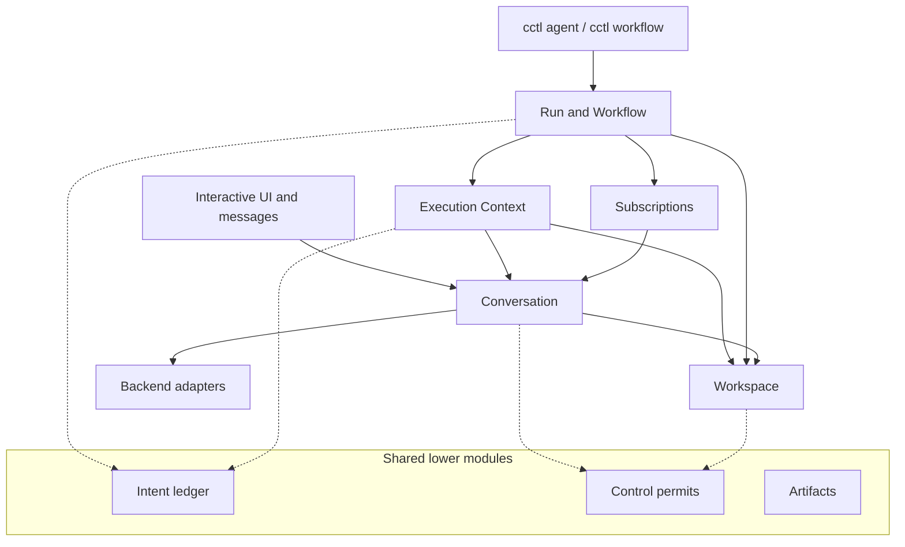

# Shared conversation core, revision 2

Design for Alex, 2026-10-02. This revision replaces [revision 1](2026-10-02-shared-conversation-design.md) as the recommended design. It resolves the two independent reviews of revision 1 and their cross-responses (Appendix A) and maps the two existing-codebase reviews to remedies (Appendix B). It is a design only. It authorizes no implementation, migration or spec approval.

Product intent comes from the session Alignment charter and the notepad **Reimagined graph workflows, revision 342**, which adds the cooperative-writes decision to revision 341. Where the charter still lists a question as open, the notepad's confirmed answer governs.

## What changed from revision 1

Revision 1's four services (Conversation, Execution Context, Run, Workspace) and its product decisions stand. Both reviews found the top level sound and the levels below it underspecified. This revision specifies those levels.

1. **One cross-domain protocol** (§3). A requester records a pending intent. The executor records the outcome under the intent's stable cause. One `reconcile` operation consumes outcomes after a live completion, a pause, a resume or a restart. No in-process await carries correctness.
2. **Control permits** (§3.3). Every executor checks the permit at actual admission: model turns, Workspace operations, scripts, provisioning and publication.
3. **Context stores facts and derives progress** (§5). One pure function derives the next obligation and the display lifecycle. Handlers record facts. None assigns lifecycle or invalidates downstream proof. Proof binds to a candidate, and retiring a candidate is one fact.
4. **A briefing composer** in Context decides what each seat is told for each obligation (§5.6).
5. **Conversation's lower levels** (§4): a turn lifetime with one exit path, a closed list of input contributions that share one delivery-evidence value, one admission policy, the backend port input carried whole with the relay types deleted, and configuration application owned by the MCP and capability domains.
6. **A repaired module map** (§2.4): launch resolution in Run, the cascade rule in the configuration domain, an Artifacts owner, one seal and success predicate, and owner boundaries recorded only by Run.
7. **Integration checks need a declared home** (§7.4): an after-all Context or lane publication. Launch is refused otherwise. "Integration debt" is no longer a state.
8. **Acceptance scripts are readers** (§5.5). A script that writes into the reviewed scope fails its check.
9. **Interactive turns are cooperative writers; supervised bindings never overlap** (§§6.1–6.2). Interactive turns wait only for short Git and publication windows. Revision 1 made each interactive turn an exclusive whole-workspace writer, which would serialize the conversations in a session and make the owner wait behind its own session children. Supervised Contexts whose bindings overlap wait for each other instead of mixing changes. Alex confirmed the interactive change on 2026-10-02 (§17).
10. **Per-backend launch policy** for enforcement decisions, one live emitter for Claude content, and the cancellation fix for the retained Claude task runner (§8).
11. **Owners for read models and client state** (§9).
12. **Checks that keep the lower levels honest** (§11): historical change scenarios, the limits of static enforcement, test layers and a split rule.

## Amendments from implementation (2026-10-04)

The partial implementation (core turn lifetime, interactive conversations on the core, Run, Context, Workspace, one-context and multi-context session workflows) confirmed the four domains and the cross-domain protocol. These amendments record what it corrected; the sections named carry the detail.

1. **A read-only binding overlaps every writer** (§6.1). Its evidence and stable reads cover the whole tree, so a writer beside it would retire its candidate until `candidate_unstable`. Readers may share a workspace with each other. A lane's publication is such a writer of the session worktree (amendment 11, decision 5).
2. **Every registered check is a whole-tree check** (§7.4). Whether it is an integration check depends only on whether another writer can run alongside the Context.
3. **Owned-scope evidence covers the owned paths** (§6.3, §17). Whole-tree review evidence would make concurrent reviewed writers retire each other's candidates.
4. **A standalone run is internally a one-entry definition** (§12, §16). Standalone callers author no topology and inherit no workflow-only obligations; the scheduler serves both forms.
5. **Context's observation is semantic** (§5.1) and a **Run fault is a control fact** (§7.8).
6. **The conversation row's admission rules form one table** (§4.5), evaluated for every entry.
7. **Decisions** (§17): live input stays; reviewer seats are not write-confined.
8. **Route choices and loop outcomes are derived, not recorded** (§7.1, §7.5). Both follow from the frozen definition and accepted outputs, which are durable before any dependent's start intent is recorded, so a choice still persists before dependents are admitted. Amendment validation (§7.6) refuses any change that would decide a settled source's routes differently, and any change to a started loop body, which keeps the derivation stable; raising `maxPasses` simply lets the next pass derive. A source whose result breaks its cardinality commits none of its routes: its dependents wait and the run halts at that source.
9. **Route and loop rules found while implementing them** (§7.4, §7.5). Branches a route never takes together (an else and a guarded sibling, or `exactlyOne`) do not count as running alongside each other. A Context a route can skip covers no deferred check. The route projection owns both static relations and the meaning of an uncommitted source; the compiler and scheduler compose them. A loop body is one region: only its entry depends on work outside, only its exit is depended on from outside, every member lies on a path from entry to exit, and the body has no routes. Each later pass runs in a fresh Context `<base>.pass<n>`; the entry receives the exit results of up to three recent passes. Resume does not clear a route or loop halt; an amendment does (amendment 12). A halt reported while other work remains (moving, held by a pause or fault, or waiting on the owner) promises one more notice, recorded once the halts are all that stands.

10. **Lanes as implemented** (§6.1–6.5, §7.5). Lane worktrees and branches are named at launch from the session directory, the configured branch prefix and the run, so two runs never share one; provisioning starts the branch at the session branch's head commit and refuses if the names moved. A dependency can be marked output-only, which creates no Git dependency; a lane cannot depend on a session Context's code, which is never committed. Publications into one session run one at a time, so a lane merges the result of the publication before it rather than going stale; only an outside move of the session branch, such as an owner commit, makes a publication stale. Landings and publications carry a marker trailer naming their Workspace operation; after a crash, a marked commit settles the operation and an unmarked branch runs the attempt again, so a publication is `uncertain` only when a branch cannot be read or the session branch holds it while its worktree could not be brought to it. Interactive turns hold an interactive-write grant on their worktree, and publication's final step also takes the session Git lock CC's own commit and merge jobs use. A blocked, stale, failed or uncertain publication (a session branch that holds the publication while its worktree could not be brought to it), or a failed provisioning, halts its lane until the owner asks for a new attempt (`cctl run retry --lane`).

11. **The Smart Merge adapter** (§6.4, §6.5). Workspace owns publication; the Smart Merge machine runs only the integration between capturing the session head and the final publish: it merges the captured head (passed as a commit, not the moving branch) into the lane, its resolver settles conflicts and its fixer repairs failing publication checks, all as fresh tasks committed on the lane branch. Its prepare and publish actors are replaced by no-ops, so the machine ends there and Workspace publishes under target admission. A merge in progress in the lane at the start of an attempt, whether interrupted or a person's unfinished resolution, ends the attempt for the owner rather than being aborted; whatever ends the machine, it undoes its own merge only while unresolved and keeps a resolved one for the owner. Files a passing publication check writes are committed on the lane and published with it, as the machine's validation already does. The final step runs holding the session worktree and the session Git lock together and refuses unless the worktree still checks out the session branch at the checked head, holds no merge or changes, and the lane contains that head. After a crash, a found publication counts only once the session worktree holds it; a worktree still exactly at the old head is brought forward, anything else is left for the owner as uncertain. Runs restore paused before Workspace recovery runs, so a recovered receipt starts nothing. Cancelling a run withdraws a lane step Workspace has not admitted and interrupts a running one, staying `stopping` until it settles; the fixer's fresh task stops with it. The compiler checks one wait graph (contexts, lanes starting, lanes publishing) for cycles. A publication changes the session worktree, so the compiler orders every session Context against each lane's publication: a reader comes before it (the lane's work waits for the reader) or after it, and a writer comes after it, since the writer's uncommitted results would block the publication. It refuses an unordered one. At run time a session Context also waits for every lane still able to publish that does not wait for it, since a skipped route can drop the dependency that ordered it. Recovery finishes a found publication under the same session grant and lock as publishing, publication refuses to overwrite files the lane starts tracking (ignored ones included), and a published lane is removed only while it holds nothing beyond its publication.

12. **Amendments as implemented** (§7.6). The owner reads the definition as written (`cctl run definition`) and submits the whole of it again (`cctl run amend --based-on <revision>`); it is compiled like a launch with the same run id, and lanes the run already named keep their worktree and branch. One transaction checks it against what the Run did and records the next revision. Started contexts and every member of a started loop's body keep their frozen entries and their loop; a started context keeps the seats it started with — an amendment is compared with what its owner wrote for started contexts, so a changed seat, brief or check is refused rather than silently ignored, and preparation reuses the frozen seats instead of admitting them again — and changing its contract through `Contexts.amend` is not implemented. Decided routes stay decided: the amended definition, planned against what already happened, must take, leave out or drop every kept edge as before, may remove a route not taken only with its target or while that target stays skipped, and must keep every skipped context and every lane whose contexts were all skipped skipped, so neither removing an edge nor adding a sibling or a lane member can revive or reverse a choice. Removing unstarted work can therefore be refused when it would turn an else route the other way. An undecided edge, such as one from a source whose result broke its cardinality or cannot be read, may change, which is how a route halt clears. A started loop changes only by raising `maxPasses`, which clears an exhausted halt; an unreadable exit stays cancel-only. A lane that has been provisioned, or asked to be, keeps its contexts, checks and the lanes whose code it started from. **Plan approval is removed** (Alex, 2026-10-05): the workflow's own author opted into it, so it was no control over that author. The compiler judges concurrency from the whole authored graph, so it may refuse new work beside a context that already finished; ordering the new work after it is the remedy. Refusals the boot-time supervision throws are classified by error name, because routes load their own copy of its modules; a cancel the last process did not finish is driven again at boot.

13. **One runtime registry, turn input and live input as implemented** (§4.4, §4.6). The process has one runtime registry, one map shared by the boot-time supervision and the routes' own copies of the module. The core's runtime host registers into it, so MCP status, the capabilities page, skill commands and discovery see a core runtime while its turn runs; core runtimes still end with each turn. Turn input builds core input from the closed list by mode. A turn carries the message (feedback prose, native-spec expansion, notepad expansion, live-reference summaries, images), checkpoint seed, passive briefing, notepad context and references, memory index, active ticket and debug context; a live delivery carries the message, passive briefing and notepad context and references. The runtime-recovery reminder, peer correspondence and fork seed have no core producer yet: forks stay on the actor, core runtimes end with each turn, and no peer correspondence exists. On acceptance the order of §4.4 holds. A failed required receipt does not hold the queue release back, since the agent has the input and holding it for review would offer to send it twice; it stays owned and is retried at each settlement and before the conversation's next turn. That retention is in memory (§17). Live input reaches a core turn only once the turn's own input is accepted, while it is not settling, when its runtime declares `liveInput: "running_turn"`, and while no question is pending, debug mode is off and no collaboration holds the conversation. Codex and Cursor declare it: the provider binds input to the running turn and refuses it once that turn has ended, which backend conformance checks. Claude's input channel may answer input after the turn's result as a separate turn, which a core that releases its runtime after each turn cannot follow, so a Claude conversation on the core takes such messages at its next turn. The queue keeps its policy and its claim. For a core conversation it asks the core before claiming, so no delivery attempt is spent, and hands the claimed row over; the core settles it as accepted, returned to pending (not sent) or held for review (uncertain). A rejection the port does not mark uncertain is a refusal before sending, so its contributions settle as not sent too. When the queue cannot confirm the release of accepted input, its rows are held for review while the core retries the release, at the latest before the conversation's next turn; the confirmation clears the hold. A checkpoint input accepted without a provider reference is left to the checkpoint's reconciliation, and its briefing settles as uncertain. A turn's settlement waits for its live deliveries. The queue's own preparation remains for the actor's conversations until cutover.

14. **Second design reflection** (2026-10-05; §§3.2, 5.5, 5.7, 6.5, 7.6, 7.7). An owner disposition is a decision recorded with its occurrence, time and evidence, and it authorizes a new attempt: an operation that repeats safely (bind, a check, accept, an answer wait, a reviewer's continuation) gets a new cause, so its executor runs it again instead of answering with the refused or uncertain outcome it already has; `confirm_effect` is `continue` with the owner's evidence, not an adopted receipt. A retry or remediation in flight still counts as available, so the last allowed one reads as running until it settles. Only work and review turns may ask the owner, the turns whose settlement parks a question and resumes with the answer; capture and advice turns answer within the turn. Run projects owner attention from a Context's open questions, so a reviewer's question reaches the owner while other reviewers still run, and its answer wait and continuation are planned beside them; only those steps, which park and resume that one seat, start while other effects are pending. A Run's own halt carries what clears it (`amend`, `retry_lane`, `cancel`), decided where the halt is planned, and every boundary carries a typed detail its notice is rendered from. Run stores Workspace's lane reports in Workspace's own vocabulary and reads lane steps back from one cause codec. The compiler keeps an amended run's lanes where they were, so lane placement is decided once. A publication rechecks its permit each time it takes the session; one paused or faulted meanwhile goes back to the queue unpublished (its lane integration, if done, is repeated safely) and its Run is told, so a run resumed meanwhile submits it again. Capture and advice turns cannot ask through `cctl ask` either: the ask gate reads the running turn's own permission. New work after an advisory response is reviewed in full again. Lanes are provisioned at the coordinates launch froze. A conversation whose last runtime did not close holds every new turn, and a task's caller is told it failed; recovery leaves a row its turn already settled unchanged; a runtime's background progress keeps its running turn from being taken for stalled.

## 1. Envelope, decisions and scope

**Operating envelope** (from `ENVELOPE.md`). One operator. One always-on server process and one SQLite database per machine. Many concurrent conversations, child processes, model calls and worktree writers. Rebuilds restart the server mid-flight. Agents are trusted; restrictions keep them from clobbering each other and are not a security boundary. This warrants local serialization, durable intent identities, explicit settlement and checked Git effects. It does not warrant distributed actors, event sourcing, leases, leader election, or retries with backoff around local calls.

| Confirmed decision | Consequence |
|---|---|
| Conversation is the shared unit; ownership is one level deep | An interactive conversation owns spawned work. Implementers and validators cannot spawn. |
| Owner-first child questions and second opinions | The owner answers or relays to Alex. Consultation creates sibling work through the owner. Human approvals stay human-only. |
| Peer requests may wake interactive recipients | Requests use bounded inbox wakes; ordinary notes stay passive. Supervised recipients stay under Context admission. |
| Child completion wakes its owner | Launch installs a persistent owner follow; no explicit wait is needed. |
| Session edits may continue while isolated lanes run | Interactive writers take part in Workspace admission. Publication waits for them and for a clean target. |
| Closed isolated lanes | A lane publishes once, after all selected members and required checks settle. |
| Finite, non-nested loops in one workspace | Each pass runs fresh Contexts in one retained workspace; an isolated loop lane publishes once after success. |
| Routes and safe edits remain; expansion is removed | The owner amends future work; an implementer adds local tasks only when its contract allows it. |
| Restart requires explicit resume | Active runs restore paused. Booting starts no child work. |
| Spec delivery uses human acceptance informed by reports | Specs keeps criterion decisions and approvals; no mandatory structured-evidence gate. |
| Export-only access to old executions | Preserve history as exports; delete the old runtime and its viewer. |

In scope: interactive conversations, `cctl agent` and `cctl workflow`. Collaboration Mode, merge and commit agents, and validation-fix jobs keep their algorithms and task protocols. They use only the native hold and admission seams. Optional features remain unless §14 removes them.

**Invariants.**

1. Every opened turn attempt reaches one terminal outcome, and every refused request records its refusal.
2. A Context's lifecycle and next obligation are derived from its facts. No handler stores them.
3. A result is accepted only for the candidate that was certified and approved: contract, task revision, output, files and governing inputs.
4. A cross-domain request remains a pending intent until the requester's single reconcile path consumes its outcome.
5. No supervised effect starts unless its control permit admits it at the moment of admission.
6. A local command may return its recorded outcome on retry. Repeating an agent turn is never assumed safe.
7. Interactive and supervised turns share the mailbox, admission policy, turn lifetime and settlement.

## 2. Architecture

### 2.1 Modules



| Module | Kind | Owns |
|---|---|---|
| Conversation | Domain and executor | Mailbox, turns, questions, transcript, usage |
| Execution Context | Supervisor and executor | One task contract, from start to an accepted result or a halt |
| Run, with Workflow | Supervisor | Launch, topology, publication obligations, owner boundaries |
| Workspace | Executor | Placement, grants, evidence, contributions, Git effects |
| Intent ledger | Shared, small | Pending intents, post-commit hints, per-owner reconcile scheduling |
| Control permits | Shared, small | Authorization to start supervised effects |
| Artifacts | Shared | Immutable document and artifact snapshots: identity and bytes |
| Subscriptions | Existing | Inbox delivery, wakes, waits |
| Configuration | Existing | Stored settings, the cascade rule, MCP and capability desired/applied state |
| Backend adapters | Existing | Provider protocols, launch policy, continuity, billing normalization |

Imports point down: Run → Context → Conversation, and both supervisors → Workspace. Conversation and Workspace never import Context or Run. They know a requester only as an opaque reference.

**Run is a launch-and-observation envelope, not another execution layer.** A standalone run holds one Context invocation; its caller authors no topology and inherits no workflow-only obligations, and internally it is a one-entry definition the same scheduler reads (amendment 4). A workflow run adds a compiled dependency program. Both use the same resolver, Context start, placement, boundaries, control and observation. Interactive conversations are not one-node workflows.

### 2.2 Identities

| Identity | Meaning |
|---|---|
| Conversation ID | History, mailbox, continuity, questions, usage |
| Request ID | One accepted mailbox item, refused or consumed |
| Attempt ID | One opened turn or maintenance operation and its settlement |
| Context run ID | One invocation of a frozen task contract, with its seats |
| Run ID | The owner-facing launched operation, standalone or workflow |
| Definition key and loop pass | An authored position and invocation number |
| Workspace binding and operation ID | Placement and policy; one physical effect or access grant |
| Candidate ID | Immutable reviewed evidence: contract and task revisions, output, files, inputs |
| Intent ID and cause | A requester's pending request; the cause is the executor's idempotency key |
| Permit | `(controllerId, generation)` authorizing supervised effects |
| Boundary ID | `(runId, source occurrence)`: one owner-facing occurrence |

Use the existing `ConversationTarget` scope union. Scope, working directory and ownership are separate properties. A project-scoped owner can launch into an explicit session target. Cross-session messaging never moves files or grants workspace access.

### 2.3 Ownership and spawning

Every spawned conversation records its interactive owner and its controller. Context creates implementer and reviewer conversations on the owner's authority. A reviewer does not belong to the implementer, and deterministic supervisors do not count as a spawning level. Owner and membership rules are enforced at domain mutations, using CC's existing caller identity; prose claims are not trusted, and no cryptographic identity is introduced.

A UI launch uses a selected interactive owner or creates one without spending a model turn. Named lane keys select isolated placement. Archiving an owner keeps its address and owned work. Hard deletion is refused while live work exists, with an explicit stop action instead. Session deletion keeps its existing stop-and-cleanup behavior.

### 2.4 Decision owners

Each decision has one owner. Private owners inside a domain share its repository transaction and host, and add no lifecycle, queue or bus of their own. No private owner writes another's state; a domain composes their semantic commands in one transaction.

| Owner | Decision it hides | Surface |
|---|---|---|
| **Conversation** mailbox | Ordering, duplicates by cause, batch selection, withdrawal, consumption | Accept, select, withdraw, consume |
| Conversation admission policy | Which requests may be accepted, selected and admitted | `ingress`, `admit`, `explain` (§4.5) |
| Conversation turn lifetime | Attempt identity, stage order, cancellation, resource release, the one exit path | `runTurn` (§4.3) |
| Conversation turn input | Contribution list and eligibility, rendering, live interactive policy, frozen supervised policy | Prepared input (§4.4) |
| Conversation runtime binding | Runtime creation and reuse, incarnation, continuity handle, activity, delivery evidence, close | Runtime for an attempt (§4.6) |
| AgentCall | Work → format → repair sequencing within one admitted operation | Execute one operation |
| Conversation settlement | Terminal outcome, receipt order, dispositions, transcript notice, usage, hints | `settleAttempt` (§4.7) |
| Conversation requests | Question and reply identity, principal routing, answer consumption | Open, answer, withdraw, outcome |
| Conversation holds | Exclusive maintenance on the conversation slot | Acquire, release, recover |
| **Context** contract | Frozen contract revisions and amendments | Amend |
| Context seats | Which conversation serves each implementer and reviewer assignment | Seat for an assignment |
| Context ledger | Task identity, addition and completion authority | Task commands, summary |
| Context candidates | Freezing, provenance, retirement, capture bound | Current candidate, stability |
| Context certification | Round kind, script and seat order, seat authority, verdict shape | Standing per candidate |
| Context advice | Fresh advisories, delivery, dispositions, lineage | Standing per candidate |
| Context approval binding | Whether a human decision applies | Standing per candidate |
| Context allowances | Which work spends which allowance; reservations; owner grants | Remaining, reserve, grant |
| Context progress | The only combination of the summaries above | `deriveProgress` (§5.3) |
| Context briefing composer | What each seat is told for each obligation | `compose` (§5.6) |
| **Workspace** placement | Physical identity, canonical scope, backend feasibility | Preflight |
| Workspace admission | Binding overlap, grants, conflict relation, fairness | Bind, request, grant, release, blocker |
| Workspace evidence | Baselines, candidate content identity, review sessions, comparison | Capture, begin review, compare |
| Workspace contributions | Owned landing, publication adapter, operation journal | Accept, provision, publish, reconcile |
| **Run** launch resolver | Defaults, cascade application, freezing, provenance, artifact snapshots, placement feasibility | Resolve (§7.2) |
| Workflow definition compiler | Topology, closed-lane plan, route and loop validity, binding overlap, integration coverage | Compile |
| Run amendment rules | What started work keeps: its authored entry and seats, its loop, decided routes and skips, provisioned lanes' members, place and checks | Validate amendment (§7.6) |
| Run eligibility, shared by standalone and workflow runs | Dependency visibility, route projection, loop progression, lane seal, run success | Pure predicates (§7.3) |
| Run scheduler | Next actions from eligibility and Context observations | `decideNext` |
| Run control | Run permit, revisions, amendments | Pause, resume, cancel, amend |
| Run boundary projection | Owner-facing boundaries and the subscription source | Project, observe (§7.7) |
| **Configuration** cascade rule | Precedence and replacement semantics | Pure function used by both resolvers |
| Configuration MCP and capability domains | Desired, pending and applied state per runtime incarnation | Seed, record application (§4.6) |
| **Artifacts** | Snapshot identity, bytes, read-when metadata | Snapshot, read |
| **Backend** launch policy | Effective cwd, writable roots, environment, MCP set, native memory and skills, sandbox | `launchPolicy` (§8) |
| **Client** entity caches, transcript fold, composer policy | Replica updates, logical message units, available actions | §9 |

## 3. The cross-domain protocol

Revision 1 specified how a requester asks for work: stable causes, intent before effect, and `advance` consuming a receipt once. It did not say how a result returns. Today's "context left running with nothing driving it" defects came from that gap: a normal in-process path plus a separate repair path on resume, each patched one case at a time. This section replaces both with one path.

### 3.1 Pending intents and executors

```ts
// Intent ledger: a requester's durable record that it awaits another domain's operation.
interface PendingIntent<Request> {
  id: IntentId;
  requester: OwnerRef;      // { kind: "context" | "run"; id }. Opaque to executors.
  executor: ExecutorKind;   // "conversation" | "requests" | "context" | "workspace"
  cause: Cause;             // stable; the executor's idempotency key
  permit: PermitRef | null; // null only for uncontrolled requests
  request: Request;         // the exact prepared request, stored before submission
}

// Implemented by Conversation, Conversation requests, Context and Workspace.
interface Executor<Request, Outcome> {
  // Idempotent by cause. Records the operation and returns without waiting for it.
  // Refreshes the permit of an operation that has not been admitted yet.
  submit(intent: PendingIntent<Request>): void;
  // The authoritative state of the operation recorded under this cause.
  outcome(cause: Cause): OperationState<Outcome>;
}

type OperationState<O> =
  | { kind: "unknown" }                                // never submitted
  | { kind: "queued" | "running" }
  | { kind: "settled"; outcome: O }
  | { kind: "uncertain"; evidence: EvidenceRef };     // the effect may or may not have happened
```

A requester records an intent in the same transaction as the decision that needs it, with its allowance reservation if any. Payloads stay domain types; the ledger stores them and does not interpret them. The executor records each state change in its own transaction, and after commit calls `hints.touch(requester)` whenever the change is one the requester consumes: settlement for Conversation, Conversation requests and Workspace, and any change of derived progress for a Context.

Each executor's own records answer `outcome`:

| Executor | Cause identifies | `outcome` reads |
|---|---|---|
| Conversation | A mailbox item: work order, review request, capture request | The item's disposition and the consuming attempt's outcome. An item whose attempt ended `not_admitted` is still `queued`. |
| Conversation requests | A question | Open, answered (with answer), or withdrawn |
| Context | A Context start | `running` with the current progress projection until the Context is terminal, then `settled` |
| Workspace | Bind, capture, review, check (one acceptance script), accept, provision, publish | The operation journal: queued, running, receipt, or uncertain |

### 3.2 One reconcile path

```ts
// Serialized per owner and coalesced; triggered by hints, control changes, resume and boot.
function reconcile(owner: OwnerRef): void {
  for (const intent of intents.pending(owner)) {
    const state = executor(intent).outcome(intent.cause);
    if (state.kind !== "unknown" && state.kind !== "queued")
      domain(owner).advance(owner, { intent, state }); // settled or uncertain closes the intent; running may carry progress
  }
  domain(owner).advance(owner, { kind: "step" });      // derive; record new intents if the permit admits
  for (const intent of intents.pending(owner))
    if (control.admits(intent.permit)) executor(intent).submit(intent);
}
```

`advance` is one synchronous state-store transaction (better-sqlite3). It applies the outcome to the domain's facts, closes the intent when the outcome is final, derives progress, and records the next intents. A `running` state closes nothing; Run uses it to observe its Contexts' halts, questions and approvals while they run. An outcome with no matching open intent, such as a late result from a superseded review, is kept as evidence and changes nothing else.

Rules:

- **Hints are only triggers.** A live completion, a progress change, a control change, an explicit resume and boot all call the same `reconcile`. No caller advances a domain from a callback payload.
- **Liveness is a query.** An intent whose executor reports `settled` but which is still open means a stalled host. Run and Context observations show it, with the intent and outcome references, and `cctl` surfaces it. Resuming a running Run reconciles it.
- **Failure stays visible.** If `advance` throws while consuming an outcome, the host calls `advance(owner, { kind: "reconcileFailed", error })` in a fresh transaction, which records a `reconcile_failed` halt, and the Run reports it to the owner. The intent stays open. There is no timed sweep; restart and explicit resume reconcile.
- **Uncertain effects are never resubmitted.** `uncertain` becomes a recorded halt with evidence. The owner inspects it and records a disposition before work continues (§5.7).

### 3.3 Control permits at actual admission

```ts
interface ControlPermits {
  issue(tx, parent: PermitRef | null): PermitRef; // Run permit, or a Context permit under it
  close(tx, controllerId): void;                  // pause, cancel, invalidating amendment
  reopen(tx, controllerId): PermitRef;            // resume: same controller, new generation
  admits(permit: PermitRef | null): boolean;      // open, current generation, parent admits
}
```

Each controlled request carries a permit. Each executor calls `admits` inside its own admission critical section, at the moment it grants resources, and records the admission in the same step. Conversation does this when it grants a turn's resource bundle (§4.3), Workspace when it grants an operation, and Context when it starts. A queued intent is not an admitted effect.

Pause closes the permit in one short transaction. Effects that were admitted drain; queued ones stay queued. Resume opens a new generation, and the next `reconcile` resubmits still-pending intents, which refreshes their permits. An intent closed by an amendment is never resubmitted. Its queued executor record keeps the old generation and can never be admitted, even if a withdrawal was missed. Conversation reads only the permit module, never Run state.

### 3.4 Restart

1. Boot closes every supervised permit, so every active Run restores paused.
2. Each executor reconciles its own records. Conversation settles admitted-but-unsettled attempts as `interrupted`, keeping partial output references, and opened-but-unadmitted attempts as `not_admitted`, returning their items to the mailbox. Workspace leaves journaled operations that were never admitted `queued`, because no effect started, and resolves admitted ones to receipts or `uncertain` (§6.4).
3. Every requester with open intents reconciles. Settled outcomes are consumed and facts advance. Nothing is submitted, because permits are closed.
4. The owner receives a restored-paused boundary. The notice never tells the owner to resume automatically. An answer delivered during the restart stays pending until resume.

Explicit resume reopens the permit and reconciles. Interrupted model work stays halted until the owner records a disposition. Interrupted interactive prompts keep their explicit retry or discard behavior.

### 3.5 The supervisor pattern

Context and Run follow the same pattern: **facts → derive → intents → executors → outcomes → advance**. Each owns its facts and its derive function. They share only the Intent ledger and Control permits. There is no generic supervisor framework, workflow language or effect language.

### 3.6 Alternatives considered

| Option | Why not chosen |
|---|---|
| Addressed receipt table: executors write a receipt row for the requester; requesters drain unconsumed rows | It stores the executor's recorded outcome a second time and still needs a trigger and failure handling. Pending intent plus `outcome(cause)` gives the same liveness query. Adopt it only if an executor cannot answer `outcome` by cause. |
| Each requester follows each executor's observation stream with a stored cursor | One cursor and restore path per requester-executor pair. Intents are few and individually identified, so lookup by cause is simpler. |
| Reuse the subscription inbox for machine outcomes | Its wake limits, batching and agent-delivery semantics fit notices to conversations, not supervisor outcomes. |
| In-process awaits with a separate resume repair | This is the shape that produced today's stranded-context fixes. |

## 4. Conversation

### 4.1 Public contract

The actor contract stays: address, spawn, send, stop, observe. Signatures describe behavior, not wire formats.

```ts
interface Conversations extends Executor<WorkRequest, AttemptOutcome> {
  spawn(spec: ConversationSpec, cause: Cause): ConversationAddress;
  send(to: ConversationAddress, message: Message, cause: Cause): MessageReceipt; // accepted | duplicate | refused
  withdraw(message: MessageId): WithdrawalReceipt;
  stop(address: ConversationAddress, reason: StopReason): StopReceipt;           // requested | settled
  observe(address: ConversationAddress, after?: Cursor): ConversationObservation;
}
```

Spawn and send acknowledge only after persistence; a repeated cause returns the same operation. `send` never waits for model attention and never refuses because the recipient is busy. Durable acceptance is not proof of provider delivery. Observation exposes lifecycle, pending requests, message dispositions, settled turns and usage. A cursor reads persisted outcomes before waiting. SSE is a projection; clients recover from durable records.

Stop records intent first. `requested` means cancellation is underway. `settled` means model and background execution, required persistence and owned runtime closure have finished. Until then the operation keeps conflicting resources and reports what blocks it.

Public lifecycle: `idle | running | waiting | stopping | stopped`, each with a reason. A stopped supervised conversation needs its controller to resume it. A user's new interactive prompt resumes interactive work under existing rules. Messages never override a paused Run.

### 4.2 One execution path

User messages, peer messages, work orders, review requests and capture requests all enter the mailbox. A controller submits attributed work through `send`; it cannot bypass admission or call a provider. Spawn-time configuration carries stable role policy, profile snapshots and the controller. Messages carry turn intent and any permitted model override. They are not a second set of role flags.

The same path prepares instructions, applies capabilities, binds continuity, dispatches through AgentCall, preserves transcript events, settles results and attributes usage. Output schemas remain turn contracts. Profiles remain prompt identity, not runtime policy. One logical turn or maintenance operation runs per conversation at a time. Work, format and the single format repair belong to one operation, and no message interleaves between them.

Continuity does not change silently after failure. A lost continuation produces an explicit outcome, and supervised work halts for a replacement or recovery decision. A backend, model or profile change that invalidates a started supervised assignment requires a replacement Context.

### 4.3 Turn lifetime

```ts
// One lifetime per selected mailbox batch. Stages return typed results.
async function runTurn(batch: MailboxBatch): Promise<void> {
  const attempt = open(batch);                        // durable attempt record; slot reserved
  let outcome: AttemptOutcome;
  try {
    const input = await prepare(attempt);             // turn input (§4.4)
    const grant = await acquire(attempt, input);      // permit + workspace grant + model capacity, atomically
    outcome = grant.admitted
      ? await dispatch(attempt, input, grant)         // AgentCall: work → format → repair
      : notAdmitted(grant.reason);                    // permit closed while waiting
  } catch (error) {
    outcome = normalize(error);
  }
  settleAttempt(attempt, outcome);                    // the only terminal recorder once an attempt is open
}
```

- **Before `open`**, selection re-checks the request's stable predicates (§4.5). A request that no longer qualifies is refused with `refuseRequest(requestId, reason)` and shown to its sender. No attempt is invented.
- **Open** reserves the conversation slot before any awaited preparation, so preparation is never raced by another turn. The slot carries no model capacity or workspace grant.
- **Acquire** asks resource owners for nonblocking grants under one short in-process critical section, together with the permit check. If the whole bundle is not available, it releases any partial grant and waits for a change. It never holds model capacity while waiting for a workspace grant, or the reverse. Expensive filesystem checks run outside the section and are revalidated at effect admission.
- **`not_admitted`** means the permit closed before admission. The batch returns to the mailbox, no allowance is charged, and no failure notice is written.
- **After admission**, every exit settles: success, returned failure, thrown error, cancellation or interruption. Current-attempt and incarnation checks inside each persisted mutation stop an old callback from affecting a successor.

An owner may enqueue children and end its turn. A durable wait ends the owner's turn and releases its resources. A conversation-bound synchronous `--wait` that could hold capacity its child needs is refused with the asynchronous command. Human CLI waits remain. Background work that can write, and provider-initiated continuations, stay inside the owning attempt until they settle or are confirmed stopped. They cannot use an idle runtime to bypass admission. Adapters that cannot expose this control are refused for supervised restricted execution.

### 4.4 Turn input and delivery evidence

Turn input produces one prepared input from a **closed list of contributions**: the work order or user message, checkpoint seed, passive subscription briefing, notepad references and context, memory index, active ticket, runtime-recovery reminder, peer correspondence for supervised recipients, fork seed and debug context. The list lives in Turn input; it is not a plugin registry. Transformations of the user message itself, such as native-spec command expansion, are part of rendering the primary contribution, so ordinary and live delivery apply them identically.

```ts
interface InputContribution {
  kind: ContributionKind;
  eligible(turn: TurnKind): boolean;       // e.g. passive briefings need user input
  render(): RenderedPart;                  // bytes through Artifacts, identities retained
  prepare?(): RequiredIntent;              // e.g. checkpoint binding, persisted before dispatch
  settle(delivery: InputDelivery): void;   // the contribution owner applies its own receipt
}

// Reported once per delivery by runtime binding.
interface InputDelivery {
  dispatched: boolean;                            // the provider send was invoked
  accepted: { backendRef: string | null } | null; // the backend reported acceptance
  provenUndelivered: boolean;                     // the adapter marked the last send undelivered
}
```

The shared classification of a delivery is `accepted | not_sent | uncertain`, matching today's passive-briefing and runtime-instruction vocabulary. A contribution may refine it; the checkpoint seed distinguishes `applied` from `accepted_without_reference`. Durable acceptance, provider delivery, transcript archival and uncertainty remain separate facts.

When a delivery is accepted, settlement applies receipts in one fixed order: archive the accepted input, then required contribution receipts, then optional receipts, then mailbox consumption and queue release. A required receipt that fails stays owned and is retried at settlement. At attempt settlement, deliveries that never reached acceptance are finalized: `not_sent` returns items to the mailbox, and `uncertain` holds them for review.

**Live input**, a message delivered into a running turn, uses the same contributions, the same evidence value and the same receipt order, in `live` delivery mode. An attempt can therefore hold several deliveries. The separate preparation and acceptance sequence in `prompt/queue.ts` is deleted.

### 4.5 Admission policy

One Conversation-owned module of pure predicates decides admission. The rest of the system consults it.

| Question | Predicates | Used by |
|---|---|---|
| Can this message be accepted? | Stable facts: recipient exists and accepts this kind; sender authorized; payload valid; requested backend and model compatible with the conversation's lock; profile exists | `send` ingress → `refused`. Busy is never a refusal. |
| Can this request still be selected? | The same stable predicates, re-checked | Selection → `refuseRequest` |
| Can this attempt be admitted now? | Dynamic facts: no other admitted operation or hold; permit admits; current assignment generation; model capacity; workspace grant | `acquire`, authoritative |
| What can the user do now? | `explain(state)` over the same predicates | Composer policy and routes; never an authority |

A rule added to admission changes this module only. Each surface maps a refusal to its own form.

The conversation row's part is one table, evaluated for every entry (a person's message, a queued delivery, a workflow task, a conversation command, a claim): a collaboration owner holds every turn but its own claim; queued deliveries awaiting review hold everything but the queue's own deliveries; debug mode lets the person keep talking and holds tasks, commands and claims. The queue decides which of its own deliveries review and debug mode hold. Entering debug mode counts as a message, so queued deliveries awaiting review hold it too. In-process facts answer first: a stopping server, maintenance or a running turn refuses before the row's rules are read, so a command sent while a turn runs is refused as busy. A direct prompt admitted alongside another turn rechecks the row's rules when its turn comes, and goes back to the person for review if they hold it. A direct prompt to a busy core conversation is refused and belongs on the message queue, which delivers it into the running turn where the backend allows (§4.4, amendment 13).

### 4.6 Runtime binding, configuration and the backend port

**The port input is carried whole.** Turn input produces the backend port's own input type once. AgentCall receives it, owns the work → format → repair transformation, and passes it to the adapter. The facade and dispatcher relay types that restate port fields are deleted. A new per-turn field changes its port type, its producer in Turn input and its consumers in adapters. A layer that genuinely changes abstraction may define its own narrow value; a layer that only forwards may not copy fields. The normalized outcome carries the delivery and cleanup facts the lifetime needs, so no caller observes raw retry callbacks.

**Runtime binding** obtains or reuses the runtime for the attempt's incarnation. It takes launch configuration from the backend's launch policy (§8). Real incoming activity for the current incarnation and attempt, including background-task progress, refreshes turn liveness; polling a task list does not. The backend settlement timeout and the inactivity timeout have independent meanings. Releasing runtime memory and releasing execution ownership are separate operations.

**Configuration application belongs to the MCP and capability domains.** When runtime binding creates a runtime, it asks each domain for a seed, `seed(conversation) → { values, revision }`, and later reports `applied(conversation, incarnation, revision)`. The domain records what that incarnation received. If Alex saved a newer selection B while the runtime was being created from A, B stays desired and pending; A never overwrites it. A receipt from a replaced incarnation is ignored. Supervised conversations seed from their frozen contract values, and interactive conversations from current settings. Runtime binding never writes pending or applied state.

### 4.7 Settlement: one terminal recorder

Every opened attempt converges on `settleAttempt(attemptId, outcome)`. The outcome holds input dispositions, partial-result references, a typed failure or stop reason, delivery evidence and available usage. Normalization happens before this call; streaming presentation does not record terminals.

Settlement commits the attempt's terminal result and consumed-message dispositions in one transaction. The conversation row settles before it, in its own commit through the state store's write queue; a row that cannot settle fails the attempt visibly. A crash between the two recovers the attempt as interrupted and leaves the already settled row unchanged; supervised work then needs an owner disposition. Once the core is the only writer of the row's lifecycle fields (client owners, §9), those fields join the attempt transaction and the window closes. A transcript notice keyed by attempt ID makes a failure visible beside partial output after reload. If a crash interrupts the append, reconciliation completes it without duplicating the notice. Observation reads the durable outcome even while the transcript projection catches up. After commit, settlement hints the controller, if any. Late provider billing updates the usage ledger under its billing identity and neither opens a turn nor changes the outcome.

This replaces the eight exits that each owed end-of-turn work today, including the gap where accepted queued Claude work could throw before the durable failure notice.

### 4.8 Messages, questions and wakes

| Input and recipient | Delivery rule |
|---|---|
| User prompt to an interactive conversation | Normal admitted turn; live input as in §4.4 |
| Unsolicited peer request to an interactive conversation | Bounded wake at an eligible boundary, coalesced through subscription delivery |
| Ordinary peer note | Passive; included in a later eligible turn |
| Peer correspondence to an implementer | Saved and attributed; attached to the next work turn as a contribution. It changes no task, criterion or grant. |
| Peer correspondence to a reviewer | Saved; the owner is notified. Not injected into the current review. The owner may request a new review. |
| Owner steer of supervised work | A Context control operation (§5.7), never a turn sent directly to the seat |
| Answer or awaited reply | Matched to its durable request; wakes interactive work, or makes the supervised continuation eligible subject to the permit |
| Message to completed or halted work | Retained and shown to the owner; never restarts the contract |

Conversation requests own question batches and replies. The owner is the principal for child questions, and the user for interactive ones. A child question goes to its owner first; the owner answers or opens its own question to Alex with the original reference. Human approval is a separate capability that no owner agent holds. One answer consumes its exact request once, and an unrelated message never answers it. An answer that arrives before the asker parks is found by read-before-wait. Questions from several reviewer seats keep their own identities. Cancelling a superseded review withdraws only its own requests. The request record is authoritative: a wait is an observation registration, not a second answer store, and no Run-owned question gate copies answer state.

Child questions use the durable end-turn path: the child's turn ends and releases resources so the owner can answer. Incompatible native child-question modes are configured off or refused before dispatch. Native in-turn questions remain for interactive conversations. A supervised adapter may use them only with a verified park that releases what the owner needs. Losing an in-memory question transport is reported, never reconstructed as an answer.

### 4.9 Holds and retained consumers

Checkpoints, compaction capture, forks and Collaboration claims take an exclusive hold on the conversation slot, with a durable holder identity and explicit release and recovery. Commit, merge and validation-fix side tasks keep their AgentCall task protocol under a hold; their instructions, tools, timeouts and cancellation do not become conversation prompts. Model calls without conversation history stay isolated task calls and still consume capacity. Maintenance already enrolled in an admitted attempt stays in that attempt's lifetime; it never waits for its own slot.

Codex's SDK task protocol and app-server conversation protocol stay separate transports. Shared decisions have shared owners, and in-scope conversations do not choose a second pipeline.

## 5. Execution Context

### 5.1 Contract

A Context executes a resolved task contract with one implementer conversation and one stable conversation per configured reviewer assignment. Two assignments with the same profile are distinct seats. It returns an accepted immutable result or a concrete obligation for its owner. It knows no siblings or topology.

```ts
interface Contexts extends Executor<ResolvedContextRequest, ContextProgress> {
  observe(id: ContextId, after?: Cursor): ContextObservation;
  applyTaskCommand(id: ContextId, command: TaskCommand): TaskReceipt;
  steer(id: ContextId, instruction: OwnerInstruction, options: { interrupt: boolean }, expected: Revision): ControlReceipt;
  pause(id: ContextId, expected: Revision): ControlReceipt;
  // Required when halted: the disposition names the halt's occurrence ID and is refused if it changed.
  resume(id: ContextId, expected: Revision, disposition?: HaltDisposition): ControlReceipt;
  amend(id: ContextId, amendment: ContractAmendment, expected: Revision): AmendmentReceipt;
  decide(id: ContextId, candidate: CandidateId, decision: HumanDecision): ApprovalReceipt;
  cancel(id: ContextId, expected: Revision): ControlReceipt;
}
```

`describe` returns a semantic summary, not the record (the record stays readable for diagnostics only): progress and its occurrence, whether an effect is admitted and running, the accepted result, the Context's own pause, the dispositions that clear its halt, and task, seat and question summaries. Run and its clients read only this; parent pause and Context pause are distinct facts, and a paused Run is draining exactly while some Context has an admitted effect.

`start` is `submit`. Task commands verify the bound implementer and the command identity. Task addition is allowed only when the contract permits it. Reviewers produce findings and never edit the ledger. Run cannot mark a Context successful or discharge its approval.

### 5.2 Facts and their owners

The Context record holds only facts. Each fact type has one private owner, and each owner exposes a semantic summary rather than its records.

| Owner | Facts | Summary |
|---|---|---|
| Contract | Frozen contract revisions (brief, tasks as authored, criteria, output schema, cohort, governing inputs); amendments | Current revision |
| Seats | Implementer and reviewer-assignment bindings to conversation addresses; replacements | Seat for each assignment |
| Ledger | Tasks with stable IDs; revision | `{ openTasks, revision }` |
| Candidates | Frozen candidates `{ id, contractRev, taskRev, output, evidence, provenance }`; retirements `{ id, reason }`; capture failures | `current()`, `unstable`, `captureExhausted` |
| Certification | Rounds `{ id, candidate, kind, scripts, seats, verdicts }` | `not_required \| pending \| passed \| failed(findings) \| defect(evidence) \| unavailable(seat)` |
| Advice | Advisories keyed `(round, assignment, ordinal)`; deliveries; dispositions | `not_applicable \| owed(items) \| settled` |
| Approval binding | Human decisions bound to a candidate | `not_required \| pending \| approved \| rejected(notes)` |
| Acceptance | Workspace receipts bound to a candidate | Receipt or none |
| Allowances | Budgets; owner grants with reasons; reservations and charges keyed by intent | Remaining per kind |
| Control | Permit; cancel requested; recorded halts; halt dispositions; owner steers | Paused, cancelled, halt, unconsumed steer |
| Requests | Open question references; consumed answers | Open question; answer awaiting continuation |

Allowances and timeouts are execution policy, not part of the contract revision, so granting more retries never voids a candidate. A candidate is **current** when it was frozen at the current contract and task revisions and has not been retired. Certification, approval and acceptance bind to a candidate ID, so they lapse when it stops being current. Nobody deletes them. Advice binds to a candidate's lineage: a candidate whose provenance is an advisory response inherits its parent's advice standing.

### 5.3 Derived progress

```ts
// Pure. Reads the owners' summaries, never their raw records.
function deriveProgress(s: ContextSummaries): ContextProgress {
  if (s.control.cancelled) return s.effects.admitted ? stopping() : cancelled();
  if (s.control.halt) return halted(s.control.halt);
  if (s.control.paused) return s.effects.admitted ? pausing() : paused(nextObligation(s));
  if (s.effects.pending.length) return inFlight(s.effects.pending); // running, or waiting on an answer or approval
  return nextObligation(s);
}
```

`nextObligation` returns the first unsatisfied step:

| Step | Satisfied when | Otherwise | Allowance spent |
|---|---|---|---|
| Steer | No unconsumed owner steer | `work(steer)` | None |
| Answer | No open question; no answer awaiting continuation | `waiting(answer)` or `continue(answer)` | None |
| Tasks | No open tasks | `work(initial)` or `work(retry)` | Retry: `unfinishedTaskRetries` |
| Output | A current candidate exists | `capture`; `halted(output_invalid)` if the capture bound is exhausted | None |
| Certification | `passed` or `not_required` | `certify(kind)`, `remediate(findings)`, `halted(plan_defect)` or `blocked(unavailable)` | Remediate: `validationRetries` |
| Advice | `settled` or `not_applicable` | `advise(items)` | None |
| Approval | `approved` or `not_required` | `waiting(approval)` or `rework(notes)` | None |
| Acceptance | A receipt for the current candidate | `accept` | None |
| Done | Every step satisfied | `succeeded` | — |

A step that would spend an exhausted allowance yields `halted(retries_exhausted)`. Candidate instability past its bound yields `halted(candidate_unstable)`. These halts are derived, not stored. `resume` alone does not clear them, because it changes no fact the derivation reads. The owner clears a halt with a disposition (§5.7), which the owning module records as a fact.

`advance` writes a persisted projection of the derived progress for queries and the UI. Only `advance` writes it, from `deriveProgress`, in the same transaction as the facts. The projection carries an occurrence ID that changes whenever the derived kind changes. Run keys owner boundaries by that ID (§7.7). Display lifecycle (`ready | running | waiting | paused | halted | succeeded | cancelled`) is a function of the projection.

### 5.4 Handlers record facts only

| Input | Facts recorded | Never |
|---|---|---|
| Task command | Ledger | Touches candidates or proof |
| Work turn settled | Allowance charge confirmed; retire the current candidate as `reworked`; open question if the turn ended with one; halt on failure or lost continuity | Clears output, certification or approval |
| Capture turn settled | Captured output, or a capture failure | — |
| Workspace capture receipt | Frozen candidate with provenance | — |
| Script or seat verdict | Certification round result | Reopens tasks |
| Advisory response settled | Dispositions; Workspace comparison retires the candidate as `advised` if evidence changed | Starts another advisory cycle |
| Human decision | Approval binding | Edits tasks or output |
| Workspace accept receipt | Acceptance; or retire the candidate as `changed` | — |
| Answer | Question consumed | — |
| Pause, resume, cancel, steer | Control | — |
| Halt disposition | The owning module's fact: Allowances, Candidates, Certification or Control, bound to the halt occurrence | Clears a different halt |
| Amendment | Contract revision, with ledger changes | Rewrites completed results |
| `uncertain` outcome | Recorded halt with evidence | Resubmits |

This is the existing problem it removes. Today, approval rejection deletes the captured output because the completion path skips capture whenever output exists (`approval-gate.ts:405-413`). Approval code has to know another phase's shortcut. Here, rejection records one approval fact. The derivation yields `rework`. The rework turn retires the candidate, and the next capture produces a new one.

Retirement is still an explicit fact, as Codex's response to the Claude review pointed out. A rejected or reworked candidate has no replacement yet, and only a Workspace comparison can discover changed files. But each handler records only what it observed. The derivation decides what that means for every proof type. Adding a step, such as a second kind of approval, adds one fact type and one row in the chain.

### 5.5 Certification

1. **Round kind.** A candidate whose provenance is an advisory response gets a blocking-only round: scripts and blocking seats. Every other candidate gets a full round, including advisory seats. `not_required` is a round result, not a shortcut. Standing stays `pending` until the round its candidate needs has run, so an advisory-only cohort still runs its full round and produces advice; its blocking result is then `not_required`, never a fabricated pass. Standing is `not_required` without running anything only when the cohort has nothing configured, or when a blocking-only round has no scripts or blocking seats.
2. **Freeze.** Capture runs through the implementer's conversation before review. The candidate binds contract and task revisions, the exact output value and schema, reviewed filesystem inputs and governing document revisions. Reviewers see the exact payload downstream will consume.
3. **Scripts first, as readers.** Each script is a Workspace `check` operation with its own cause, permit check at admission and outcome, run inside the review session's stable-read grant against the binding's paths. Scripts run before reviewer seats, as today's coordinator runs them before reviewer lanes. Workspace then compares candidate evidence. A write inside the reviewed scope is a failing blocking check: its finding names the command and the changed paths, and remediation goes through `validationRetries`. The implementer either keeps the change, so the next capture includes it, or reverts it. Writes outside the scope, such as logs and caches, are ignored. There is no "preparation writer" mode until a real command needs one.
4. **Seats.** Reviewer seats run concurrently against the same candidate. Review Round validates seat authority, the expected candidate and verdict shape. A seat's question parks that seat only: its answer wait and its continuation run while the other seats review, and the round settles once every seat has a verdict.
5. **Remediate or halt.** A blocking failure yields `remediate`; the briefing carries that round's fresh advisories with their identities and delivery records, without an extra advice turn. A plan defect halts with evidence for the owner. Infrastructure failure, such as a script that cannot start or an unknown command, and an unavailable required seat make standing `unavailable`: an explicit blocker that spends no allowance, not a task failure disguised as a retry.
6. **Advice.** After a passing full round, fresh advisories are delivered once. One disposition is recorded per advisory: `addressed`, `declined` with a reason, or `deferred`. A valid decline does not fail acceptance. The existing bounded correction for malformed dispositions stays; continued failure halts as `advice_invalid`, and the engine never invents a disposition. If the response changed the evidence, the new candidate gets a blocking-only round and inherits the settled advice.
7. **Approval.** A human decision names the candidate and contract revision. Review grants are released while waiting. A changed candidate makes the approval inapplicable by binding. Rejection yields rework, which is not counted as a validator failure. No owner agent can decide.

Context-scoped checks certify a candidate. Integration checks certify assembled work and are owned by Run (§7.4). Ordinary agent access to registered validators is separate from acceptance gates.

### 5.6 Briefing composer

Turn input renders generic contributions and must not learn Context semantics. What a seat is told for an obligation is Context knowledge, so one Context-private composer owns it.

```ts
// Pure. Inputs come from one frozen contract revision and the owners' semantic packets.
function compose(obligation: Obligation, frozen: ContractBundle, packets: EvidencePackets): WorkOrder;
// WorkOrder = message parts + output contract + artifact references. Stored as the intent's request.
```

| Obligation | Recipient | Contents |
|---|---|---|
| `work(initial)` | Implementer | Contract, tasks, criteria, output schema, applicable charter bundle and documents |
| `work(retry)` | Implementer | Open tasks, with the contract by reference |
| `remediate` | Implementer | Findings, failed criteria, carried advisories, contract by reference |
| `rework` | Implementer | Human notes and the rejected candidate's reference |
| `work(steer)` | Implementer | Owner instruction |
| `capture` | Implementer | Output contract; no capture turn when no output schema is required |
| `advise` | Implementer | Advisories with identities and the disposition contract |
| `certify` | Each seat | Candidate identity, exact payload, reviewed scope, criteria, seat role |
| `continue(answer)` | Asking seat | Question, answer and the interrupted obligation |

Obligation-specific facts go inline. Stable bulky material (contract documents, charter bundle, seeded documents) goes by artifact reference with read-when text. Packets come from their owners, so the composer never interprets advisory syntax or verdicts itself. There is no delivery cache: the composer produces complete, correct work orders. If repeated content later proves costly, it may shorten follow-ups based on Conversation's continuity facts (no compaction, fork or runtime replacement since a given work order), not on a Context-side record of what was sent.

### 5.7 Allowances, timeouts and controls

Two finite allowances persist: `unfinishedTaskRetries` for extra work turns while tasks remain, and `validationRetries` for remediation after failed blocking certification. The initial work turn spends neither. A reservation is recorded with the work-order intent, so a duplicate submission cannot charge twice. A reservation closed before admission is released; after admission it stays charged. Completing or adding tasks, pausing and resuming never replenish an allowance. Only an owner disposition grants more, with a recorded reason. Answer continuations, capture and its repair, reviewer work and approval spend neither allowance. Steers and human rework spend no allowance either: each needs an explicit owner or human action, so neither can loop on its own. No generic infrastructure-retry allowance is added.

`cctl agent`'s optional `timeoutMs` and provider defaults keep their meaning: a limit **per backend invocation**, format calls included, not a Context deadline. It is separate from inactivity detection. A parked human wait is not an executing invocation. A timeout requests cancellation and keeps partial evidence; it does not prove that repeating the invocation is safe.

`pause` closes the Context permit and drains admitted effects. Settled pause has no admitted effect but may still owe capture, certification or acceptance. `cancel` also requests interruption and stays `stopping` until each seat's stop settles. `steer` records the instruction; with `interrupt`, it also stops the admitted work turn. `amend` requires affected work to be quiescent, checks the revision and records the change. Proof lapses by binding, completed results are never rewritten, and changing a started assignment requires a replacement Context.

`resume` reopens the permit and reconciles. When the Context is halted, it also requires a disposition naming the halt's occurrence ID:

| Halt | Disposition that clears it | Fact recorded by |
|---|---|---|
| `retries_exhausted` | `grant(kind, count, reason)` | Allowances |
| `output_invalid` | `retry_capture`, or amend the output contract | Candidates (resets the capture bound) or Contract |
| `candidate_unstable` | `continue` | Candidates (resets the instability count) |
| `plan_defect` | Amend the contract, or `rereview(reason)` | Contract, or Certification (retires the defect round) |
| `advice_invalid` | `retry_advice` | Advice (resets the correction bound) |
| `unavailable` | `retry` after repairing the seat or command | Certification |
| `turn_failed`, `interrupted` | `continue` after inspection; `replace_seat` when a seat lost its continuity; or `confirm_effect(evidence)` | Control, or Seats for a replacement conversation on the same assignment |
| `effect_uncertain` | `continue` after inspection, or `confirm_effect(evidence)` | Control |
| `workspace_refused`, `reconcile_failed` | `continue` once the cause is repaired | Control |

Every disposition is recorded with the halt occurrence it names, its time and its reason or evidence, and authorizes a new attempt of what halted: an operation with a stable cause (bind, a check, accept, an answer wait, a reviewer's continuation) runs again as a new operation, which converges because those operations repeat safely — an acceptance whose landing already happened reads the content as unchanged. `confirm_effect` is `continue` with the owner's statement of what they found; Context does not adopt an executor receipt from it (amendment 14). Unknown model work is never repeated just because the tasks are still open; `continue` is the owner's explicit decision to proceed.

## 6. Workspace

### 6.1 Binding is not a grant

A durable binding identifies the physical workspace, permitted scope, baseline and role policy. A grant authorizes compatible use now. Questions, approvals and paused work keep their binding, not an idle grant, so an owner can answer a parked child in the same workspace.

Supervised bindings are admitted too, through a Workspace `bind` operation at Context start. A supervised binding waits while it overlaps another active supervised binding in the same workspace, from the same run or another, and the Run shows the blocker; a full-scope binding overlaps every other, and a read-only binding overlaps every writer, because its evidence and stable reads cover the whole tree; read-only bindings may share a workspace with each other. Workspace never adopts another supervised operation's changes into a candidate. A Context binds once, at start, and holds its binding until it is terminal, even while halted. Because no Context waits for a binding while holding one, binding waits cannot form a cycle. Cancelling a halted Context releases its binding and leaves its files in place. Interactive conversations hold no binding (§6.2).

Placement resolves canonical physical identity, path casing, symlinks, scope and backend feasibility. Lane names are not lock keys. Restricted supervised grants prohibit direct Git mutation and use Workspace contribution operations. Backend-native restrictions enforce scoped writes, and placement preflight uses the same launch policy as dispatch (§8). Example: a backend whose allow-list adds to its cwd needs a scratch cwd; it cannot promise subtree confinement while rooted above the subtree. Unsupported placement is refused before any turn, with the isolated or full-workspace alternative named.

### 6.2 Conflict relation

Grants conflict only within one physical worktree, and for Git operations within the affected index and refs. Independent worktrees rely on Git's own locks; no turn takes a repository-wide lock.

| Grant | Held by | Conflicts with |
|---|---|---|
| Observe | Any read with no stability promise | Nothing |
| Interactive write | An interactive turn | Git and publication operations on that worktree |
| Scoped write (scope S) | A supervised turn with an owned scope | Supervised writes and stable reads that overlap S; Git and publication operations |
| Full write | A supervised turn without a scope | Every supervised write and stable read; Git and publication operations |
| Stable read (scope S) | A review session: scripts, seats, capture, acceptance check | Supervised writes that overlap S; Git and publication operations |
| Git or publication | Owned landing, lane publication, wrapped CC Git effects | Every write and stable read on the affected worktree, index or ref |

**Interactive turns are cooperative writers** (confirmed by Alex, §17). An interactive turn never waits for supervised turns, reviews or other interactive turns. It waits only for a Git or publication operation on its worktree, and a publication waits for in-flight interactive turns to settle. Revision 1 gave every interactive turn an exclusive whole-workspace grant. That would have:

- serialized all interactive conversations in a session, which run concurrently today (the two reviews of revision 1 did);
- made the owner wait for each turn of its own session-placed children, which is the default placement; and
- held the user's prompt behind a whole-tree review, the cost the Claude review flagged.

The safety net is evidence: acceptance compares the candidate's content identity. This choice has two costs:

- Interactive edits made while a session child works may enter that child's candidate when they fall inside its scope.
- An interactive edit inside the scope a child's candidate is compared over (its owned paths, or the whole tree for a full-scope child) during review or approval retires the candidate and repeats certification, spending reviewer turns, until `candidate_unstable` halts the child for an owner disposition. For a full-scope session child this can follow any owner edit; edits outside an owned child's paths are not detected (§6.3).

Use an owned scope with a narrow review scope, or isolated placement, for work the owner will keep editing around.

An interactive turn may use ordinary Git on its own worktree, index and checked-out branch, so owner commits keep working; CC Git effects on that worktree wait for the turn. Operations that change another worktree or shared refs go through Workspace-wrapped operations with explicit admission. Interrupted shell Git is an uncertain model effect, never a replayable Workspace receipt. Under any grant policy, owner Git such as `stash`, `reset`, `checkout` or `commit -a` can absorb or discard a session child's uncommitted work, between its turns as well as during them. CC cannot police shell Git: owner guidance warns against it while session children are bound, and Workspace evidence reports the resulting change.

Supervised writers still coordinate strictly among themselves. Their bindings never overlap (§6.1), so a candidate never includes another supervised Context's changes. Whole-tree reviews and checks exclude supervised writers. Within one workflow, the compiler refuses overlapping bindings that could be active at the same time, so authors learn at launch rather than through a silent wait: give the Contexts disjoint owned scopes, order them, or isolate one.

Fairness follows existing queue order. No lease can expire and release an uncertain writer. Deterministic nested Git operations enroll under the current grant with their own operation identity, and the holder cannot release before they settle. Sharing a conversation or Run ID grants no reentrancy. Model-bearing commit and merge jobs return a durable receipt first, then take their own grants and capacity after the caller yields. Run launch acknowledges persistence before lane provisioning, so an owner cannot deadlock behind its own Git use.

### 6.3 Evidence and stable reviews

Workspace evidence owns baselines, candidate identity, reviewed inputs, review sessions and acceptance comparison. Context contributes contract, output and governing-document identity. Neither hashes the other's records. Evidence identifies scope **content**, not a diff against the current HEAD, so an owner's commit in the session worktree does not change a child's candidate. The baseline is kept for presenting diffs. Dirty session work is preserved: the binding records authorized pre-existing changes and excludes unrelated dirty paths from a scoped contribution. Session acceptance leaves edits in place and never commits them. Isolated lanes start from a clean committed base, and a dependent lane cannot inherit uncommitted session code.

`capture(binding)` returns an opaque candidate receipt. `beginReview(candidate)` opens a stable review session covering the scripts and seats. The reviewed scope includes the inputs a judgment relies on, not only writable paths. When a reviewer may read anything and no narrower input contract is justified, the review covers the whole workspace. A Context with an owned scope compares evidence over its owned paths: whole-tree evidence would let concurrent reviewed writers retire each other's candidates. Its reviewers still read the whole tree, so edits outside the owned scope during its review are not detected and do not repeat certification; only edits inside the owned paths do. Where a covering Context runs whole-tree checks on the assembled tree, those are the backstop; a lane's publication checks are its backstop; a single owned-scope writer with no covering check has none (§17). The first script or seat capacity and the review barrier are acquired together. Seats use a subset of the session's scope and never compete with their own barrier. When no review operation is active and the rest wait on capacity or input, the barrier is released; reacquiring compares the candidate. Approval always releases it. Remediation and advisory writing begin only after it closes.

Final acceptance reacquires a grant and compares exact evidence. A relevant change returns `candidate_changed`; unrelated changes outside an honest scope do not. External editors and shell Git are outside grants. Final checks detect persistent changes but cannot prove that nothing changed and was restored during a review.

### 6.4 Contributions and Git recovery

Workspace contributions expose `accept(candidate)`, `provisionLane(plan)`, `publish(lane)` and `outcome(cause)`. Private-index commits, refs and merge-job details stay inside. Each operation has a stable cause chosen by its requester, such as `<context>:accept:<candidate>` or `<run>:publish:<lane>:<attempt>`. Before the effect, the journal records the operation's request (its binding, the candidate evidence, the lane coordinates and publication checks), its requester and permit. The operation is then admitted, existing Git primitives run, and the receipt is stored. Each commit it makes carries a trailer naming the operation, which restart recovery reads to find the result (amendment 10); no refs are stored ahead of the effect. A repeated request returns the same operation. An explicit new attempt gets a new identity and keeps the old evidence.

Owned landing uses a private index, records the expected parent and tree with an operation-derived commit marker, and prepares the commit before moving the branch. After a crash between `update-ref` and the receipt, ancestry, tree and marker identify that exact landing; a matching tree alone does not. If completion cannot be established, the outcome is `uncertain` with evidence. A later "no changes" result is never proof that the original landing happened.

The Smart Merge job machine keeps its algorithm and non-durable actor lifetime. Its injectable merge, prepare and publish actors and its ref fields are the adapter seam. The Workspace adapter owns grants, preservation checks, operation identity and receipt reconciliation. Conflict and check-fix agents keep their task protocol. An interrupted merge actor cannot be resumed; insufficient evidence yields `uncertain`.

### 6.5 Publication

1. Run's seal predicate (§7.3) says the lane may seal. Workspace freezes its writers and rejects unlanded dirt rather than letting merge commit unfinished work.
2. Admit a short target grant, capture the target head and keep the grant while the deterministic merge-into-source step incorporates it. Record the head incorporated. Release the target while conflict resolution, integration checks and fixes run under their own grants.
3. Before the final publish step, reacquire exclusive target admission. Require the checked head to be current and the target free of tracked changes and non-ignored untracked files. A moved head is `publication_candidate_stale`; dirt is `publish_blocked`. Release admission and notify the owner. An explicit new attempt incorporates the new head and reruns checks.
4. Publish through the existing actor, keeping target admission until the effect settles. This step waits on no model capacity. Store the receipt and release grants. Only this receipt makes code visible downstream. Cleanup is separately idempotent.

This lets session editing continue while lanes run and integrate. It never commits unrelated session changes, resets a dirty target or discards a human conflict resolution. Ambiguous pre-existing merge state is a blocker. Abandonment is an explicit scoped owner operation. Workspace names actual binding paths to tools that need them, such as validation and dev servers, so lane evidence is never gathered against the session baseline.

## 7. Run and Workflow

### 7.1 Contract

```ts
interface Runs {
  launch(owner: ConversationAddress, request: RunRequest, cause: Cause): RunReceipt;
  observe(id: RunId, after?: Cursor): RunObservation;
  pause(id: RunId): ControlReceipt;
  // Each disposition names a halt occurrence ID and is passed to its Context (§5.7) or applied to the Run.
  resume(id: RunId, dispositions?: HaltDisposition[]): ControlReceipt;
  cancel(id: RunId): ControlReceipt;
  amend(id: RunId, amendment: RunAmendment, expected: Revision): AmendmentReceipt;
}
```

A request is a standalone context contract or a workflow definition. Both go through the launch resolver and start Contexts the same way. Run facts: resolved launch contracts, owner, permit, definition revisions, invocations `(definitionKey, loopPass, replacementOrdinal) → contextRunId`, lane records and publication receipts, and the boundary ledger. Route decisions and loop states are derived from the frozen definition and accepted outputs, not recorded (amendment 8). Run stores no task, reviewer, question or Context phase state. An isolated standalone run uses the same lane records without an authored graph.

### 7.2 Launch resolver and artifacts

The resolver is common Run preparation for both request kinds. It applies the configuration cascade (global → workflow defaults → per-context; standalone skips the middle tier) through the configuration domain's pure cascade function, and records effective values with provenance. It validates templates and defaults, snapshots seeded and shared documents through Artifacts, checks placement feasibility through Workspace placement and the backend launch policy, and freezes one `ResolvedContextRequest` per invocation. The definition compiler calls it once per context and then checks what needs the whole topology, such as integration coverage (§7.4). Unsupported or removed options produce a located error, never a silently weaker launch.

Supervised conversations consume these frozen values. Interactive conversations resolve live policy at turn time through Turn input, using the same cascade function. Changing a global config or saved template never mutates an active contract.

Artifacts owns document identity, content hash or revision, descriptions, read-when metadata and bytes, with repeatable materialization. Required bytes are captured before dependent work. Missing or conflicting material is a located error. A mutable absolute session path is not a frozen document. Consumers hold snapshot references and read bytes through Artifacts; candidates bind snapshot identities but do not store artifacts.

### 7.3 Workflow modules

- **Definition compiler**: topology, references, closed-lane planning, route and loop validity, lane-cycle rejection, overlapping bindings that could be active together (§6.2), and integration coverage (§7.4).
- **Eligibility**, pure predicates used by the scheduler, observation and completion alike. Standalone runs use the same predicates: an isolated standalone run is a lane with one member.
  - dependency visibility: accepted same-workspace results versus published code;
  - route projection: predicate evaluation through `output-schema-subset.ts`, committed choices, skips and cardinality;
  - loop progression: pass, exit and carry;
  - **lane seal**: every selected member accepted or route-skipped, human boundaries settled, loops succeeded, integration commands covered;
  - **run success**: every selected invocation succeeded and every required publication receipt exists.
- **Scheduler**: `decideNext` composes eligibility with Context observations into complete actions: start context, provision lane, publish lane. It knows nothing of turns, retries, advisory schemas, prompts or Git internals.
- **Control and amendment**: permit, revisions (§7.6).
- **Boundary projection** (§7.7).

These are focused modules sharing Run's host, not services with their own queues.

### 7.4 Integration checks

Every registered validation command checks the whole tree. The definition compiler classifies each selected command for each context:

- **Context-scoped**: no other writer in the same workspace can run alongside the context; the command runs in its certification.
- **Integration**: another writer can run alongside it (neither depends on the other), so the command cannot certify one writer while siblings leave the shared tree incomplete. The context defers it, and its briefing and its reviewers say so.

Every integration command must be covered by either the lane's publication check set (isolated lanes) or a later Context in the same workspace that depends on the deferring context and selects the command. That Context's own check is judged the same way, so a coverage chain ends at a check no writer can run alongside, after every writer of the chain. Otherwise launch is refused with a located error that names both options. A standalone `cctl agent` has no sibling writers and runs whole-tree checks directly.

There is no "integration debt" state. Coverage becomes an ordinary dependency or a lane-seal condition. Run cannot succeed before the covering Context succeeds or the lane publishes, and no Git publication is invented for session work.

Limitation: whole-tree checks in a shared session workspace see every writer's state, including interactive edits and other runs. Use isolated placement when a check must reflect only the child's work.

### 7.5 Routes, lanes and loops

Declarative predicates and route cardinality (`independent`, `atLeastOne`, `exactlyOne`, conditional fan-out, else) remain. One route projection serves scheduling, dependency inputs, UI and completion. Missing or malformed output, or a cardinality violation, produces a located resumable halt, never a silent false. A choice persists before dependents are admitted.

Each isolated lane is a closed contribution group. All external code prerequisites of all members publish before its baseline is provisioned. Same-lane consumers use accepted contributions; cross-lane consumers need publication. Output-only dependencies create no Git dependency. Lane cycles such as `X → Y → X` are rejected at definition acceptance. A session result that needs code visibility in a new lane must have an explicit committed baseline.

A loop has a frozen finite body, one entry and exit, a declared carry input and a finite `maxPasses`. Loops do not nest. Each pass creates fresh Contexts in the same workspace, carrying the previous exit output, with bounded recent-pass summaries and full retained evidence. Success is checked before exhaustion, so the last allowed pass can succeed. An unevaluable exit output halts. The surrounding graph consumes the final output only after the loop succeeds. An isolated loop keeps scoped intermediate commits in one lane and publishes once after success. A session loop leaves intermediate edits in place and makes no isolation promise; other permitted operations can run between its grants, with evidence checks on continuation. The compiler includes every loop member when checking lane closure, and a halted or exhausted loop cannot close its lane. Raising `maxPasses` is an owner amendment; changing a started body requires a new loop or run, which keeps the earlier evidence.

### 7.6 Amendments

Every structural change enters `amend`. It validates the whole proposed definition and checks started-work facts under the same Run revision the scheduler uses. One short transaction decides whether the amendment or a start wins; no model or Git work runs inside it.

- Unstarted work and unconsumed future configuration may change; the owner can add future nodes.
- Started or provisioned lane membership and prerequisites are frozen. Pending placement may change only if the result stays closed and acyclic.
- Committed route choices, consumed inputs and completed results are never reinterpreted. New consumers of retained output are allowed when those facts and publication obligations remain valid.
- Started Contexts change only after a settled Context pause, through `Contexts.amend`, composed in the same transaction. Run never patches Context facts.
- A started loop body and its pass evidence are immutable. Required human approval cannot be removed by claiming an old candidate passed.
- Cancellation preserves partial work. Skip applies to unstarted work or an explicitly abandoned contribution with a recorded disposition.

There is no expansion exception. Local task addition stays within a Context's contract. Repair is an owner operation, not a repair-agent runtime.

### 7.7 Owner boundaries

Only Run records run boundaries. Context, Conversation requests and Workspace record facts. A Context hints its Run whenever its derived progress changes (§3.1), and Run's reconcile projects owner-worthy occurrences into the boundary ledger:

| Boundary | Source occurrence |
|---|---|
| Context halted or blocked | Context progress occurrence ID |
| Question awaiting the owner | Conversation request ID |
| Human approval needed | Context ID and candidate ID |
| Publication blocked or uncertain | Workspace operation ID |
| Run succeeded, cancelled or restored paused | Run occurrence |

Each entry is keyed `(runId, source occurrence)` and freezes its evidence snapshot, as the workflow result ledger does today. Projection is idempotent, so a missed projection is repaired by the next reconcile without a second occurrence. The subscription system reads the ledger as a source. Launch installs a persistent owner follow with wake, so child completion wakes an eligible interactive owner without an explicit wait. A synchronous observation and the later delivery refer to the same boundary ID, and acknowledging either marks the boundary delivered, so the owner is not woken again for an occurrence it already handled. CC does not promise exactly-once model attention after an interrupted owner turn; the boundary ID makes a duplicate presentation recognizable without rerunning the child. Late cost receipts update accounting without waking anyone.

Until cutover preparation, boundaries reach the owner as queued conversation messages, which wake an idle owner; the inbox has no delivery mode that wakes yet. The move into the inbox, with that wake mode and one migration replacing the retired workflow source kind, is part of cutover preparation (Alex, 2026-10-04).

Correspondence is not a run boundary. A peer message to a seat, or to completed or halted work, is a Conversation fact; Conversation records a passive subscription fact for the recipient's owner through the existing producer operation (§4.8).

Owners answer, relay, amend, resume, cancel or launch follow-up siblings. They cannot approve human-only work. Summaries link questions and approvals; they are not shadow stores.

### 7.8 Pause, stop and progress

Pause closes the Run permit, which closes every Context permit under it. Admitted effects drain. Stop also requests cancellation and stays `stopping` until each executor confirms settlement. Preserved results, salvageable isolated branches and blockers remain visible. A child halt is reported at once while independent work continues. The Run is `halted` when repair is required and independent progress is exhausted. A stopped child is never treated as a successful or skipped contribution. A Run whose own reconcile fails records a fault as a control fact: its permit closes, nothing new starts, progress needs the owner, the boundary projects from the fact, and resume clears it. Run-level halts clear through the operation that fixes their cause: an amendment for a route or loop halt, and an explicit new attempt for a lane whose provisioning failed or whose publication was blocked, stale, failed or uncertain — a new attempt rechecks the session before anything moves (amendment 10). Restart follows §3.4.

## 8. Backend adapters

Registered adapters keep provider protocols, continuity, strict-schema conversion, separate task and conversation transports, and billing normalization. The overhaul needs these changes:

- **Launch policy per backend.** One `launchPolicy(policy, placement) → EffectiveLaunch | Refusal` per backend decides the enforcement settings: cwd, writable roots, environment, MCP composition and suppression, native memory, skills and instruction loading, and sandbox options. Placement preflight and every launch site of that backend use it, including conversation runtime creation and the retained task runner. Preflight is advisory; launch recomputes, because MCP discovery and environment can change. Pricing stays with usage normalization, and continuation disposition stays with failure handling; they are not launch inputs. This answers the drift between Claude's task and conversation confinement and Codex's four assembly sites without an umbrella for unrelated decisions.
- **MCP suppression is complete or refused.** A policy that requires suppression can never receive `[]` because discovery threw, returned a malformed shape or met an unsupported transport. A genuinely empty set is different, and any best-effort use for ordinary launches is a separate, explicit choice. Effective invocation behavior is verified; outgoing settings alone do not prove policy.
- **One model catalog per provider.** Static IDs, labels, aliases and reasoning levels feed descriptors and schema derivation from one entry. Backend-served availability stays separate.
- **One live emitter for Claude content.** Today `process-message.ts` emits each assistant block during streaming and `conversation-runtime.ts` emits the result's blocks again. Contract: each live block is emitted once by the provider-local interpreter; result content is result data. Tool-result delivery that currently relies on the result loop is preserved. This fix can land before the overhaul.
- **Retained Claude task runner cancellation.** An external abort currently never sets `timedOut`, which the task port promises, so cancellation is misreported. Record cancellation provenance whether the provider resolves quietly or throws, still await actual cleanup before releasing a grant, and run the cancellation conformance case for every backend. This narrow fix can also land early. Moving `cctl agent` and reviewers onto Conversation does not repair the runner used by retained jobs.
- **Preserved.** Codex cumulative-baseline usage handling, the patched lossless JSONL framing, unknown costs kept unknown, and late billing recorded once.

## 9. Observations and clients

The server has one projection function per observation: Conversation, Context, Run, and Workspace blockers. The two `summarizeExecution` copies are deleted. Projections publish through `src/lib/events/publication.ts`.

Three client owners interpret those observations. They are scoped to the semantics this overhaul adds or changes: lifecycle states, holds, message origins, and Run and seat entities.

- **Entity cache module** per entity (conversation, run). Mutations and SSE reactions both call it, and it updates every replica of that entity. Hosts never write cache subsets.
- **Logical transcript fold**, shared by initial reads, live events and reconnect, so slash-command boundaries and new origins (owner boundaries, peer requests, work orders) group the same way live and after reload.
- **Composer policy**, a pure function over the Conversation observation and the admission policy's `explain`. It covers backend lock, model selection, turn activity and available actions. Project and session hosts are layout adapters. Server admission remains the authority.

Seat conversations carry `kind` and `controller`. The default conversation list shows interactive conversations; seats appear under their Run and Context views and are addressable for messages and reading. Editor draft restoration is out of scope.

## 10. Persistence

Keep the existing state store. Each domain's repository is the only writer of its facts. Focused transaction operations compose owners without exposing raw tables. Nothing serializes the whole graph into a shared mutable object, and no second database is added.

| Durable facts | Authority |
|---|---|
| Mail, requests and refusals, attempts, outcomes, continuity, transcript publication receipts | Conversation |
| Questions, replies, answer consumption | Conversation requests |
| Contract, seats, ledger, candidates, certification, advice, approvals, allowances, control, halts and dispositions, progress projection | Context |
| Bindings and their admission, grants needed by uncertain effects, operation journal, receipts | Workspace |
| Launch contracts, definitions (with their written form), invocations (loop pass included), lanes, boundary ledger; route decisions and loop states are derived | Run |
| Pending intents | Intent ledger |
| Permits | Control permits |
| Snapshots | Artifacts |
| MCP and capability desired, pending and applied state | Configuration domains |
| Delivery cursors and wake receipts referencing boundaries | Subscriptions |
| Provider-normalized usage | Conversation usage, aggregated by Run |

Intents persist before effects and receipts correlate by cause. Revisions and attempt generations stop conflicting bookkeeping; they do not undo dispatched effects. Transcript files, Git and SQLite are not one transaction; journals and projection receipts own those gaps, and unresolved settlement stays visible. If SQLite cannot record a settlement, no durable success is acknowledged and recovery starts from the pre-dispatch intent. A Workspace operation whose effect finished but whose result could not be recorded stays `running` for restart recovery, which settles it from its operation marker or runs it again; its grants were released when the effect ended, so it holds no other work back meanwhile.

Every new repository gets a maximal round-trip contract fixture, its mapping, and migration and floor treatment. New Conversation facts use one canonical row mapping, tested for insert, update and upsert parity; insert-only tests missed omissions before. Strict-schema key removals are paired with a cutover transformation of every live serialized owner.

## 11. Keeping the lower levels in check

A deep interface does not help if the implementation behind it scatters each decision. These checks apply below the service level.

**Change scenarios.** Each historical change below was expensive because one decision lived in several places. An implementation review runs each scenario against the code and confirms the decision stays with its owner. Persistence obligations (schema, mapping, migration, maximal fixture) are legitimate extra edits; these are not edit-count budgets.

| Change | Cost today | Decision that must stay local | Expected owners |
|---|---|---|---|
| Add a per-turn backend input | Three relay types; `signal` silently dropped | Producing and consuming the field | Port type, Turn input, adapters |
| Add a turn input contribution | Four or five actor hooks plus a `queue.ts` copy | Content, eligibility, receipt meaning | The contribution and Turn input's list |
| Add a stop or interruption reason | Three to eight exits | Classification and recording | Normalization, outcome type, settlement |
| Add a Context halt or park kind | Stop, resume, re-entry, finalize guard and list must agree | What it means for progress | One owner's fact and one chain row |
| Add a persisted Context fact | 121–155 literal edits in 22–30 files | Its representation | Owner, mapping, builders |
| Add a prompt fact for seats | Three call sites with optional parameters | Which obligations need it | Briefing composer |
| Add a model admission rule | Two or three copies | The rule | Admission policy |
| Add a configuration option with cascade | Resolver plus hand-built fixtures | Precedence | Cascade function, resolver, builders |
| Add a conversation lifecycle state or message origin | Composer rules in three hosts; transcript grouping on server and client | Its presentation | Composer policy, transcript fold, entity cache |
| Add a validator authority | — | Verdict semantics | Certification schema and Review Round |
| Add a route form | — | Route semantics | Definition validation, route projection |
| Change contribution recovery | — | Git recovery | Workspace contributions |
| Add an owner notification | — | Boundary semantics | Run boundary projection |
| Add a cross-domain effect | Normal path plus resume repair | How its outcome returns | Executor's `outcome`, requester's `advance` |

**Enforcement.** The seams ratchet enforces domain import direction and forbidden alternate paths: only the turn lifetime calls AgentCall, only `settleAttempt` records attempt terminals, only `advance` writes Context and Run facts, and no domain imports another's repository. Private owners keep their state types inside their domain and give consumers read-only projections. That catches accidental writes but proves nothing about aliases or shared transactions. Behavioral contract tests at each mutator seam carry the real assurance.

**Test layers.**

1. Owner contract tests, mostly pure: `deriveProgress`, admission policy, eligibility predicates, briefing composer, the conflict relation, contribution classification.
2. Fixtures from semantic builders and production commands. Hand-written whole records stay only in maximal round-trip fixtures, which must stay independent of the production mapping, and in deliberate malformed-state recovery tests.
3. A small composed layer: the §16 probes, through the production turn lifetime, on real SQLite and Git. No test-only settlement path; the current actor tests that run without an attempt are replaced.

**Split rule.** Revisit a boundary when the same decision appears in two owners, or when a module grows a branch per caller form. A legitimate cross-cutting feature that edits several owners is not by itself a reason to split.

## 12. Ordinary callers and journeys

These are semantic requests, not committed CLI spellings.

```ts
// cctl agent: resolves the current interactive owner and session placement.
const run = runs.launch(owner, { kind: "agent", context: { brief: "Fix the duplicate completion notice" } }, cause);
// The receipt carries observation and control references. The owner is already followed.
```

The resolver supplies backend, profile, capabilities, validation and placement defaults. A caller opts into an output schema, owned scope, isolation, reviewer cohort or approval only when needed. The caller never spawns seats, takes locks, manages format turns, counts retries or subscribes to phases.

```ts
// cctl workflow: adds topology and placement; the context contract is the same one.
const run = runs.launch(owner, {
  kind: "workflow",
  definition: {
    contexts: [
      { key: "api", brief: "Implement the approved API contract", lane: "api" },
      { key: "ui", brief: "Implement the approved UI contract", lane: "ui" },
      { key: "integrate", brief: "Check the assembled user journey", dependsOn: ["api", "ui"],
        placement: "session", checks: ["typecheck", "test"] },
    ],
  },
}, cause);
```

The two lanes run concurrently. Their publications serialize against the clean session target. `integrate` becomes eligible when both are published, and it covers the whole-tree checks. Reducing this to one context removes only topology.

- **Owner keeps talking while a child works.** The owner launches a session child and ends its turn. Alex asks the owner a question; the owner's turn starts at once, because interactive writes do not wait for supervised turns or reviews. If the owner edits files inside the child's reviewed scope, the child's acceptance check retires the candidate and recertifies.
- **Child question.** The child asks through a durable request and ends its turn. The owner wakes, answers or relays to Alex, and yields. The child continues its interrupted obligation without spending an allowance. Completion later wakes the owner.
- **Session edits and publication.** The owner edits while a lane runs. Publication waits for the owner's turn to settle. If the session stays dirty, it reports `publish_blocked` and releases admission. The owner commits or finishes the work, and an explicit continuation integrates and checks the new head.
- **Pause during capture.** The owner pauses after a sibling halts. The admitted capture turn drains and settles. `reconcile` consumes its outcome, and derived progress shows `paused(next: certify)`. Resume reopens the permit and certification starts. Nothing reconstructs whether tasks were complete.
- **Lost completion hint.** A work turn settles, but the hint is lost to an exception in host code. The Run shows the Context as stalled, with the settled outcome. Resume reconciles it once.
- **Restart after a lane commit.** The journal recorded a landing and the ref moved, but the receipt was not stored. Boot pauses the Run, Workspace finds the exact commit by its marker and stores the receipt, and Context's reconcile consumes it while paused. Resume continues with publication.

The UI reads the same observations. Interactive conversations keep their transcript. Run views show tasks and obligations, pending input and approval, owner, workspace, output, costs and exact blockers. A dependency diagram may remain as a read-only projection. The visual builder, planner and repair-agent controls are removed, and no hidden graph editor replaces them.

## 13. Alternatives and tradeoffs

| Choice | Alternative | Reason |
|---|---|---|
| Shared Run envelope; a standalone run is internally a one-entry definition the same scheduler reads (amendment 4) | Caller-authored one-node graph; separate agent-run service | The first forces graph concepts on the simplest caller; the second duplicates ownership, control and observation. |
| One Conversation path | A task executor behind a common facade | A facade cannot stop divergence in cancellation, prompts, questions, capture and failure recording. |
| Pending intents and one reconcile path | Receipt table; per-executor cursors; in-process awaits with resume repair | §3.6. |
| Facts plus derived progress | Stored lifecycle and obligation set by each handler | Stored fields that must agree are today's `status`, `activeContextIds` and machine-snapshot problem moved inside one function. |
| Proof bound to candidate; retirement as one fact | Explicit invalidation of each proof type by each handler | Handlers would need knowledge of every downstream proof, as approval rejection needs today. |
| Briefing composer without a delivery cache | `previouslyDelivered` record in Context | Durable acceptance is not provider retention after compaction or replacement; a second record would drift from Conversation's. |
| Admission policy with stable ingress and dynamic admission | One predicate set evaluated at `send` | Being busy is not a reason to refuse mail; capacity and permits change after acceptance. |
| Turn lifetime with two terminal recorders | Every stage settles an attempt; or a generic stage pipeline | A refusal before any attempt is not a model turn; a framework adds nothing over one function with one exit. |
| Per-backend enforcement launch policy | Universal `composeLaunch` including pricing and continuation | Those decisions have different lifetimes and owners. |
| Cooperative interactive writes with evidence checks | Exclusive interactive grants (revision 1) | Exclusive grants serialize a session's conversations and block the owner behind its children. |
| Scripts as readers; writes fail the check | Preparation-writer mode; silent recapture | Silent recapture accepts auto-written drift such as snapshots. No current command needs a writer mode. |
| After-all integration Context | Run-owned integration action; synthetic publication | No new action kind or receipt type; coverage becomes an ordinary dependency. |
| Operation grants and stable review sessions | Lifetime locks per Context; trusting declared paths | Lifetime locks block owner answers; declarations alone do not stabilize review inputs. |
| Live-worktree review with barriers | Immutable review worktrees | Barriers reuse current machinery. Script checks would need full checkouts with dependencies. |
| Local journal and receipt reconciliation | Repeat unfinished effects; event sourcing | Repetition duplicates real effects; event sourcing is machinery this envelope does not need. |

**Net cost.** New mechanisms: the Intent ledger with its reconcile scheduler, Control permits, candidate identity, the Workspace operation journal and the grant owner. They replace duplicated admission, completion repair, drain checks, question routing, prompt threading and Git recovery. Real concurrent writers and real restarts justify them, not scale. Not added: a receipt table, a delivery cache, a generic pipeline, a universal effect language, leases or a graph framework for private modules.

## 14. Feature disposition

| Capability | Disposition and owner |
|---|---|
| Interactive, standalone and workflow agent execution | One Conversation path and one Context protocol, launched through Run |
| Tasks, blocking and advisory review, scripts, human candidate approval | Context; one acceptance protocol; distinct reviewer authority |
| Invocation timeout and registered-command access | Conversation policy; separate from inactivity and allowances |
| Cohort assignments, disabled cohorts, advisory-only cohorts | Kept; seat identity stable; dormant assignments need not be deleted |
| Configuration cascade and role settings | Configuration cascade function; Run resolver freezes; provenance kept for backend, model, profile, capabilities, memory read and contribute, validation access |
| Workflow charter | Mission, invariants, ranked sources, structured applicability, amendment history; resolved before execution; each Context freezes its bundle. Session Alignment does not replace scoped workflow sources, and retired access-policy fields stay retired. |
| Shared and seeded documents | Artifacts |
| Optional plan approval | Removed (amendment 12) |
| Routes, loops, live edits, closed lanes | Run and Workflow per §§7.3–7.6 |
| Integration-barrier coverage | Lane publication checks or an after-all Context; refused otherwise |
| Automatic graph expansion | Removed; owner amends future work |
| Integration-debt state | Removed; becomes a dependency or seal condition |
| Visual builder, planner session, repair agent | Removed; owners author and repair through conversation and CLI |
| Graph-bound spec delivery | Removed. Specs owns approvals, criterion acceptance and waiver, and report links. Run and Context cannot approve a spec or demand per-criterion structured proof. |
| Collaboration, merge and commit agents, validation-fix jobs | Algorithms and task protocols kept; native hold and admission seams only |
| Old execution viewer and supervisor | Replaced by verified exports; drained or stopped before cutover |
| Saved templates | One-time conversion keeping retained options; removed patterns get located errors, never a silently weaker launch |

Old retry settings need an explicit conversion rule; old counters are not relabeled with new meanings.

## 15. Migration and cutover

This section sets proof and deletion order. It is not an implementation authorization or a task plan, and native approvals apply where relevant.

1. **Land independent fixes early.** Claude single live emission, the task runner's cancellation, and Codex MCP complete-or-refuse are backend-local and do not wait for the overhaul.
2. **Freeze the inventory.** Map current Conversation, agent, workflow, configuration and template surfaces to §14, including backend restrictions and native maintenance consumers. Rewrite the affected supervision and Conversation code around the new contracts; do not keep old coordinators behind renamed facades. Reuse independently useful primitives and the retained out-of-scope algorithms. Define schemas, repositories, maximal fixtures and migration treatment before schema changes.
3. **Build the shared lower modules and the turn lifetime.** Intent ledger, Control permits, Artifacts, and Conversation's mailbox, admission policy, turn lifetime, contributions and settlement. Prove an interactive turn and a supervised work order through the same core on the backend Alex uses most: failure, question, cancellation, structured output, live input and late usage. Verify each other backend's capabilities before enabling the replacement for it. Collaboration and task jobs keep working through holds.
4. **Prove Context without graphs.** Facts, derivation, certification, briefing composer and Workspace admission and evidence, with no graph dependency. Run the same contract as `cctl agent` and as a one-context workflow and compare the effective behavior.
5. **Compose Run.** Launch resolver, closed lanes, publication, routes, loops, amendments and boundaries, with real Git effects and a moving target. Use the existing Smart Merge adapter and inspect its actual parking and result facts. A missing fact needs a narrow reviewed seam change or yields `uncertain`.
6. **Client owners**, with the new observations.
7. **Prepare one cutover.** Inventory stored configuration, defaults, templates, spec links and history. Prepare transformations and exports and verify them before touching live state. Exports include transcripts, artifacts, approvals, outputs, source and definition revisions, and costs, and must resolve after old tables and worktrees are gone. Drain or stop old runs, keeping partial contributions. Never move an in-flight old supervisor onto the new protocol.
8. **Switch and delete.** Apply transformations at the deploy boundary; the running older build may still require removed keys. Switch dispatch, then delete the old engine, graph-bound spec delivery, the alternate agent executor, `prompt/queue.ts`'s second preparation path, and dead UI and configuration. No dual writes, runtime fallback or permanent shim.

Old and new engines may coexist during development with per-run authority; a run never changes engine mid-flight. Builds and schema floors can open the live database, so rehearsals use an isolated datastore.

## 16. Acceptance probes

These are future implementation scenarios. None has run.

| Scenario | Observable result |
|---|---|
| Same task through `agent` and a one-context workflow | Same resolved contract, Conversation path, questions, certification and result; the standalone caller authors no topology (internally a one-entry definition) |
| Provider throws after partial output, queued and interactive | Durable partial output and exactly one failed outcome and notice after reload; correct message dispositions |
| Cancel during preparation; old callback after replacement | No dispatch after cancel; the old completion cannot change the successor, and its cost still records |
| Permit closes while a work order waits for capacity | `not_admitted`; no allowance charge; the item stays queued; resume admits it under a new generation |
| Pause races a queued landing, publication or script | Effects not yet admitted never start until resume; an admitted one drains and settled pause waits for it |
| Completion hint lost after Workspace stores a landing receipt | The Run shows a stall; resume, and separately restart, consume the receipt exactly once |
| Outcome arrives while paused | Consumed and recorded; no next effect submitted until resume |
| Late result from a superseded review | Recorded as evidence; no progress change |
| Candidate rejected while paused, then resumed | Approval binding records only the decision; derivation yields rework; no handler touches lifecycle, tasks or output |
| Derived halts and dispositions | `retries_exhausted` clears with `grant` and keeps the current candidate's certification; `candidate_unstable` clears with `continue`; a disposition naming an outdated halt occurrence is refused |
| Sibling halts while another Context captures or lands | Each keeps one coherent obligation and its own settled results; independent work continues; resume needs no membership repair |
| Child asks a question while the owner needs the last model slot | The durable question ends the child's turn and releases its capacity; the owner answers; the continuation spends no allowance |
| Advisory-only cohort | Its full round runs and produces advice; blocking standing is `not_required`; an advisory response that changes files gets no second advisory cycle |
| An acceptance script cannot start | Standing `unavailable`; no `validationRetries` spent; `retry` after repair runs it again |
| Last allowed retry or loop pass succeeds | Success evaluated before exhaustion; pause and task addition never reset allowances |
| Schema-valid output that omits a required finding | The reviewer sees the exact payload and refuses it before downstream use |
| Inputs change during a parked review or approval | Comparison retires the candidate; unchanged output alone does not preserve acceptance |
| Advisory declined; advisory response changes files | Reason kept; blocking-only recertification; no second advisory cycle |
| Acceptance script rewrites a tracked snapshot in scope | Failing check naming the command and paths; no self-wait on the barrier; no verdict on unreviewed bytes |
| Two session writers share a whole-tree check; one sibling is parked | Launch refused without an after-all Context; with one, the Run cannot succeed before it passes on the assembled tree; no Git publication invented |
| Two interactive conversations in one session, with a session child under review | All three proceed; the owner's prompt starts immediately; an owner edit in the reviewed scope triggers recertification |
| Owner edits the session while lanes run | Publication waits for the owner's turn; dirt blocks without commit or discard; publication names the checked head |
| Two runs bind overlapping scopes in one workspace | The second waits with a visible blocker; neither candidate includes the other's changes; the compiler refuses the same overlap inside one workflow |
| Interactive Git or a launched commit job overlaps queued lane work | Only the affected worktree and ref operations conflict; nested deterministic effects settle before release; a model-bearing job never waits behind a caller holding the last slot; unrelated sessions stay concurrent |
| Target moves after integration checks | Final publish refuses the stale candidate; a new attempt rechecks |
| Crash after an owned ref move, before the receipt | Exactly one landing receipt by marker; ambiguous state halts; no repeated commit |
| Restart with a ready node, an answer, captured output and a queued owner wake | Every active Run stays paused; no model or merge call until explicit resume |
| Save configuration B while a runtime is created from A; stale receipt from a replaced runtime | After reload, A is recorded as applied to that incarnation and B stays desired and pending; the stale receipt is ignored |
| Add a neutral per-turn port field | Changes the port type, its producer and adapters; no relay types exist to edit |
| Checkpoint, passive briefing and notepad receipts through ordinary and live input | Same contributions, evidence classification and receipt order in both modes, including `not_sent`, `uncertain` and a failed required write |
| A model-admission rule refuses through UI, interactive, queued and supervised entry | Same rule and reason everywhere; busy recipients still accept mail |
| One assistant block through the composed Claude adapter | One live content event; tool results still visible; result data intact |
| External cancel of a retained Claude task job | Reported as cancelled; the grant is released only after cleanup |
| Required MCP suppression cannot be established | Typed refusal before dispatch; no empty-list fallback |
| Add a static model to a provider catalog | One authoritative entry changes; descriptor and schema derivation agree |
| New lifecycle state and message origin in the client | One change in entity cache, transcript fold and composer policy; parity across project and session views, live, reload and reconnect |
| Safe amendment races scheduler admission | Exactly one revision wins; started evidence and lane prerequisites stay immutable |
| Loop in an isolated lane | Fresh Contexts per pass, one workspace, finite carry, one publication |
| Background progress and eventual timeout | Real current progress counts; polling does not; the grant is held until confirmed stop |
| Template or default changes after launch | Active contracts and seeded bytes keep their frozen revisions |
| Historical export after old viewer deletion | Executions and referenced evidence remain inspectable without the old runtime |

## 17. Limits and decisions for Alex

**Deliberate limits.**

- External editors and shell Git are outside grants. Final evidence checks detect persistent changes only.
- Interactive edits made during a session child's work may enter its candidate when inside its scope, and interactive edits inside a reviewed scope repeat certification (§6.2).
- A long interactive turn delays lane publication into its worktree, because publication waits for it to settle.
- A halted Context keeps its binding, so overlapping supervised work waits until the owner resolves or cancels it.
- Whole-tree checks in a shared session workspace see every writer's state (§7.4).
- Unknown provider and Git effects cannot always be reconciled; they halt with evidence.
- The retained merge machine is not restart-durable.
- Whole-tree reviews reduce supervised concurrency.
- Started loop bodies and provisioned lanes cannot be rewritten.
- A hint lost while the server runs is not swept by a timer. It shows as a stall and is cleared by resume or restart.
- An input receipt that fails to write is retried in memory. A restart before the retry loses that notepad delivery or follow record; passive claims, checkpoint operations and queue rows have durable states and boot repair, and the memory index is best-effort.
- On the core, a Claude conversation takes messages sent during a turn at its next turn (amendment 13).
- A single owned-scope writer with no covering whole-tree check has no backstop for edits outside its scope made during its review (§6.3).
- Cancelling a lane's publication can leave a Smart Merge effect (a started merge or commit, a resolver shutting down) running briefly inside the cancelled run's own lane; nothing else uses that lane and the session is untouched.
- An untracked file at a parent path of a file a lane adds (a file `a` where the lane adds `a/b`) is not detected before publication; a recovered landing's index resync can replace newer staged contents in an agent lane; a publication the owner edited around before a restart is reported uncertain, and a retry runs the lane's checks again.

**Decision confirmed.**

1. **How interactive turns take part in workspace admission (§6.2).** Alex chose option A on 2026-10-02. Every option keeps the notepad's rule that all CC-controlled writers take part and that publication waits for them. Under every option, owner shell Git can still absorb or discard a session child's uncommitted work.

   | Option | Owner and session responsiveness | Candidate cost |
   |---|---|---|
   | **A. Cooperative interactive writes** (chosen) | Interactive turns wait only for Git and publication windows. Conversations in a session stay concurrent, as today. | Owner edits during a child's work may enter its candidate. Owner edits inside a child's reviewed scope during review or approval repeat certification, up to `candidate_unstable`. |
   | **B. Exclusive interactive writes** (revision 1) | Every interactive turn holds the whole workspace. A session's conversations run one at a time, and the owner waits for each child turn and review. | Edits cannot overlap child turns or reviews. Edits during approval waits still repeat certification. |
   | **C. Wait for active reviews only** | Cooperative, except an interactive turn waits while a review session runs in its worktree. A prompt can wait behind a whole-tree check; this repository's full test suite takes 12–25 minutes. | No repeated certification from edits made during reviews. Edits during a child's work or approval waits behave as in A. |

   A keeps the owner responsive at the price of occasional repeated reviews, which the owner can avoid by using owned scopes or isolated placement for work it will keep editing around. The choice is recorded in the notepad's Workflow section.

2. **Live input stays** (Alex, 2026-10-04). Messages sent during a running turn are delivered into it where the backend supports that, through the input contributions of §4.4, on the core as well. On the core this holds for Codex and Cursor; Claude needs the runtime kept between turns (amendment 13).
3. **Reviewer seats are not write-confined** (Alex, 2026-10-04). Reviewers are told not to edit; acceptance evidence retires a candidate whose reviewed scope changed.
4. **Smart Merge cancellation stays a limit** (Alex, 2026-10-05). Cancelling a lane's publication does not wait for every Smart Merge effect to stop; the effect stays inside the cancelled run's own lane (§17). A feature that reuses or removes a cancelled lane must not assume the lane is quiet.
5. **Session Contexts are ordered against publications** (Alex, 2026-10-05). A publication writes the session worktree, so the rule for one workspace applies: a session reader comes before or after each lane's publication, and a session writer comes after every one. The compiler refuses an unordered session Context instead of inferring the order, because only the author knows whether a reader belongs before the lanes (a plan) or after them (an audit), and inferred waits can form cycles no one wrote. Limit: the compiler does not know which Contexts finished, so an amendment that adds a lane must also order it against a session reader that already finished; an output-only dependency of the new lane's work on that reader is enough.

No other material product decision is open. UI owner creation and named lanes remain the design defaults. Wire names, file splits and configuration transforms come from these contracts during implementation. Backend restriction feasibility and Smart Merge receipt facts remain implementation proof obligations.

## Appendix A. Review dispositions

Reviews: Codex, conversation `55e820f1` (four findings, `.cc/temp/shared-design-review/review.md`); Claude, conversation `05e74ea0` (F1–F8, `.cc/temp/shared-conversation-design-review/review.md`). Cross-responses: `.cc/temp/shared-design-review/alternative-response.md` and its three supporting notes, and the Claude response in conversation `05e74ea0`, message 3.

| Finding | Positions | Resolution |
|---|---|---|
| Claude F1: no owner for returning results across domains | Both accept a single path. Claude proposes an addressed receipt table; Codex proposes reconciling pending operations by ID. | Single reconcile path over pending intents, with executor `outcome(cause)` (§3). No receipt table: it stores the executor's outcome twice, and liveness is already a query. Claude's structural points are kept: one path for all triggers, liveness as a query, and failures that stay visible. |
| Claude F1 and Codex probe: pause enforced only for model turns | Both accept | Control permits checked at every executor's admission (§3.3) |
| Claude F2: Context stores what it could derive | Claude: store facts, derive obligation, remove explicit invalidation. Codex: rejected as stated; candidate inequality cannot discover file changes, cannot retire a candidate before a replacement exists, cannot preserve advice history and cannot reject late results. | Claude's principle with Codex's corrections (§5.2–5.4). Facts only, with progress derived over owners' summaries. Retirement is one explicit fact recorded by the handler that observed the cause. Discovery comes from Workspace comparison. Advice binds to lineage through candidate provenance. Late results are rejected by intent matching. Codex's "phase means obligation" holds: there is no phase field. |
| Codex: no material Context defect | Claude disputes this, citing F2 | Superseded by the F2 resolution |
| Claude F3a: port-field relays | Both accept; Codex says retaining the AgentCall protocol never required the relays | §4.6 states it: the port input is carried whole and the relay types are deleted. Probe added. |
| Claude F3b: turn deliverables and the second live-input path | Both accept. Claude proposes `sent / not_sent / uncertain`; Codex wants the distinct facts preserved. | §4.4: one `InputDelivery` evidence value, shared classification `accepted / not_sent / uncertain` that owners may refine, a fixed receipt order, and live input as a delivery mode. No plugin registry. |
| Claude F3c: admission written several times | Both accept one owner. Claude: send and admission share predicates; Codex: ingress and admission are different decisions. | §4.5: stable predicates at ingress and selection, dynamic predicates at admission, `explain` for UIs. Busy never refuses mail. |
| Claude F3d and Codex 1: configuration seeding | Both accept | §4.6: seed and application receipts owned by the MCP and capability domains. Probe added. |
| Claude F3: turn lifetime needs internal structure | Claude: fixed stages, each settling; Codex: refusals are not attempts, use one lifetime | §4.3: one lifetime with one exit path, request refusal before `open`, `settleAttempt` after it, and `not_admitted` for a closed permit |
| Claude F4: no owner for what each seat is told | Both accept. Codex rejects a `previouslyDelivered` cache. | §5.6: Context briefing composer and no delivery cache; any later shortening uses Conversation continuity facts |
| Claude F5: module-map contradictions | Codex accepts most and says Run success already had an owner and boundaries can be a source fact plus a projection | §2.4 and §7: resolver in Run with the cascade function in Configuration; Artifacts owner, with bytes read through it rather than IDs only; plan approval in Run control; seal and success predicates in eligibility; boundaries recorded only by Run, keyed by source occurrence |
| Claude F6: nothing keeps the lower levels in check | Codex accepts the historical probes but rejects edit-count gates, claims that static checks prove ownership, and "touches two owners" as a split trigger | §11 uses decision locality instead of edit counts, with enforcement claimed only for what it can catch, Codex's split rule and Claude's three test layers |
| Claude F7: per-path backend launch assembly | Codex accepts shared enforcement but rejects an umbrella covering pricing and continuation | §8: per-backend launch policy for enforcement decisions, used by preflight and every launch site |
| Claude F7 and Codex 3: Claude double emission | Both accept | §8: one live emitter; can land early |
| Claude F7: retained Claude task cancellation | Both accept | §8: narrow fix with a cancellation conformance case for all backends |
| Claude F8 and Codex 2: read models and client caches | Both accept. Codex keeps composer rules and transcript grouping in scope; Claude conceded this. | §9: server projections and three client owners scoped to overhaul semantics; seat visibility defined |
| Codex 4: session integration has no completion path | Both accept the after-all Context and reject a Run integration action | §7.4. Claude's simplification is adopted: no integration-debt state. |
| Codex probe: writable acceptance scripts | Codex: reader, preparation writer or refusal; Claude: readers only | §5.5: readers only. A write in scope fails the check, which avoids silently accepting drift. |
| Codex probes: delivery evidence, field propagation, pause racing queued effects | Accepted | Probes in §16 |
| Codex: revision 1's coverage table mapped an older review | Both accept | Appendix B maps the two supplied reviews |
| Claude caveat: an interactive prompt can wait behind a whole-tree review | Claude: keep the uncontended case free and show the blocker | Broadened in §6.2. Revision 1's exclusive interactive grant also serialized a session's conversations and blocked owners behind their children. Interactive turns are now cooperative writers; the price is repeated certification when the owner edits inside a child's reviewed scope. Confirmed by Alex (§17). |

## Appendix B. Coverage of the existing-codebase reviews

Claude review: conversation `87ab34df` (findings #1–#15 and slice reports). Codex review: conversation `e783c3ab` (findings 1–3). Findings are cited as those reviews reported them. "Design" means the design supplies the owner and contract; it does not mean the code is fixed.

| Existing finding | Response | Status |
|---|---|---|
| Context liveness: `status`, `activeContextIds` and machine state disagree; eight fixes (Claude #1, graph F1) | Derived progress, no membership list, one reconcile path (§§3, 5.3) | Design |
| Drain rule enforced by about 20 checks in six files (graph F1) | Permit checked at every executor's admission (§3.3) | Design |
| Publish and completion gate list written three times (graph) | One seal and one success predicate (§7.3) | Design |
| `summarizeExecution` written twice (graph) | One projection per observation (§9) | Design |
| `graph-merge-runner` pass-through adapter (graph) | Workspace adapter owns grants, identity and reconciliation (§6.4) | Design |
| Implementer prompt facts threaded through three call sites (graph F3) | Briefing composer (§5.6) | Design |
| 162 hand-written Context-state fixtures (Claude #14, graph F2) | Semantic builders; derived state removes stored fields (§11) | Proof obligation |
| Backend port fields relayed through three types; `signal` dropped (Claude #6) | Port input carried whole; relays deleted (§4.6) | Design and probe |
| Eight end-of-turn exits; one durable notice (Claude #7) | Turn lifetime and `settleAttempt` (§§4.3, 4.7) | Design |
| Turn deliverables wired at four or five hooks plus a `queue.ts` copy (conversation slice) | Contributions, one evidence value, one receipt order, live mode (§4.4) | Design and probe |
| Runtime created twice; "host busy" written five times; lock released three ways (conversation slice) | Runtime binding and the turn lifetime (§§4.3, 4.6) | Design |
| Model admission written three times; queue gate four times (Claude #12) | Admission policy (§4.5) | Design and parity probe |
| Fresh-runtime seed overwrites newer pending configuration (Codex 2) | Seed and receipts owned by the MCP and capability domains (§4.6) | Design and probe |
| Claude assistant content emitted twice (Codex 1) | One live emitter (§8) | Backend fix |
| Claude task cancellation misreported (Claude #2) | Narrow fix and conformance case (§8) | Backend fix |
| Codex MCP discovery fails open (Claude #3) | Launch policy, complete or refused (§8) | Design |
| Backend launch assembly repeated per path (backends F1) | Per-backend launch policy (§8) | Design |
| Neutral task request leaks Codex option names (Claude #15) | In-scope paths move to conversations; new policies use neutral names; the retained task seam is unchanged | Partly |
| Stall timeout must exceed the background wait; background activity misses the watchdog | Activity of the current attempt feeds liveness; timeouts are independent (§4.6) | Design |
| Conversation in up to five client caches (Claude #8) | Entity cache module (§9) | Design |
| Transcript grouping duplicated on server and client (Claude #9) | One logical transcript fold (§9) | Design |
| Composer backend-lock and turn-active rules copied per host (Claude #10) | Composer policy (§9) | Design |
| Conversation column list copied 22 times; insert tests miss update omissions (persistence) | Canonical row mapping with insert, update and upsert parity for new facts (§10) | Proof obligation |
| Accepted queued Claude work throws before the failure notice (earlier review) | `settleAttempt` (§4.7) | Design |
| Static Codex model metadata duplicated (earlier review) | One provider catalog (§8) | Design |
| Abandoning a spec skips the workflow cleanup coordinator (Claude #4) | Removed with graph-bound delivery; Specs keeps abandonment | Removal |
| Spec Studio sign-off check stale (Claude #5); criterion standing in seven places (Claude #11) | Specs domain, untouched | Out of scope |
| Schema-version fence and DDL ceremony (Claude #13) | New tables follow the migration rules; no store-wide refactor | Out of scope |
| Deferred draft hydration bypasses command restoration (Codex 3) | Editor, untouched | Out of scope |
