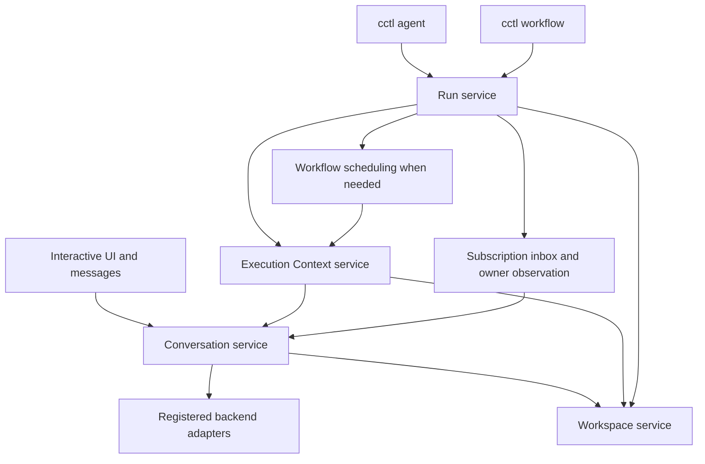

# Shared conversation and workflow core

Design for Alex, 2026-10-02. This proposal incorporates the comparison of the Fable and Astra designs, the existing-system review, and the completed decision interview. It replaces neither prior file and changes no executable behavior. Implementation and native-spec approval are separate work.

The governing product intent is the session Alignment charter together with Alex's later decisions, recorded in **Reimagined graph workflows, revision 341**. Where the older charter still labels those decisions open, the confirmed answers govern. The architecture and private contracts below are the new design recommendation, not a claim that Alex approved either earlier proposal wholesale.

## 1. The design in brief

Build one Conversation service for interactive and supervised agents. Put task acceptance in an independent Execution Context service. Put ownership, observation and lifecycle of launched work in a Run service; only a workflow run needs dependency scheduling. Use a common Workspace service for every CC-controlled writer and for contributions that require Git operations.

An ordinary caller delegates a complete operation:

- **Conversation:** accept messages, execute admitted work, and expose its durable outcome.
- **Execution Context:** pursue a task contract until an accepted result, a wait, or an actionable halt.
- **Run:** launch and supervise one or several contexts, deliver results and boundaries to the owner, and publish required contributions.
- **Workspace:** admit compatible operations and identify, accept and publish their filesystem contributions.

The internal design matters as much as these interfaces. Each domain has one authoritative state writer and private modules that hide distinct decisions. A coordinator sequences semantic operations; it does not inspect every reviewer, reconstruct Git effects, or manipulate someone else's counters. Pure decision functions are useful within those boundaries, not substitutes for them.

The central invariants are:

1. Every admitted turn has one terminal outcome, including a durable explanation when it fails after producing partial output.
2. Every unfinished context has a recorded next obligation, wait, halt, or admitted operation. Completing tasks alone never means completing the context.
3. A result is accepted only for the contract, inputs, files and output that were reviewed and approved.
4. No scheduler keeps another writable copy of context completion or execution ownership.
5. Retrying a local command can return its recorded result; this does not imply that repeating an agent turn is safe.
6. Interactive and supervised work use the same admission, turn execution, restrictions, cancellation and settlement machinery.

## 2. Scope and product decisions

The installation has one operator, one coordinating server and one SQLite database on one machine. Concurrent conversations, subprocesses, model calls and worktree writers are real. Server restarts during work are real. The two installations do not synchronize. Agents are trusted but can make mistakes; restrictions coordinate work rather than defend against a hostile local agent.

This warrants local serialization, durable operation identities, explicit settlement and checked Git effects. It does not warrant a distributed actor framework, a generic event-sourcing runtime, cross-process leadership, or retries with backoff around local calls.

| Confirmed decision | Consequence |
|---|---|
| Conversation is the shared unit; ownership is one level deep | An interactive conversation owns spawned work. Implementers and validators cannot spawn. |
| Owner-first child questions and second opinions | The owner answers or relays to Alex; consultation creates sibling work through the owner. Human approvals remain human-only. |
| Peer requests may wake interactive recipients | Requests use bounded inbox wake delivery; ordinary notes stay passive. Supervised recipients remain under context admission. |
| Child completion wakes its owner | Launch installs persistent owner observation; the owner need not register an explicit wait. |
| Session edits may continue while isolated lanes run | The owner is a participant in workspace admission. Publication waits for compatible access and a clean target. |
| Closed isolated lanes | A lane publishes after all selected members and required checks settle; no partial-lane publication or lane re-entry cycle. |
| Finite, non-nested loops; one workspace throughout each loop | New context runs per pass, one retained workspace; an isolated loop lane publishes after loop success. |
| Routes and safe edits remain; expansion is removed | Future work can be amended by the owner; implementers can add local tasks only when allowed. |
| Restart requires explicit resume | Active runs restore paused, including unambiguous continuations. No child dispatch occurs merely because the server booted. |
| Spec delivery uses human acceptance informed by reports | Specs retains criterion decisions and approvals, without a new mandatory structured-evidence gate. |
| Export-only access to old executions is sufficient | Preserve history and evidence as exports; delete the old runtime without maintaining its in-app viewer. |

Interactive conversations, `cctl agent`, and `cctl workflow` are in scope. Collaboration Mode and merge/commit agents retain their algorithms and backend task behavior. They use the new lifecycle's native claim/hold seam when necessary; converting their agent protocols is not part of this overhaul.

Existing optional features remain unless explicitly listed as removed in §13. In particular this design does not quietly delete advisory dispositions, route cardinality, workflow charter semantics, shared/seeded documents, plan approval, invocation timeouts, scripts, or configuration choices unrelated to removed features.

## 3. Architecture and identity



**Run is a shared launch and observation envelope, not another agent or another execution layer.** A standalone run contains one context invocation and calls the Context service directly. It needs no graph definition, edge array, graph IDs or graph UI. A workflow run additionally owns a compiled dependency program. Both use the same definition resolver, context startup, placement, boundaries, cancellation and observation. A one-context workflow has no extra supervision or validation path.

Interactive conversations are not one-node workflows. Conversation has no dependency on Run or Context repositories. The Context service receives its owner, frozen contract, inputs and workspace binding; it does not query siblings, lanes or the run's definition.

Keep identities for genuinely different things:

| Identity | Meaning |
|---|---|
| Conversation ID | History, mailbox, continuity, questions and usage |
| Turn attempt ID | One admitted logical operation and its settlement |
| Context run ID | One invocation of a frozen task contract, including its reviewer seats |
| Run ID | The owner-facing launched operation, standalone or workflow |
| Definition key and loop pass | An authored position and invocation number, not a conversation identity |
| Workspace binding and operation ID | Placement/policy and one physical effect or access claim |
| Candidate ID | Immutable reviewed evidence, including its scope and contract revision |

Use the existing `ConversationTarget` scope union. Scope, working directory and ownership are different properties. A project-scoped interactive conversation can select an explicit session target for work needing a worktree; target resolution happens before launch. Cross-session messaging never moves files or grants access to another workspace.

Every spawned conversation records its interactive owner and private controller binding. The Context service creates implementer and validator conversations on that owner's authority. A validator does not belong to the implementer, and deterministic services do not count as another spawning level.

Resolve caller identity from CC's existing conversation context and records. Enforce owner/membership rules at domain mutations rather than trusting supplied prose. Do not introduce cryptographic identities or hostile-agent authentication machinery.

**Design defaults:** a UI launch uses a selected interactive owner or creates one without spending a model turn; named lane keys select isolated placement. These are recommendations implementing the model, not additional interview answers. Archiving an owner retains its address and owned work; refuse hard deletion while live work exists, with an explicit stop action. Session deletion retains its existing stop-and-cleanup behavior.

## 4. Information hiding inside the services

These are modules and contracts, not a requirement for one class, database or asynchronous service per row. Private modules may share a domain repository transaction. They may not independently write each other's state.

| Private owner | Decision hidden from neighboring code | Semantic surface |
|---|---|---|
| Conversation mailbox | Ordering, duplicates, sender disposition, consumed-message correlation | Accept, select eligible batch, withdraw, mark consumed |
| Turn admission and lifetime | Conversation reservation, capacity/workspace acquisition, attempt ownership, cancellation and final release | Admit operation, execute, request stop, observe settlement |
| Turn input | Profile and instruction assembly, capabilities, memory, source context and environment | Prepare input for an admitted request |
| Runtime binding | Backend creation/reuse, opaque continuity, current incarnation and owned close | Obtain compatible runtime, observe activity, settle/close |
| Turn settlement | Normalizing every exit, final outcome, failure explanation and result publication | Settle one attempt with one terminal outcome |
| Conversation requests | Question/reply identity, answer consumption, routing to principal and waits | Open request, answer, withdraw, observe boundary |
| Context task ledger | Stable task IDs, completion/addition authority and remaining work | Apply task command, summarize obligations |
| Context certification | Candidate/round identity, scripts, reviewer authority, verdicts, advice and approval validity | Begin candidate review, apply evidence, return acceptance decision |
| Context allowance policy | Which additional work consumes which allowance | Decide whether requested remediation may proceed |
| Context settlement | Relationship among obligations, phase, admitted effect and completion | Advance from a command/fact to one durable state and next obligation |
| Workspace admission | Canonical overlap, operation lifetimes, stable readers, fairness | Request access, try grant, release, observe blocker |
| Workspace evidence | Baseline capture, scope identity, input revisions and retained candidates | Capture baseline/candidate, compare evidence |
| Workspace contributions | Scoped landing, publication, Git serialization and crash reconciliation | Accept contribution, publish lane, reconcile operation |
| Workflow definition | Defaults, inputs, document snapshots, topology and authoring validity | Resolve and compile, validate amendment |
| Workflow eligibility | Dependencies, route decisions, loops and contribution visibility | Project eligible/skipped/waiting invocations |
| Run lifecycle and boundaries | Owner operations, run control, persistent notification causes | Launch, pause/resume/cancel, amend, observe boundaries |

The Context coordinator does not receive a mutable aggregate containing every reviewer and Workspace implementation field. Certification returns semantic decisions such as `accepted`, `needs_work`, `plan_defect`, `awaiting_answer`, `awaiting_approval`, or `unavailable`, with evidence references. Allowance policy receives the requested work reason; it does not inspect reviewers. Workflow eligibility receives context observations and contribution visibility, not task ledgers.

Within a service, a pure function may apply a command to a private state slice. The state writer composes the result in one mutation. Splitting a switch into files while passing the same mutable aggregate to every file does not satisfy this design.

The same rule applies one level further inside the substantial private owners:

| Private subsystem | Internal abstraction and the knowledge it hides |
|---|---|
| Context certification | **Review round** validates seat authority, expected candidate and verdict shape, returning accepted/remediation/defect/unavailable. **Advice** owns fresh delivery and response coverage, returning settled or response debt. **Approval binding** owns whether a human decision still applies. The certification coordinator sequences those results; it does not loop over raw verdict payloads in several phases. |
| Workspace contributions | **Owned landing** knows private-index and commit-marker mechanics. **Publication adapter** knows the existing merge machine's phase/ref receipts. A small **operation journal** owns cause identity and intent/receipt storage shared by those two operations. The journal does not interpret Git trees; each operation reconciles its own effect. |
| Turn input | **Execution policy resolution** produces capabilities/settings and provenance. **Context materialization** resolves instruction, memory, artifact and source bytes with their identities. Input assembly consumes those prepared bundles; it does not grow branches for task, review, loop, standalone and workflow launch forms. |
| Workflow eligibility | **Route projection** and **loop progression** return decisions over immutable results; **dependency visibility** distinguishes accepted same-workspace results from published code. The scheduler asks for eligible complete actions, without repeating those rules. |

These private abstractions share their enclosing domain's transaction and execution host. They add no independent lifecycle, generic bus or new queue. For example, changing advisory response syntax touches Advice and its schema boundary, not Context settlement, Review Round, Run scheduling and prompts assembled in unrelated callers. An implementation that still requires those edits has leaked the decision despite matching this directory/module vocabulary.

An implementation review should demonstrate these change scenarios:

- A new validator authority changes certification schemas and folding, not mailbox admission or DAG scheduling.
- A new failure representation changes backend normalization and terminal recording, not each prompt/queue caller.
- A different contribution-recovery rule changes Workspace, not Context resume or Workflow readiness.
- A new route form changes definition validation and route projection, not context completion.
- A new owner notification changes Run boundary projection/subscriptions, not task execution.

## 5. Conversation contract

### Public operations

The actor contract remains address, spawn, send, stop and observe. The following signatures describe behavior, not final CLI syntax or wire schemas.

```ts
interface Conversations {
  spawn(spec: ConversationSpec, cause: CommandId): Promise<ConversationAddress>;
  send(to: ConversationAddress, message: Message, cause: CommandId): Promise<MessageReceipt>;
  withdraw(message: MessageId): Promise<WithdrawalReceipt>;
  stop(address: ConversationAddress, reason: StopReason): Promise<StopReceipt>;
  observe(address: ConversationAddress, after?: Cursor): Promise<ConversationObservation>;
}
```

Spawn and send acknowledge only after persistence. A repeated cause identifies the same operation. `send` does not wait for model attention or fail merely because the recipient is busy. Its receipt distinguishes accepted, duplicate and refused. Durable acceptance is not proof of provider delivery or successful work.

Observation exposes lifecycle, pending requests, message disposition, settled turns and usage. A cursor reads already-persisted outcomes before waiting for new ones. SSE/watch is a responsive projection; reconnecting clients recover from durable records. A request convenience can hide send-and-correlate for internal callers without creating a second execution path.

Stop records intent first. `requested` means cancellation is underway; `settled` means model/background execution, required persistence and owned runtime closure are complete. While stop cannot be confirmed, the operation retains conflicting resources and reports the blocker. No caller receives a settled receipt merely because an abort signal was sent.

Public lifecycle is `idle`, `running`, `waiting`, `stopping`, `stopped`, with explicit reasons. A stopped supervised conversation requires controller resume. A user's explicit new interactive prompt can resume interactive work under its existing semantics. Messages alone do not override a paused Run.

### One normal execution path

Interactive messages, supervisor work orders, reviews and output capture all enter the mailbox. The controller submits an attributed turn request; it cannot bypass admission or invoke a provider. Spawn-time configuration carries stable role policy, profile snapshots and controller identity; messages carry actual turn intent and any permitted model override, not a second collection of role flags.

Every supervised order also carries its controller admission generation. Conversation owns a small controller gate and checks that generation inside actual admission, not just when accepting mail. Context/Run control closes the gate through Conversation's semantic operation in the same short state-store transaction that records pause, cancellation or invalidating amendment. If admission won first, pause drains that admitted operation; otherwise queued orders remain visibly parked or superseded. Resume reauthorizes still-valid obligations under a fresh generation, preserving the logical request/effect ID and allowance charge. Conversation never reads a Run repository or interprets graph status. Boot starts controlled gates closed before restoring mail.

The same hosted Conversation path prepares instructions, applies capabilities, binds continuity, dispatches through the existing AgentCall protocol, preserves transcript events, settles results and attributes usage. Output schemas remain turn contracts. Profiles remain prompt identity rather than runtime-policy containers. Backend-specific schema handling, transport and billing normalization stay in adapters.

There is one admitted logical turn or maintenance operation per conversation. Work, format and the single allowed format-repair attempt belong to the same logical operation when AgentCall uses its work-then-format mode. Messages cannot interleave between those stages. A context's later final-output request uses the same conversation and protocol in the appropriate single-output mode; it is not a graph-specific task runner.

Continuity and assignment identity do not silently change after failure. A lost continuation yields an explicit outcome; supervised work halts for a replacement or recovery decision. Backend/model/profile changes that invalidate an already-started supervised assignment require a replacement context. Interactive changes retain their declared backend rules.

### Admission and execution resources

Admission first reserves the conversation against another turn or maintenance operation, before awaited prompt/profile preparation. That reservation carries no model slot or workspace write grant. It then requests the required resource bundle: workspace access plus existing model capacity.

The local admission coordinator uses the resource owners' nonblocking grant operations under one short in-process critical section. If the whole bundle cannot be granted, it releases any provisional grant and waits for a change. No model slot is held while waiting for a conflicting workspace, and no idle writer claim waits indefinitely for model capacity. Expensive filesystem checks happen outside that section and are revalidated at effect admission. This is local coordination over the existing semaphore, not a general distributed scheduler.

Once admitted, one Turn Lifetime object owns the attempt, cancellation, provider callbacks, scarce resources and settlement. Admission writes the attempt identity before provider dispatch. Current-attempt/incarnation checks prevent an old callback from affecting a replacement. The persisted mutation checks identity, not only a pre-await condition.

An owner may enqueue children and end its turn. A durable reply/subscription wait ends the owner's current turn and releases its resources after settlement. A conversation-bound synchronous `--wait` that could hold resources required by its child is refused with the asynchronous wait command. Human CLI waiting remains available. No skill instruction is relied on to prevent this deadlock.

Background work that can write, and provider-initiated continuations, remain part of owned execution until they settle or are confirmed stopped. They cannot use an idle hosted runtime to bypass workspace/capacity admission. Releasing runtime memory and releasing execution ownership are separate operations. Adapters must expose the control needed for this lifecycle; unsupported autonomous-continuation modes are refused for supervised restricted execution rather than advertised as safe.

### One terminal recorder

Every admitted attempt converges on `settleAttempt(attemptId, outcome)`, regardless of returned success, returned failure, thrown error, cancellation, or interruption. The outcome includes input disposition, partial-result references, typed failure/stop reason and available usage. Normalization occurs before this call; streaming presentation is not a terminal-recording owner.

Settlement commits the terminal result, consumed-message dispositions and publication intent under the existing database boundary. A durable transcript notice/projection keyed by attempt ID makes a failure visible alongside the partial output after reload. If a crash occurs before the append finishes, reconciliation uses that key to finish it without duplicating the notice. Observation can read the durable outcome even while transcript projection is catching up. A failed required write remains owned and actionable; it does not become a successful settlement.

Pre-admission refusals are recorded on their request and shown to the sender; they are not invented model turns. Failures after admission, even before provider acceptance, have a terminal attempt record. Provider-native frames remain lossless. Late provider billing updates the conversation usage ledger separately, under its existing billing identity; it neither opens another turn nor changes the previous outcome.

This directly repairs the current early-return gap where accepted queued Claude work can throw before the durable failure notice. There is no separate failure-notice policy for queued, interactive, implementer or reviewer work.

### Messages, questions and wakes

| Input and recipient | Delivery rule |
|---|---|
| User prompt to interactive conversation | Normal admitted turn; existing supported live-input behavior stays within the actor's ownership. |
| Unsolicited peer request to interactive conversation | Queue a bounded wake at an eligible boundary; coalesce requests through subscription delivery. |
| Ordinary peer note | Passive correspondence, included at an eligible later turn. |
| Peer correspondence to implementer | Save and attribute it; attach to the next controller work turn. It changes no task, criterion or grant by itself. |
| Peer correspondence to validator | Save it and notify the owner; do not inject it into the current review. Owner may request a new review when it matters. |
| Owner/user steer of supervised work | A control operation through Context: stop or park the current obligation, invalidate affected evidence, then schedule explicitly. It is not an unbudgeted direct turn. |
| Answer or awaited reply | Match its durable request; wake interactive work or make the supervised continuation eligible, subject to Run pause. |
| Message to completed/halted work | Retain and expose it to the owner; do not silently restart the contract. |

Conversation Requests owns question batches and correlated replies. The owner is the principal for child clarification; the user is the principal for interactive clarification. Any enabled child question goes to its owner first. The owner may answer or open its own question to Alex with the original reference. Human approval is a different capability and cannot be answered by an owner agent.

One answer consumes the exact request once. An answer arriving before the caller parks is found by read-before-wait; an unrelated message does not answer it. Multiple reviewer questions retain their own identities. Cancelling a superseded review withdraws only its requests. Persisted answer state is not copied into a Run-owned question gate.

Reply waits compose existing subscriptions. The Conversation request record is authoritative; a wait is an observation registration, not another answer store. Supervised answer consumption makes the next controller action eligible; it does not admit a turn while its run is paused. Owner-mediated child questions use the durable end-turn path, releasing execution resources after settlement so the owner can answer. Configure or refuse incompatible native child-question modes before dispatch. Native in-turn questions remain available for interactive conversations; a supervised adapter may use them only with a verified park that releases the resources the owner needs. No generic suspension framework is assumed. Loss of an in-memory question transport is reported, never reconstructed as a falsely delivered answer.

### Runtime activity and retained consumers

Runtime Binding reports actual incoming activity for the current incarnation and admitted attempt. Genuine background-task progress feeds turn liveness as well as the UI. Polling a nonempty task set is not activity. The backend settlement timeout and the shared inactivity timeout then have independent meanings; their correctness does not depend on one magic constant exceeding another.

Checkpoints, compaction capture, forks and Collaboration claims use an exclusive semantic hold on the same conversation slot. Holds have durable holder identity and explicit release/recovery behavior. Existing claim/release consumers continue through this native seam. Commit/merge/validation-fix side tasks retain their present AgentCall task protocol under a hold; their custom instructions, tools, timeout and cancellation do not become ordinary conversation prompts. Model calls without conversation history remain isolated task calls and still consume capacity.

The hold applies to independently initiated maintenance. Checkpoint/receipt work or native compaction already enrolled in an admitted attempt stays within that attempt's lifetime; it must not recursively wait to acquire its own conversation slot.

Shared machinery does not require merging Codex's SDK task protocol with its app-server conversation protocol. It requires that their shared decisions have shared owners and that in-scope conversations do not choose a second execution pipeline.

## 6. Execution Context: one acceptance protocol

### Contract and private state

A Context executes a resolved task contract using one implementer conversation and a stable conversation for each configured reviewer assignment. Two assignments using the same profile remain distinct seats. It returns an accepted immutable result or a concrete obligation for its owner. It knows no siblings or graph topology.

```ts
interface Contexts {
  start(request: ResolvedContextRequest, cause: CommandId): Promise<ContextReceipt>;
  observe(id: ContextId, after?: Cursor): Promise<ContextObservation>;
  applyTaskCommand(id: ContextId, command: TaskCommand): Promise<TaskReceipt>;
  pause(id: ContextId, expected: Revision): Promise<ControlReceipt>;
  resume(id: ContextId, expected: Revision): Promise<ControlReceipt>;
  amend(id: ContextId, amendment: ContractAmendment, expected: Revision): Promise<AmendmentReceipt>;
  approve(id: ContextId, candidate: CandidateId, decision: HumanDecision): Promise<ApprovalReceipt>;
  cancel(id: ContextId, expected: Revision): Promise<ControlReceipt>;
}
```

Task commands verify the bound implementer and stable command identity. Task addition is available only when permitted by the contract. Reviewers produce findings; they do not directly edit the task ledger. Run cannot mark a Context successful or discharge its approval.

The Context record owns the frozen contract, task ledger/revision, seat bindings, current obligation, pending effect identity, consumed receipt references, persistent allowances, candidate/evidence references, approval and terminal result. It references Conversation questions/turns and Workspace operations instead of copying their mutable state. Historical candidates and results are immutable.

Lifecycle is `ready | running | waiting | paused | halted | succeeded | cancelled`; a separate obligation names work, capture, certification, advice, approval or acceptance. A waiting record names the resource, answer or approval that can resolve it. A halt names required owner repair. Pause/cancellation requests remain unsettled controls until admitted effects settle. The observation derives its display state from these facts; there is no independent active-membership list to repair.

The private task ledger exposes remaining work and task revision. Certification exposes acceptance or specific debt. Allowance policy answers whether a requested follow-up may proceed. **Context Settlement alone combines those answers into lifecycle progress.** The host serializes commands/results, records the next effect intent, and submits it to its owning service. It does not parse backend frames, implement review authority or inspect Git state.

The atomic operation is `advance(contextId, commandOrReceipt, expectedRevision)`: apply the owning modules' changes and dependent invalidations, consume the receipt once, and record either a next obligation, stable effect intent, boundary or terminal result. Effects run after the transaction. A duplicate submission returns the prior effect; an ambiguous effect is not rerun. This keeps one transition owner without turning it into a universal reducer over every domain's internals.

### The completion sequence

1. **Work.** The implementer pursues the frozen tasks and criteria. Ordinary turn completion with open tasks may earn another work turn through allowance policy. Completing all tasks only makes capture eligible.
2. **Capture.** Capture the required output through the implementer's Conversation **before review**. Give the output schema to the agent when work begins. The later capture asks it to express its actual result, not redo the work. Schema validity alone never establishes acceptance. Without a schema, retain ordinary summary/artifact references. Do not depend on a formatting prompt to guarantee no file changes; freeze the candidate after capture settles. Exhausting the common bounded capture/repair protocol retains rejected content and issues, then halts as `output_invalid` for owner amendment or explicit resume. It does not start an uncharged recapture loop.
3. **Freeze and certify.** Bind contract/task revisions, exact output schema/value, reviewed filesystem inputs, and governing document/input revisions into one candidate identity. Run applicable script checks and reviewer seats against that candidate. Reviewers see the exact payload downstream will consume. With no required blocking script or reviewer, blocking certification is `not_required`, not a fabricated passing verdict; configured advisory work still runs.
4. **Remediate or halt.** A blocking finding reopens affected work and invalidates dependent output/certification/approval in the same transition. Carry that round's fresh optional advisories in the remediation message, preserving their identity and actual delivery record without adding an advice-only turn or blocking obligation. A plan defect halts with evidence for the owner. Infrastructure failure or an unavailable required reviewer is an explicit blocker, not a task failure disguised as a retry. Changed candidate inputs retire the round; bounded repeated instability halts as `candidate_unstable` instead of spending model turns indefinitely.
5. **Respond to advice.** After an ordinary passing round, deliver fresh advisories once, with engine identity `(round, assignment, ordinal)`. Record one `addressed | declined | deferred` disposition per advisory; a decline includes its reason. A valid decline does not fail acceptance. Preserve the existing bounded correction for malformed/missing dispositions. Continued protocol failure halts; the engine does not invent a disposition.
6. **Recertify changes.** Compare actual evidence after the advisory response. If unchanged, retain certification. If changed, recapture output when required and run applicable scripts plus blocking reviewers only; do not start another advisory-response cycle. An advisory-only cohort without scripts creates no blocking certification debt. A failing blocking check requests remediation through validation allowance policy.
7. **Obtain human approval when enabled.** Approval names the candidate and contract revision. Release review grants while waiting. A changed candidate makes the approval stale. Rejection requests work without pretending it was a validator failure; an owner agent cannot issue the human decision.
8. **Accept the contribution.** Ask Workspace to accept the exact candidate. Session placement produces an in-place snapshot receipt; isolated placement produces a scoped landing receipt. Changed evidence returns to certification. Context commits success, immutable result and its boundary intent only after this receipt. Lane publication is a separate Run obligation.

A context cannot succeed with unfinished tasks, missing required output, outstanding certification/advisory obligations, stale approval, or missing acceptance receipt. Every path—including resume and a halt arriving during capture—uses this same rule. Captured output from an interrupted completion remains evidence; it is not prematurely released as a successful downstream result.

### Allowances and controls

Persist two finite work allowances: `unfinishedTaskRetries` for additional work turns while tasks remain, and `validationRetries` for work requested by failed blocking certification. The initial work turn spends neither. Reserve the applicable allowance with its work-request effect ID; duplicate submission cannot charge twice. A reservation cancelled before admission is released; once admitted it remains charged. Completing/adding tasks and pause/resume do not replenish it. Explicit owner amendment can increase it and records the reason. A task-adding implementer therefore cannot gain an endless loop through partial progress.

Question continuations, admission waits, format/format repair, reviewer work and human approval spend neither work allowance. Their protocols remain separately bounded where they already are. Clarification resumes the interrupted obligation; it is not a free unrelated work turn. No generic infrastructure-retry allowance is added.

Preserve `cctl agent`'s optional `timeoutMs` and provider defaults through common Conversation invocation policy. Its existing task-dispatch meaning is **per backend invocation**, including format calls, not a total Context wall-clock deadline. It is separate from inactivity detection. A parked human wait is not an executing invocation. A timeout requests cancellation and preserves partial evidence; it does not prove an unknown model effect is safe to repeat.

`pause` closes admission and drains the current admitted effect; it need not finish the whole Context. `cancel` also requests interruption. Settled pause has no active owned effect, but may still owe capture, certification or acceptance. `resume` rechecks evidence and consumes known receipts without resetting allowances. `amend` requires affected work quiescent, checks revision, records the contract change and invalidates dependent proof. It cannot rewrite completed results. Changed started assignment identity requires an explicit replacement Context with its own history.

## 7. Workspace: placement, compatible use and contribution evidence

### Binding is not a lock

A durable **binding** identifies physical workspace, permitted scope, baseline and role policy. An operation **grant** authorizes compatible use now. Questions, human approval and paused work retain their binding, not an idle writer grant. This lets an owner answer a parked child in the same workspace.

Workspace Placement resolves canonical physical identity, path casing, symlinks, scope and backend policy feasibility. Lane names are not lock keys. Restricted Context grants prohibit direct Git mutation and use Workspace contribution operations. An interactive full-workspace grant includes ordinary Git use of its bound worktree/index and checked-out branch, preserving normal owner commits while excluding conflicting CC Git effects there. Cross-worktree/ref-changing operations require explicit admission for the affected identities through Workspace-wrapped operations. Independent worktrees rely on Git's own common-object/ref locks; ordinary turns do not take a repository-wide lock. Interrupted shell Git is an uncertain model effect, not a replayable Workspace receipt.

Deterministic nested Git operations enroll under the current grant using their own operation identity; the holder cannot release it before they settle. There is no reentrancy merely because two operations share a conversation or Run ID. Model-bearing commit/merge jobs return their durable receipt before execution, then obtain their own grants/capacity after the caller yields conflicting resources. They do not borrow a model slot or recursively acquire the caller's grant. Existing job algorithms remain unchanged behind this admission seam. Run launch likewise acknowledges persistence before waiting for lane provisioning, so a launching owner cannot deadlock behind its own Git use.

Existing backend-native restrictions remain the enforcement mechanism for scoped writes; prompts alone do not qualify a backend for concurrent owned writing. Placement preflight must establish the effective policy, instruction-loading behavior and writable cwd. For example, a backend whose allow-list adds to cwd needs an appropriate scratch cwd; it cannot promise subtree confinement while rooted above that subtree. Unsupported placement is refused before spending a turn, with isolated/full-workspace alternatives where applicable. Git admission is cooperative coordination of the supported CC operations, not a command parser or security boundary against arbitrary shell escape.

Admission uses one conflict relation:

| Use | Compatible operations |
|---|---|
| Observational read | May overlap writers; makes no stable-input promise |
| Owned-prefix write | Other writers only when canonical scopes are disjoint |
| Full-workspace write | No other workspace writer or overlapping stable reader |
| Stable scoped review | Readers and writers outside its actual reviewed input scope |
| Git-changing operation | Serialized for the worktree/index/ref identities affected; publication has exclusive target use |

All CC-controlled writers participate: interactive owners, supervised turns, repository-writing validation commands and wrapped merge/commit effects. A message-only owner turn does not receive a fictitious read-only grade unless its effective tool policy enforces it. Fairness follows existing queue ordering; add no lease expiry that can release an uncertain writer.

Dirty session work is preserved. Binding records authorized pre-existing changes in its baseline and excludes unrelated dirty paths from an owned contribution. Refuse ambiguous overlapping active ownership rather than adopt another live operation's changes. Session acceptance leaves edits in place; it does not automatically commit them. Isolated lanes start from a clean committed base. A dependent isolated lane cannot inherit uncommitted session code: keep that continuation in-session or have the owner commit the intended baseline before a follow-up run.

### Stable candidates and reviews

Workspace Evidence owns baseline/diff identity, scope, reviewed filesystem inputs, review sessions and acceptance receipts. Context contributes its contract, output and governing-document identity. Neither owner hashes another domain's mutable aggregate itself.

`capture(binding)` returns an opaque candidate receipt. `beginReview(candidate)` establishes a stable review session covering the reviewer cohort and applicable scripts. Reviewed scope includes the inputs the judgment relies on, not just writable output paths. If a reviewer can inspect arbitrary repository files and no narrower input contract is justified, use a whole-workspace review. Do not call an owned-prefix hash proof of a stable whole-tree review. A read-only context also needs an input snapshot; unchanged output is insufficient after its source changed.

Acquire the first reviewer/script capacity and review barrier together. Reviewers use a subset of that session's scope and do not compete with their own barrier. The barrier may remain while review operations run. If no operation is active and the remaining seats wait on capacity or owner/human input, release it. Reacquisition compares the candidate; unchanged evidence preserves completed reviews, changed evidence retires them. Human approval always releases the barrier. Advisory/remediation writing begins only after closing it.

Context-scoped checks certify a candidate; integration checks certify the assembled contribution. A whole-repository check cannot certify one writer while siblings leave an incomplete shared tree. Preserve declared integration-barrier coverage for owned/enveloped contexts. The resolver refuses an incompatible check selection rather than dropping it; observations show any integration debt until publication. Ordinary agent access to registered validators is distinct from automatic acceptance gates.

Final acceptance reacquires the appropriate grant and compares exact evidence. A relevant change returns `candidate_changed`; unrelated disjoint changes do not invalidate an honestly scoped candidate. Backend-enforced restrictions and grants coordinate CC writers. Arbitrary external editors and terminal Git commands remain outside this exclusion; final checks detect persistent changes, but do not prove an external process never changed and restored a file during review.

### Git operations and recovery

Workspace Contributions exposes `accept(candidate)`, `provisionLane(plan)`, `publish(sealedLane)` and `observe/reconcile(operationId)`. It hides private-index commits, refs and merge-job details. Context and Run receive durable receipts or located blockers.

Each operation has a stable cause, for example `land:<context>:<candidate>` or `publish:<lane>:<seal>`. Persist intent with expected parent/source/target, candidate tree, scope and known prepared/result refs before effect execution. Admit the operation, perform existing Git primitives, inspect the resulting refs, and persist its receipt. A repeated request returns the same operation. An explicit new attempt gets a distinct identity and preserves the previous evidence.

For owned landing, use a private index, record the expected parent/tree and an operation-derived commit marker, and prepare the commit before moving the branch. After a crash between `update-ref` and receipt storage, ancestry/tree/marker can identify that exact landing. A matching tree alone does not identify the operation. If no effect is known to have started, explicit resume can execute it. If completion cannot be established, return `effect_uncertain` with evidence; never treat a later “no changes” result as proof that the original contribution was recorded.

The Smart Merge job machine keeps its existing algorithm and non-durable actor lifetime. Its injectable merge, prepare and publish actors, and prepared/expected/parked ref fields, provide a native adapter seam. The Workspace adapter owns grants, preservation checks, operation identity and receipt reconciliation. Conflict/check-fix agents retain their current task protocol. It cannot promise to resume an interrupted merge actor; insufficient evidence yields `publication_uncertain`.

Publication proceeds as follows:

1. Seal the lane when every selected member has an accepted contribution or legitimate route-skip, all required human boundaries settle, and its loops succeed. Freeze writers. Reject unlanded dirt instead of letting merge implicitly commit unfinished work.
2. Admit a short target/Git grant, capture the target head and retain that grant while the deterministic merge-into-source actor incorporates it. Record the head actually incorporated. Release target admission while source conflict resolution, integration checks and fixes run with their own source/capacity grants.
3. Before the final publish actor, reacquire exclusive target admission. Require the checked target head still current and the target free of tracked changes and nonignored untracked files. A moved head is `publication_candidate_stale`; dirty content is `publish_blocked`. Release admission and notify the owner. An explicit new attempt incorporates the new target and reruns checks. Do not transparently reprepare after CAS failure and bypass those checks.
4. Publish through the existing actor and retain target admission through confirmed effect settlement. This deterministic stage waits on no model capacity. Persist publication receipt and release grants. Only this receipt grants downstream code visibility. Cleanup is separately idempotent; failure to clean does not retract a successful publication.

This permits session editing while lanes run and while source integration work proceeds. It never auto-commits unrelated session changes, resets a dirty target, or discards a human conflict resolution. Ambiguous pre-existing merge state is a blocker. Deliberate abandonment/cleanup is an explicit scoped owner operation, not a side effect of retry or graph editing.

Workspace must name actual binding paths to tools that need them, including validation and dev-server requests. A lane call must not accidentally inspect a dev server or run checks against the session baseline and label that evidence as lane validation.

## 8. Run and Workflow: composition without a second Context lifecycle

### Common owner-facing contract

```ts
interface Runs {
  launch(owner: ConversationAddress, request: RunRequest, cause: CommandId): Promise<RunReceipt>;
  observe(id: RunId, after?: Cursor): Promise<RunObservation>;
  pause(id: RunId, expected: Revision): Promise<ControlReceipt>;
  resume(id: RunId, expected: Revision): Promise<ControlReceipt>;
  cancel(id: RunId, expected: Revision): Promise<ControlReceipt>;
  amend(id: RunId, amendment: RunAmendment, expected: Revision): Promise<AmendmentReceipt>;
}
```

A Run request is either a standalone context contract/placement or a workflow definition. Both resolve the same defaults and call `Contexts.start`. Run owns launch inputs, interactive owner, control revision, invocation references, final results, publication obligations, required lane/contribution records and boundary intents. An isolated standalone Context uses the same provisioning/publication records without an authored graph. Workflow runs additionally own compiled topology, route choices and loop passes. Run does not store task completion, reviewer status, question answers or a mutable copy of Context phase.

Invocation identity is `(run, definitionKey, loopPass, replacementOrdinal)`. Scheduler start records a stable cause before calling Context. A lost response cannot create a second invocation. Read observations from authoritative Context/Workspace records, optionally through disposable caches. Process-local hosts track resources; their presence is not evidence that a context is active or finished.

Progress projects to running, waiting, halted, succeeded or cancelled alongside explicit pause/stop control. A child halt is reported immediately while independent work may continue. The Run is halted when repair is required and independent progress is exhausted. Success requires selected context results plus required publication/integration receipts. A stopped child is not automatically a successful or skipped contribution.

### Private workflow modules

The **definition compiler** owns resolved settings, references, topology and closed-lane planning. The **route projection** owns predicate evaluation, committed choices, skip propagation and cardinality. The **loop progression** module owns pass/exit/carry decisions. The **scheduler** consumes their semantic projections plus Context observations and contribution visibility to select complete actions. The **control/amendment** module owns revisions and permitted edits. The **Run projection** owns status and boundaries. These are focused modules, not independently running services with six queues.

The scheduler is deliberately ignorant of implementer turns, retry accounting, advisory schemas, prompt construction and Git internals. It can request `start context`, `provision lane`, or `publish sealed lane`, then observe the receipt. A pure `decideNext` remains small because it composes decisions already owned elsewhere.

### Routes, lanes and loops

Keep declarative predicate evaluation and route cardinality `independent`, `atLeastOne`, `exactlyOne`, including conditional fan-out and else. One route projection serves scheduling, dependency inputs, UI and completion. Missing/malformed output or a cardinality violation produces a located resumable halt; it is never silently false. Persist a choice before admitting dependents. An enum-only output convention does not replace overlap/cardinality checks.

Each isolated lane is a closed contribution group. All external code prerequisites of **all members** must publish before provisioning its baseline. Same-lane consumers use accepted contributions; cross-lane consumers need publication. Output-only dependencies create no unnecessary Git dependency. Reject lane cycles such as `X → Y → X` at definition acceptance. A session-scoped result requiring code visibility in a new lane must have an explicit committed baseline, not merely a successful Context status.

A loop has a frozen finite body, one entry/exit, declared carry input and finite `maxPasses`. Loops do not nest. Each pass creates fresh Contexts/conversations in the same workspace, carrying the previous exit output. Preserve bounded recent-pass summary/history exposure and full retained evidence. Check success before exhaustion so the last allowed pass can succeed; inability to evaluate the exit output halts. The surrounding graph consumes the final output only after success.

An isolated loop retains scoped intermediate commits in one lane and publishes once after success. A session loop leaves intermediate edits visible in place; it makes no isolation promise. Other permitted operations can run between its grants, with evidence checks on continuation. The compiler includes all loop members when checking lane closure. A halted/exhausted loop cannot close its lane. Raising the pass allowance is an explicit owner amendment; modifying a started body requires a new loop/run, preserving earlier evidence.

### Safe amendments

All structural changes enter `amend`. It validates the complete proposed definition and checks immutable started-work facts under the same Run revision used for dispatch. A short repository mutation decides whether amendment or start wins; no model/Git work happens inside it.

- Unstarted work and unconsumed future configuration/dependencies may change; the owner can add future nodes.
- Started/provisioned lane membership and prerequisites stay frozen. Pending placement may change only if the unprovisioned result remains closed and acyclic.
- Committed route choices, consumed input and completed results cannot be reinterpreted. New consumers of retained output are allowed only when those facts and publication obligations remain valid.
- Started Context changes require settled pause and its semantic amendment operation. A coordinated amendment composes the owning reducers in one short state-store transaction; Run never patches Context fields itself.
- A started loop body and prior pass evidence remain immutable. Required human approval cannot be removed by claiming an old candidate passed. Definition amendments requiring plan approval await a new decision on that revision before new affected work starts.
- Cancellation preserves partial work. Skip applies to unstarted work or an explicit abandoned contribution with a recorded disposition. Unfinished lane dirt cannot ride into publication; cleanup requires a scoped owner action.

There is no agent-driven expansion exception. Local task addition remains within Context's authorized contract. Repair is an owner operation, not a hidden repair-agent runtime.

## 9. Boundaries, notifications and restart

Launch installs owner observation durably with the Run receipt. A Run boundary contains a cause identity, result/request reference, kind and delivery cursor. Completion, halt, question, approval and publication blocker boundaries are committed with their authoritative state transition; SSE is not the sole copy. Subscription delivery batches them into the owner's inbox and applies existing wake limits/eligible-boundary holds. Run never invokes the owner's backend directly.

Child completion automatically wakes an eligible interactive owner. Synchronous observation and the later notification refer to the same boundary; acknowledgement prevents duplicate work for an already-observed occurrence. Do not promise exactly-once model attention after an uncertain interrupted owner turn. The durable boundary and sender/turn receipt make duplicate presentation recognizable without rerunning the child. Late cost receipts update accounting without waking agents.

Questions name the original Conversation request, approval names the human gate, and Run status links them. Owner summaries do not become shadow question/approval stores. An owner can answer, relay, amend, resume, cancel, or launch follow-up siblings. It cannot silently approve human-only work.

Pause prevents new effect admission and drains current effects. Stop requests cancellation and remains stopping until each owner confirms settlement. Preserved work/results remain visible, including salvageable isolated branches and blockers. A late callback checks its operation generation inside the mutation; it may add evidence/billing to the old attempt, but cannot advance a successor.

**At server startup every previously active Run restores paused before controller admission opens.** Reconstruct mail, questions, known results and operation records. Read-only reconciliation may record an effect already known to have completed; it must not start a formatter, reviewer, merge, retry or queued implementer. Previously paused/halted work retains its obligations. An answer delivered during restart remains pending. The user or owner must explicitly resume, and an owner wake alone does not clear pause. Restart notices must not instruct the owner to resume automatically.

Resume first reconciles known effects and validates the recorded candidate/baseline. Unknown model work remains halted for inspection; restating unfinished tasks cannot make repetition safe. Known unstarted work can proceed only after resume. Interrupted interactive prompts retain explicit retry/discard behavior. No new recovery strategy framework is needed.

## 10. Persistence and backend contracts

Keep the existing state store. Each domain's repository is the only writer of its authoritative facts; focused transaction operations can compose owners without exposing raw tables. Do not serialize the whole graph into a shared mutable runtime object or introduce a second database for scheduling.

| Durable facts | Authority |
|---|---|
| Accepted mail, attempts, outcomes, continuation and transcript publication receipts | Conversation |
| Questions, replies and answer consumption | Conversation Requests |
| Contract/tasks, next obligation, allowances, candidate certification and approval | Context |
| Placement baselines, grants needed by uncertain effects, Git intents and contribution receipts | Workspace |
| Definition revisions, invocation causes, routes/passes, Run control and boundaries | Run/Workflow |
| Delivery cursors and wake receipts referencing original boundaries | Existing subscriptions |
| Provider-normalized usage receipts | Conversation usage, aggregated by Run |

Persist intent before external effects and correlate receipts by stable cause. Use local transaction revisions and attempt generations for concurrent commands and stale callbacks. These mechanisms prevent conflicting bookkeeping; they do not undo dispatched effects. Transcript files, Git and SQLite are not one transaction. Durable projection/operation receipts own those gaps, and unresolved settlement stays visible. If SQLite cannot record a settlement, acknowledge no durable success, block conflicting admission in the live process, and recover from the pre-dispatch intent later. Do not add another journal solely to hide database failure.

Registered backend adapters retain provider-specific protocols, continuity, strict-schema conversion, task/conversation transports and billing normalization. The overhaul needs two focused backend fixes identified by the review:

- **MCP suppression completeness:** one Codex-local operation returns a complete suppression configuration or a typed refusal. A policy requiring suppression cannot receive `[]` because discovery threw, returned an invalid shape, or encountered an unsupported transport. Genuine complete-empty is different. Any ordinary best-effort use is separately explicit. Verify effective invocation behavior; outgoing settings alone do not prove policy. This addresses a concrete contract gap, not a claim of a demonstrated security escape.
- **Model metadata:** one provider-owned source supplies static IDs, labels, aliases and reasoning levels to descriptors and schema derivation. Preserve the distinction between static catalog facts and backend-served availability. Pricing calculations remain separate. This is a small local consolidation, not an excuse to redesign every backend.

Activity and usage are observations, not lifecycle authority. Actual current-attempt background progress feeds the watchdog; polling alive does not. Retired-attempt billing can arrive after completion and still records once. Unknown costs remain unknown. Existing Codex cumulative-baseline handling and lossless JSONL framing must survive the migration; sharing supervision does not permit replacing those adapter-specific contracts.

## 11. Ordinary callers and user journeys

The common case should require the task, not a choreography. These sketches show semantic requests; they are not committed CLI spellings or complete wire schemas.

```ts
// cctl agent resolves the current interactive owner and session placement.
const run = await runs.launch(owner, {
  kind: "agent",
  context: { brief: "Fix the duplicate completion notice" },
}, commandId);
// The receipt supplies observation, control and result references.
// Completion already subscribes the owner; no graph construction is needed.
```

The resolver supplies defaults for backend/profile, allowed capabilities, validation and placement. A caller opts into an output schema, owned scope, isolation, reviewer cohort or human approval only when needed. Effective values and provenance remain inspectable. The caller does not spawn reviewer seats, allocate workspace locks, manage formatting turns, tally retries or subscribe to each Context phase.

```ts
// A workflow adds topology/placement; its context contract is the same one.
const run = await runs.launch(owner, {
  kind: "workflow",
  definition: {
    contexts: [
      { key: "api", brief: "Implement the approved API contract", lane: "api" },
      { key: "ui", brief: "Implement the approved UI contract", lane: "ui" },
      { key: "integrate", brief: "Check the assembled user journey",
        dependsOn: ["api", "ui"], placement: "session" },
    ],
  },
}, commandId);
```

API and UI lanes can execute concurrently. Their publication serializes against the clean session target. The integration Context becomes eligible when both code contributions are visible. Changing this to a single context removes topology alone; it does not change task acceptance or the normal Conversation path.

**Owner and question.** The owner launches a child and yields or continues other compatible work. The child asks through its durable request and ends its turn. The owner wakes, answers or relays to Alex, and yields. The child resumes its recorded obligation when admitted. The user can inspect the original question and attribution throughout. Completion later wakes the owner automatically.

**Session editing and publication.** The owner edits while an isolated lane is running. Publication first waits for the editing turn to settle. If the session remains dirty, it reports the exact target blocker and releases admission. The owner decides how to finish/commit that work. Explicit continuation then integrates and checks the resulting committed head. The workflow does not take ownership of those unrelated edits.

**Pause during finalization.** The owner pauses the Run after a sibling halts while another Context is capturing output. The latter's own completion protocol retains its obligation and result. Run pause lets the admitted capture settle but does not start review/landing. Resume continues from capture's receipt. A sibling halt alone still permits independent work. No scheduler patch reconstructs whether tasks happened to be complete.

**Restart after a commit.** Workspace recorded landing intent and moved the lane ref, but the server stopped before storing the receipt. Startup pauses the Run. Reconciliation identifies the exact commit and records its receipt without moving the ref again. Explicit resume lets Context settle once; downstream eligibility uses that result and the later publication receipt.

The UI reads these same observations. Interactive conversations retain their transcript; Runs show task/phase, pending input/approval, owner, relevant workspace, output, costs and exact blockers. A dependency diagram may remain a read-only projection. Remove the visual authoring builder, dedicated planner and repair-agent controls. Owners author/edit through ordinary conversation and CLI operations. Do not replace one builder with a second hidden graph editor in the Run UI.

## 12. Alternatives and complexity tradeoffs

| Choice | Alternative considered | Why this design chooses it |
|---|---|---|
| Shared Run envelope with direct standalone Context invocation | Make `agent` a synthetic one-node graph, or retain a second agent-run service | The former forces graph representation on the simplest caller; the latter duplicates ownership, controls and observation. Run hides those shared concerns while topology stays optional. |
| One normal Conversation path | Keep a task executor for controlled agents behind a common facade | A shared facade cannot prevent divergence in cancellation, prompts, questions, output capture and failure recording. Keep only the genuinely different out-of-scope task transports/algorithms. |
| Private semantic modules and one state writer per domain | One giant pure reducer, or dozens of autonomous actors | A giant reducer still exposes all knowledge; autonomous actors distribute settlement. Private decisions plus one host hide knowledge without adding inter-module delivery/recovery protocols. |
| Operation grants with stable review sessions | Lock an entire Context for its lifetime, or trust writable-path declarations alone | Lifetime locks block owner answers and needless session work. Declarations alone do not stabilize review inputs. Short grants establish the actual guarantee and release it at waits. |
| Live worktree review with scoped barriers and identity checks | Always create immutable review worktrees | Barriers reuse current machinery and avoid a second artifact/snapshot environment. They may delay writers; conservative whole-tree scope is the price when a narrower review footprint is not justified. An immutable environment is appropriate only for a check that already requires it. |
| One Context acceptance operation; capture before review | Separate finalizers, or capture after a passing verdict | The accepted payload must be the reviewed payload. Central settlement removes callers' need to reconcile output, task, approval and landing state. |
| Local effect intent and receipt reconciliation | Repeat the unfinished turn/merge on resume; or build event sourcing | Repetition can duplicate real effects; event sourcing introduces unnecessary machinery. A small operation record is sufficient for local uncertainty and explicit halt. |
| Short publication grants and checked target identity | Freeze the session for all lanes, or publish into dirt | Concurrent session work is required. Checking a clean target at effect admission preserves it without claiming an earlier snapshot is current. |
| Shared parameter resolver with frozen results | Each launch form merges settings independently | One resolver preserves option semantics and provenance. Runtime objects receive resolved values, not a repeated configuration cascade. |

Compared with Astra, this design makes the internal decomposition and shared Run contract explicit, corrects output/review ordering, and avoids leaving coordinated completion behind a broad facade. Compared with Fable, it adopts concrete ownership and one launch surface but strengthens uncertain-effect handling, stable review inputs and participation of interactive owners in Workspace admission. Both supplied useful abstractions; neither becomes the implementation verbatim.

The net complexity cost is a shared grant owner, candidate identity and a small durable effect protocol. Those mechanisms replace duplicated admission, completion repair, question routing, task dispatch and Git-recovery knowledge. They are justified by actual concurrent writers and server interruption, not by scale. Do not add a generic plugin pipeline, universal effect language, cross-process lease service, or a graph-specific framework for every private module.

Module quality is judged by representative changes and callers, not a line-count target. Each private module should have a short contract naming what it owns and what it hides; its consumers should operate at that abstraction. Architecture checks should enforce domain imports and forbidden alternate write/dispatch paths. They should not freeze every private file split into a new public interface.

## 13. Feature disposition and response to the existing-system review

### Product and configuration inventory

| Capability | Disposition and canonical owner |
|---|---|
| Interactive, standalone and workflow agent execution | Shared Conversation and Context path, one owner-facing Run surface |
| Task completion/addition, blocking/advisory review, scripts, optional human candidate approval | Retained in Context; one acceptance protocol, structurally distinct reviewer authority |
| Optional invocation timeout and registered-command access | Retained in resolved Conversation policy; timeout, inactivity and Context allowances stay distinct |
| Cohort assignments, disabled cohorts, advisory-only cohorts | Retained; dormant assignments need not be deleted when disabled; seat identity remains stable |
| Configuration cascade and role settings | One resolver preserves global → workflow defaults → per-context precedence and existing leaf/replacement semantics; standalone omits the middle tier. Preserve backend/model/profile/capability, memory read/contribute and validation access options with provenance. Freeze effective values before use. |
| Workflow charter | Retain mission/narrative, stable invariants, ranked source references, structured context applicability and amendment rationale/history. Resolve conflicts before execution and freeze each Context's applicable bundle. Session Alignment does not replace scoped workflow sources. Retired access-policy fields stay retired. |
| Shared and seeded documents | Preserve identity, descriptions/read-when metadata, content hash/revision and repeatable materialization. Artifact service captures required bytes before dependent work; missing/conflicting material is a located error. A mutable absolute session path is not a frozen document. Ordinary Contexts can use artifacts without graph queries. |
| Optional plan approval | Retain as a human gate on the definition revision, distinct from Context candidate approval. Removing the planner UI does not remove it. |
| Routes, loops, live edits and closed lanes | Retain with the contracts in §§7–8; no nested/multi-workspace loop or incremental lane publication |
| Automatic graph expansion | Remove; owner changes future work through revision-checked amendment |
| Visual workflow builder, dedicated planner and repair agent | Remove; authoring/repair uses owner conversation and ordinary tools; observation remains |
| Graph-bound native-spec delivery/ownership coupling | Remove. Specs owns human requirements/design/delivery approvals, criterion acceptance/waiver and ordinary report links. Generic Run/Context cannot approve a spec or demand per-criterion structured proof. |
| Collaboration, merge/commit agents and validation-fix jobs | Preserve algorithms and task protocols; integrate only required native holds/admission seams |
| Old execution viewer and old supervisor continuation | Replace with verified exports; drain/stop before cutover, no live-supervisor migration |
| Saved definitions/templates | Explicit one-time conversion preserving retained options; unsupported removed patterns get located errors, never a silently weaker launch |

The resolver also owns template/default validation. Changing a global config or saved template does not mutate active contracts. Simplified allowances need an explicit conversion rule for old retry settings; do not silently relabel old counters with a different meaning. Strict-schema key removals must be paired with cutover transformation of every live serialized owner, not ignored as unknown fields.

### Review findings mapped to remedies

| Finding and observed scope | Design response | Proof required in implementation |
|---|---|---|
| Accepted queued Claude work can throw before the durable failure-notice path; partial transcript and other state may still exist | Conversation terminal settlement normalizes every exit and owns the persistent explanation, §§5/10 | Inject returned and thrown failure after partial output; reload shows exactly one result/notice and correct message disposition |
| Context completion knowledge is spread across iteration, finalization, transitions and manager; an incident was fixed but ownership remains split | One `advance` and acceptance protocol; Run derives eligibility from its receipts, §§6/8 | Halt/pause/resume during capture, approval and landing all retain the correct next obligation; independent sibling completion survives |
| Codex native-MCP discovery can turn incomplete/failed enumeration into a suppression list that looks complete | Backend-local complete-or-refuse contract, §10 | Malformed/nonarray/unknown transport/discovery failure cannot admit a policy requiring suppression; complete-empty works; actual invocation checked |
| Static Codex IDs/labels/reasoning metadata duplicated in schema and descriptor | One provider catalog derives applicable metadata, §10 | Adding a static model changes one authoritative entry and resulting schema/descriptor agree |
| Real background activity reaches presentation without necessarily refreshing the turn watchdog | Runtime activity belongs to the admitted attempt and feeds liveness, §5 | Real progress refreshes current attempt; stale-incarnation callbacks and unchanged polls do not; timeout still establishes cleanup |

The review strengthens the choice of explicit internal owners. It does not justify merging different provider transports, making every warning a new lifecycle state, or claiming an observed live MCP escape. The completion incident's existing fix is preserved while replacing the structure that made several modules responsible for repairing the same state.

## 14. Feasible migration and cutover

This section defines proof and deletion order, not an implementation authorization or an exhaustive task plan. Work remains subject to the repository's native requirements/design/delivery approvals where applicable.

1. **Freeze the behavioral inventory.** Map current Conversation/agent/workflow/config/template surfaces to §13, including effective backend restrictions and native maintenance consumers. Rewrite the affected supervision and Conversation implementation around the new contracts; do not preserve old coordinators behind renamed facades. Reuse independently useful primitives and the expressly retained out-of-scope algorithms. Define new schemas and private contracts. Keep new tables/records owned through existing repositories; prepare maximal round-trip fixtures and startup migration/floor treatment before schema changes.
2. **Prove shared execution early.** Move a representative interactive turn and a standalone Context through the same mailbox/admission/settlement core on the actively used backend. Exercise failure, question, cancellation, structured output and late usage. This is an early proof, not permission to drop another supported backend; verify every retained backend capability before enabling the replacement for it. Keep native Collaboration and task-job consumers working through the hold seam.
3. **Prove Context independent of graphs.** Implement the full acceptance protocol and state-store contracts without a graph repository dependency. Run the same contract via standalone and one-context workflow entry points and compare effective behavior. Implement Workspace admission/evidence alongside it so tests cannot hide missing writer participation behind fake ports.
4. **Compose topology and contributions.** Add closed lanes, common publication admission, routes, loops, safe amendments and Run observations over proven services. Verify real Git effects and target movement. Use the existing Smart Merge adapter; inspect its cancellation/parking/result facts rather than assume an adapter can invent them. Missing factual receipts either need a narrow reviewed seam change or produce an explicit uncertain result.
5. **Prepare one cutover.** Inventory stored configuration, workflow defaults/templates, spec links and history. Prepare exact transformations and export/verification tools before touching live state. Export execution data plus referenced transcripts, artifacts, approvals, outputs, source/definition revisions and costs; verify references resolve after old tables/worktrees are removed. Drain or explicitly stop old runs, preserving partial contributions. Never transfer an in-flight old supervisor to the new protocol.
6. **Switch authority and delete the old paths.** Apply config/state transformations at the deploy boundary when the new schema becomes active; the old running build may still require removed keys. Then switch launch dispatch and remove the old workflow engine, graph-bound spec delivery, alternate agent executor and dead UI/config paths. Remove temporary migration routing after use. No dual writes or permanent compatibility shim are part of this design.

An old engine and new engine can coexist during development with explicit per-run authority; an individual run never changes supervisor implementation mid-flight. Do not keep runtime fallback to the old engine after cutover. New-source builds and schema floors can open live state in this repository, so migration rehearsals and builds must use the intended isolated datastore rather than accidentally upgrade the live database during design/branch verification.

Register validators and use the repository's typecheck, lint, seams and relevant tests when executable changes begin. Require real durable-state and Git fixtures for the guarantees below. A pure scheduler test, a settings object or a passing scoped run with zero matching tests does not prove the contract.

## 15. Acceptance probes, limits and design status

These are future implementation acceptance scenarios; none is claimed to have run for this document.

| Scenario | Observable result |
|---|---|
| Same task through `agent` and a one-context workflow | Same resolved contract, normal Conversation path, questions, output/certification and result; no graph required for standalone |
| Provider throws after partial output; queued and interactive launch | Durable partial output plus one failed outcome/explanation after reload; no acknowledged message disappears |
| Cancel during preparation; old callback after replacement | No post-cancel dispatch; old completion cannot change successor, but its legitimate cost can still record |
| Child asks while using owner's workspace or last model slot | Durable question ends child turn; owner can answer; matched continuation spends no work retry |
| Last allowed retry/pass succeeds | Success is evaluated before exhaustion; pause/task addition cannot reset allowance |
| Output is schema-valid but omits a required finding | Reviewer sees exact payload and refuses it before downstream consumption |
| Input changes during parked review/approval | Resume rechecks input identity and retires affected proof; unchanged output alone does not preserve acceptance |
| Advisory declined; advisory response changes files/output | Reason retained; valid decline allowed; changes receive required blocking recertification without endless advisory rounds |
| Whole-tree check requested beside shared writers | Use declared integration barrier or stable environment; never claim a moving tree passed for one context |
| Sibling halts during another Context's capture/landing | Each retains one coherent obligation and independently settled results; resume needs no scheduler membership repair |
| Owner edits session while independent lanes execute | Compatible work proceeds; dirty target blocks publication without commit/discard; eventual publication names checked target head |
| Interactive Git operation or launched commit job overlaps queued lane work | Only affected worktree/ref operations conflict; nested deterministic effects settle before grant release; model-bearing jobs cannot block behind a caller retaining the last slot; unrelated sessions remain concurrent |
| Target moves after integration checks | Final publish refuses stale candidate; a fresh explicit attempt rechecks integration |
| Crash after owned ref move, before receipt | Matching operation evidence yields one landing receipt; ambiguous state halts; no blind repeated commit |
| Restart with ready node, answer, captured output and queued owner wake | Every active Run remains paused until explicit resume; no new model/merge call from boot or a mere wake |
| Safe amendment races scheduler admission | Exactly one revision wins; started evidence/lane prerequisites remain immutable |
| Loop in an isolated lane | Fresh Contexts per pass, one workspace, finite carry progression, one final publication |
| Runtime background progress and eventual timeout | Genuine current progress counts; UI polling does not; conflicting grant held until confirmed stop/settlement |
| Required MCP suppression cannot be established | Typed pre-dispatch refusal with cause, no empty-list fallback that pretends success |
| Stored template/source/default changes after launch | Active contracts and seeded document bytes remain the frozen revisions; new launch resolves the update |
| Historical export after old viewer deletion | Execution and referenced evidence remain inspectable without the old runtime or a deleted lane path |

The important limitations are deliberate. External editors are not governed by CC grants. Unknown provider effects cannot always be reconciled. The retained merge machine is not made restart-durable. Whole-tree review can reduce concurrency. Started loop bodies and provisioned lanes cannot be arbitrarily rewritten. Each limit is exposed at a complete operation with retained evidence and a concrete next action; none requires consumers to reconstruct private state.

No material product decision remains open for this proposal. UI owner creation and named lanes are the stated design defaults; wire names, file splits and exact configuration transforms are implementation details to derive from these contracts. Backend restriction and merge-receipt feasibility are explicit implementation proof obligations, not assumptions that a facade makes true.

### Sources and review record

- [Operating envelope](../../ENVELOPE.md), [repository contract](../../AGENTS.md), [session Alignment charter](../../.cc/session-alignment/charter.md).
- Vision notepad **Reimagined graph workflows**, ID `6bea7281-f742-4560-8937-fa52068d7e9b`, revision **341**, including Alex's three decision batches. The later explicit request authorizes this new design, superseding the interview's “design later” hold.
- [Astra design](2026-10-01-independent-conversation-workflow-design.md), conversation `fe68a724-3fb6-4260-8d6d-b03201433c58`; [Fable design](2026-10-02-one-machinery-design-claude.md), conversation `19da9383-b081-4371-a87c-691c597e80b2`.
- Existing-system review: `cctl conversation read 49b169fa-d4e5-4a8e-886d-e6cdf475f124 --message 1`, with its graph/backend and conversation reports. Findings were assessed at their demonstrated scope.
- Current-source anchors: [Conversation actor](../../src/lib/workflows/conversation/actor-implementations.ts) failure/liveness paths; [Context validation coordinator](../../src/lib/workflow-graph/context-validation-coordinator.ts) and [validation round](../../src/lib/workflow-graph/validation-round.ts) for capture/certification ordering; [owned landing](../../src/lib/git/owned-landing.ts) for ref/receipt gaps; [merge machine](../../src/lib/workflows/merge/machine.ts) for injectable effect actors. Paths are navigation aids; the proposal specifies replacement ownership, not preservation of these file boundaries.

Independent reviews covered Conversation internals, Context acceptance/feature preservation, and Run/Workspace effects. Their substantive dispositions are:

| Finding | Disposition and reason |
|---|---|
| Native child question can retain resources its owner needs | **Accept-reduced:** require durable end-turn child questions unless safe native parking is established; no universal suspension layer |
| Pause can leave an old queued work order eligible | **Accept:** controller generation checked at actual admission; atomic gate revocation gives pause a concrete meaning without Conversation reading Run state |
| Interactive Git path absent from contribution-only interface | **Accept-reduced:** ordinary Git participates through the interactive worktree/ref grant; wrappers handle broader effects. Reject repository-wide full-turn serialization because unrelated sessions must remain concurrent. |
| Standalone isolated placement lacks common lane records | **Accept:** move those records to common Run ownership; avoid a second publication protocol or synthetic graph |
| Exhausted output capture lacks an explicit outcome | **Accept:** retained `output_invalid` halt after the existing bounded protocol, avoiding a new retry system |
| Failing blocking rounds could lose accompanying advisories | **Accept:** carry optional advice in the existing remediation message with delivery identity; no new blocking obligation |
| Maintenance inside an admitted attempt could reacquire its own slot | **Accept:** enrolled work uses the existing lifetime; independent maintenance alone acquires a hold |
| Script-only certification wording and example/source-link defects | **Accept:** clarify the guarantee and correct navigation/examples; no runtime concept added |

Together these corrections add one explicit admission generation and precise existing-protocol branches, while removing deadlock, duplicate-execution and alternate-publication ambiguities. A further simplification is to keep exhausted capture in the ordinary halted-obligation path instead of reproducing old output-rejection/circuit-breaker counters. No remaining review finding requires a new product decision.

This artifact is design-only. No implementation, test execution or live cutover is represented by its examples or acceptance probes.
